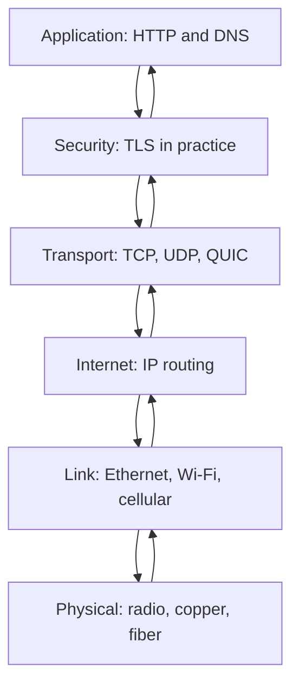

## 1. Hook

Sending a package is not one job. Someone writes the letter, someone
puts it in an envelope, someone adds an address, someone moves it
between cities, someone gets it to the building, and someone hands it
to the right person. If a package is lost, you debug by asking which
layer failed: wrong address, bad truck route, locked building, or
missing recipient.

Networks work the same way. A web page does not simply "go over the
internet." Application data is wrapped, addressed, routed, delivered to
a machine, delivered to a process, and interpreted by software.

The OSI model and TCP/IP stack are maps. They do not move packets by
themselves, but they help engineers name the layer where a problem
lives.

## 2. What Is It

(a) Plain-English one-liner: the OSI model and TCP/IP stack organize
networking into layers so engineers can separate application behavior,
transport behavior, routing, and physical delivery.

(b) Formal definition: the OSI model is a seven-layer conceptual model:
physical, data link, network, transport, session, presentation, and
application. The TCP/IP stack is the practical internet model, commonly
described as link, internet, transport, and application layers. Each
layer provides services to the layer above and uses services from the
layer below. System design usually uses the TCP/IP stack while borrowing
OSI vocabulary for debugging.

## 3. The Problem It Solves

Before layer thinking, "the API is slow" can mean anything: DNS is
slow, TLS negotiation is failing, packets are dropped, a firewall is
blocking, TCP is retransmitting, the server is overloaded, or JSON
serialization is expensive.

After layer thinking, debugging becomes structured. DNS resolution is
application-layer name lookup. IP routing is network layer. TCP
retransmission is transport layer. Ethernet or Wi-Fi loss is link
layer. HTTP status codes are application layer.

The model solves confusion. It gives a shared language for locating
where a failure belongs.

## 4. Core Concept Breakdown

- **Application layer:** protocols and data the app understands, such
  as HTTP, DNS, SMTP, and WebSocket.
- **Presentation/session layers:** OSI concepts for encoding,
  encryption, and session management, often folded into application in
  TCP/IP.
- **Transport layer:** process-to-process delivery using TCP, UDP, or
  QUIC.
- **Network layer:** host-to-host routing using IP.
- **Data link layer:** local network delivery using Ethernet, Wi-Fi, or
  cellular link protocols.
- **Physical layer:** electrical, radio, or optical signaling.
- **Encapsulation:** each layer wraps data with its own headers.
- **Port:** transport-layer number that routes traffic to a process.
- **IP address:** network-layer address that routes traffic to a host.

## 5. How It Works

Step by step, loading `https://example.com`:

1. **Browser creates an HTTP request.** This is application data.
2. **DNS resolves the hostname.** The browser learns an IP address
   (see: MOD-01/03-dns-and-dns-resolution).
3. **TLS secures the session.** HTTPS encrypts application bytes
   (see: MOD-01/05-tls-ssl-https-handshake).
4. **TCP or QUIC carries bytes.** TCP provides reliable ordered bytes;
   QUIC provides streams over UDP.
5. **IP routes packets.** Routers forward packets toward the server IP.
6. **Link layer sends frames locally.** Ethernet or Wi-Fi moves frames
   to the next hop.
7. **The server reverses the wrapping.** Link, IP, transport, TLS, and
   HTTP are processed in order.
8. **The process handles the request.** The server application returns
   a response.
9. **The response is wrapped again.** The same layers carry it back.
10. **Debug by layer.** A timeout, reset, DNS failure, certificate
    error, and 500 response are different layers.

Senior troubleshooting checks:

- **Can the name resolve?** If not, start with DNS.
- **Can packets reach the host?** If not, inspect routing and firewall.
- **Can a transport connection form?** If not, inspect ports and TCP or
  UDP behavior.
- **Can TLS and HTTP complete?** If yes, lower layers are likely fine.

## 6. Diagram



<!-- IMAGE: layered packet encapsulation showing HTTP data wrapped by
TLS, TCP/UDP, IP, and Ethernet headers before crossing the network -->

## 7. When to Use It

Use this model when:

- **Debugging network failures.** It narrows the layer quickly.
- **Designing APIs.** Know whether a guarantee comes from HTTP, TLS,
  TCP, or the application.
- **Explaining latency.** DNS, TCP, TLS, routing, and server time are
  separate contributors.
- **Choosing protocols.** HTTP over TCP, HTTP/3 over QUIC, and raw UDP
  make different layer choices.

## 8. When NOT to Use It

- **Do not treat OSI as implementation reality.** Real stacks do not
  map perfectly to seven boxes.
- **Do not blame the wrong layer.** HTTP 500 is not a packet loss
  problem.
- **Do not assume lower layers guarantee application correctness.** TCP
  delivery does not make a payment idempotent.
- **Do not ignore cross-layer effects.** TLS handshakes, TCP
  congestion, and application retries interact.

## 9. Real-World Example

**Cloudflare and browser developer tools** expose DNS time, connection
time, TLS time, request time, and response time because performance
debugging is layered.

**Kubernetes networking** also uses the layers: a Service maps to
virtual IP and load balancing, pods have IP addresses, and applications
still speak HTTP or gRPC above transport.

Realistic number: a cold HTTPS request may spend 20 to 100 ms on DNS,
one round trip on TCP connection setup, one or more round trips on TLS
depending on version, and then application time. On a 100 ms mobile RTT,
handshakes dominate perceived latency.

## 10. Production-Grade Code

```typescript
import { lookup } from "node:dns/promises";
import { performance } from "node:perf_hooks";
import https from "node:https";

export async function measureHttpsGet(hostname: string): Promise<void> {
  const dnsStart = performance.now();
  const addresses = await lookup(hostname);
  const dnsMs = performance.now() - dnsStart;

  const reqStart = performance.now();
  await new Promise<void>((resolve, reject) => {
    const req = https.get({ hostname, path: "/", timeout: 3000 }, (res) => {
      res.resume();
      res.on("end", resolve);
    });
    req.on("timeout", () => req.destroy(new Error("request timeout")));
    req.on("error", reject);
  });

  // This intentionally separates name lookup from HTTPS request time
  // because "network is slow" is only useful after it is broken into
  // layers.
  console.log({ ip: addresses.address, dnsMs, requestMs: performance.now() - reqStart });
}
```

Why-not-what notes:

- DNS is measured separately because hostname resolution and transport
  connection are different failure domains.
- The request timeout prevents an unbounded wait, which matters in all
  networked code.
- Production observability should record DNS, connect, TLS, first byte,
  and total time separately when possible.

## 11. Trade-offs Table

| Pros | Cons | What it costs you |
|---|---|---|
| Gives shared debugging vocabulary | OSI is conceptual, not exact implementation | Judgment when layers blur |
| Separates concerns cleanly | Cross-layer interactions still matter | End-to-end tracing |
| Helps choose protocols | Can feel abstract at first | Practice mapping real errors to layers |
| Makes latency breakdown concrete | Tools expose different names | Consistent observability labels |
| Prevents vague "network issue" thinking | Does not solve the issue alone | Layer-specific tests |

## 12. Comparison Table

| Model | Layers | Best use | Strength | Weakness |
|---|---|---|---|---|
| OSI | 7 | teaching and vocabulary | precise conceptual names | not how internet stacks are usually implemented |
| TCP/IP | 4 or 5 | practical internet design | maps to real protocols | folds some OSI concepts together |
| Browser waterfall | timing phases | web performance | measurable | hides lower routing details |
| Cloud provider networking view | VPC, subnet, route, firewall | operations | maps to infra controls | provider-specific |

## 13. Numbers & Benchmarks

- **IPv4 address size:** 32 bits; **IPv6:** 128 bits.
- **TCP connection setup:** typically 1 RTT before TLS or HTTP data.
- **TLS 1.3 full handshake:** usually 1 RTT after TCP; resumption can
  reduce this.
- **Ethernet MTU:** commonly 1500 bytes, influencing packet
  fragmentation and MSS.
- **Mobile RTT:** 50 to 200 ms is common, so handshake count matters.

## 14. Common Pitfalls

- **Incident: blamed API for DNS outage.** The service never received
  requests because clients could not resolve the hostname.
- **Incident: firewall looked like app timeout.** TCP SYN packets were
  dropped, so clients waited until connect timeout.
- **Incident: TCP success hid TLS failure.** Port 443 accepted
  connections, but certificate chain validation failed.

## 15. Interview Q&A

**Q1. Why do engineers still use OSI if TCP/IP is practical?** Model
answer: OSI gives precise vocabulary; TCP/IP maps better to real
internet protocols. Both are useful.

**Q2. What layer is HTTP?** Model answer: application layer. It defines
request and response semantics, not packet routing.

**Q3. What layer is TCP?** Model answer: transport layer. It gives
reliable ordered byte streams between processes.

**Q4. What layer is IP?** Model answer: network or internet layer. It
routes packets between hosts.

**Q5. Is TLS a separate OSI layer?** Model answer: not cleanly. In
practice it sits between application protocols like HTTP and transports
like TCP, providing encryption and authentication.

## 16. Follow-up / Curveball Questions

**Curveball 1. Ping works but HTTPS fails.** Answer direction: IP
reachability exists, but TCP port, TLS, certificate, proxy, or HTTP
layer may fail.

**Curveball 2. TCP connects but requests are slow.** Answer direction:
look at TLS, server processing, congestion, payload size, and response
streaming.

**Curveball 3. UDP packets arrive but app state is wrong.** Answer
direction: UDP only delivers datagrams best-effort; reliability,
ordering, and idempotency are application or protocol responsibilities.

## 17. Cheat-Sheet Summary

- Layer models separate application, transport, routing, link, and
  physical concerns.
- OSI is a vocabulary model; TCP/IP is the practical internet stack.
- Encapsulation wraps data with headers at each layer.
- Debug network problems by layer, not by vague symptoms.
- Lower-layer delivery does not guarantee application correctness.

## 18. Further Reading

- RFC 1122, "Requirements for Internet Hosts" - core internet host
  stack requirements:
  https://www.rfc-editor.org/rfc/rfc1122
- Cloudflare Learning Center, "What is the OSI model?":
  https://www.cloudflare.com/learning/ddos/glossary/open-systems-interconnection-model-osi/
- MDN, "How the Web works" - browser-oriented networking overview:
  https://developer.mozilla.org/en-US/docs/Learn_web_development/Getting_started/Web_standards/How_the_web_works

---

## COMPLETENESS CHECK

Section checklist (18):

1. Hook - Covered (package delivery analogy)
2. What Is It - Covered (plain-English and formal definitions)
3. The Problem It Solves - Covered (vague network issue before, layered debugging after)
4. Core Concept Breakdown - Covered (9 concepts)
5. How It Works - Covered (10 request steps plus troubleshooting checks)
6. Diagram - Covered (flowchart)
7. When to Use It - Covered (4 triggers)
8. When NOT to Use It - Covered (4 warnings)
9. Real-World Example - Covered (browser tools, Kubernetes, latency numbers)
10. Production-Grade Code - Covered (TypeScript layered timing)
11. Trade-offs Table - Covered (5 rows)
12. Comparison Table - Covered (4 models)
13. Numbers & Benchmarks - Covered (5 figures)
14. Common Pitfalls - Covered (3 incident notes)
15. Interview Q&A - Covered (5 Q&As)
16. Follow-up / Curveball Questions - Covered (3 curveballs)
17. Cheat-Sheet Summary - Covered (5 lines)
18. Further Reading - Covered (3 URL-backed sources)

No em-dashes. No emojis. Cross-links included.
