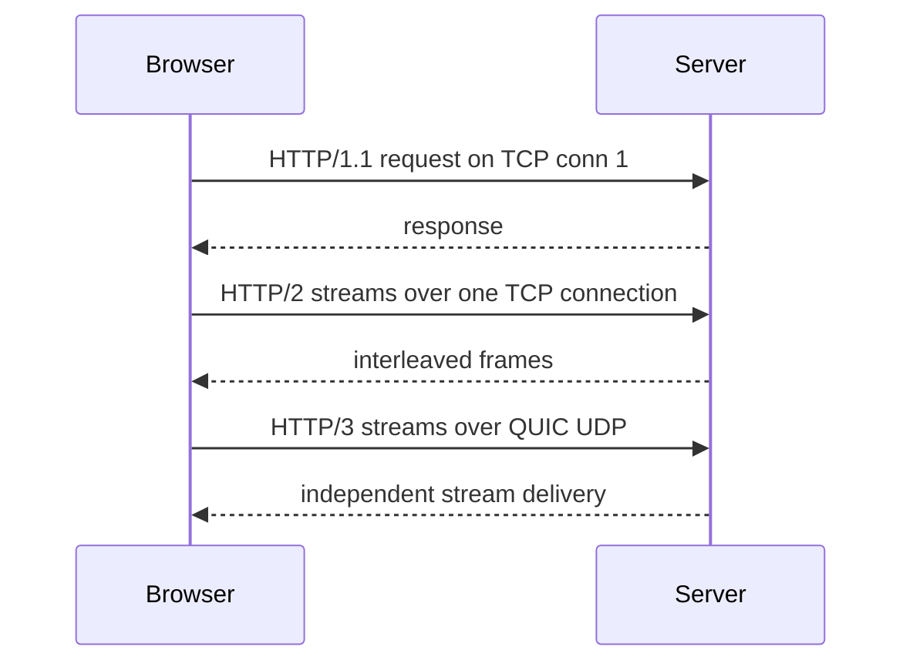

## 1. Hook

Imagine ordering food at three restaurants. In the first, you can ask
for one item, wait until it arrives, then ask for the next. That is
slow when you need ten items. In the second, you can give the waiter
the whole list and the kitchen works on many items at once, but if the
hallway from kitchen to table is blocked, everything waits. In the
third, each dish can take a separate hallway, so one spilled soup does
not stop the salad.

HTTP versions evolved like that. HTTP/1.1 is simple but limited by
request ordering and many connections. HTTP/2 multiplexes many streams
over one TCP connection. HTTP/3 keeps HTTP semantics but runs over
QUIC, reducing transport-level head-of-line blocking.

## 2. What Is It

(a) Plain-English one-liner: HTTP/1.1, HTTP/2, and HTTP/3 are versions
of the web protocol with the same basic request-response meaning but
different transport behavior and performance trade-offs.

(b) Formal definition: HTTP is an application-layer protocol for
transferring representations of resources using methods, status codes,
headers, and bodies. HTTP/1.1 maps each request-response exchange over
textual messages on TCP connections. HTTP/2 uses binary framing,
multiplexed streams, and header compression over TCP. HTTP/3 maps HTTP
semantics onto QUIC, a secure multiplexed transport over UDP, reducing
TCP-level head-of-line blocking and combining transport security into
QUIC (see: MOD-01/01-osi-model-tcp-ip-stack).

## 3. The Problem It Solves

Before HTTP/2, browsers opened many TCP connections to fetch page
assets because HTTP/1.1 could not efficiently multiplex all resources
on one connection. Head-of-line blocking and connection limits shaped
web performance tricks like domain sharding and sprite sheets.

HTTP/2 solved much of that by using one connection with many streams,
binary frames, and compressed headers. But because it still used TCP, a
lost TCP packet blocked all streams on that connection until
retransmission.

HTTP/3 solved that transport bottleneck by using QUIC streams over UDP.
Packet loss can affect one QUIC stream without blocking every other
stream at the transport layer.

## 4. Core Concept Breakdown

- **HTTP semantics:** methods, status codes, headers, caching, and
  resource meaning shared across versions.
- **HTTP/1.1 keep-alive:** reuses TCP connections but does not truly
  multiplex concurrent responses.
- **Pipelining:** HTTP/1.1 feature rarely used because response ordering
  causes head-of-line blocking.
- **HTTP/2 frames:** binary units carrying headers and data for
  different streams.
- **Multiplexing:** many logical streams share one connection.
- **HPACK/QPACK:** header compression for HTTP/2 and HTTP/3.
- **QUIC:** UDP-based transport with TLS 1.3, streams, loss recovery,
  and congestion control.
- **Head-of-line blocking:** one delayed item blocks unrelated work.
- **0-RTT resumption:** QUIC can sometimes send early data on resumed
  connections, with replay caveats.

## 5. How It Works

Step by step, loading a page with many assets:

1. **HTTP/1.1 opens several TCP connections.** Browsers parallelize by
   connection count.
2. **Each connection carries requests.** Responses are not multiplexed
   cleanly on one connection.
3. **HTTP/2 opens one main TCP connection.** It sends many streams as
   frames.
4. **HTTP/2 prioritizes and interleaves frames.** Images, CSS, and JS
   can share the connection.
5. **A lost TCP packet stalls all HTTP/2 streams.** TCP must repair
   byte order before upper streams continue.
6. **HTTP/3 opens a QUIC connection over UDP.** QUIC includes TLS 1.3
   security and stream management.
7. **HTTP/3 streams recover independently.** Loss on one stream does
   not block unrelated streams at transport level.
8. **QUIC supports connection migration.** A mobile device can move
   networks more gracefully using connection IDs.
9. **Servers choose via ALPN and Alt-Svc.** Clients discover supported
   protocols.
10. **Applications keep HTTP semantics.** Methods and status codes stay
    familiar even though framing changes.

Design review checks:

- **Does the environment allow UDP?** Some networks block or degrade
  UDP, so HTTP/3 needs fallback.
- **Are assets many and small?** Multiplexing and header compression
  help most there.
- **Is packet loss common?** QUIC can help on lossy mobile networks.
- **Are middleboxes involved?** Proxies and firewalls may affect HTTP/3
  deployment.

## 6. Diagram



<!-- IMAGE: protocol stack comparison showing HTTP/1.1 over TLS over
TCP, HTTP/2 over TLS over TCP, and HTTP/3 over QUIC over UDP -->

## 7. When to Use It

Use HTTP/2 or HTTP/3 when:

- **Pages need many resources.** Multiplexing reduces connection
  overhead.
- **Headers repeat often.** Compression reduces overhead for APIs.
- **Mobile or lossy networks matter.** HTTP/3 may reduce loss impact.
- **Streaming multiple logical requests matters.** HTTP/2 and HTTP/3
  handle parallel streams better than HTTP/1.1.

## 8. When NOT to Use It

- **Do not assume HTTP/3 always wins.** CPU, UDP blocking, and server
  support can change results.
- **Do not use HTTP/2 server push blindly.** It is hard to cache and
  has been removed or discouraged in major clients.
- **Do not ignore fallback.** HTTP/3 deployment needs HTTP/2 or
  HTTP/1.1 fallback for incompatible networks.
- **Do not optimize protocol before payload.** Huge JavaScript or slow
  backend work can dominate protocol gains.

## 9. Real-World Example

**Cloudflare, Google, and major CDNs** support HTTP/3 to improve
performance on lossy and mobile networks while falling back to HTTP/2.

**gRPC** commonly uses HTTP/2 because multiplexed streams and binary
framing fit RPC calls.

Realistic number: HTTP/1.1 browsers historically limited parallel
connections per host to around 6. HTTP/2 multiplexes many streams over
one TCP connection. HTTP/3 can avoid transport-level blocking between
independent streams when packet loss occurs.

## 10. Production-Grade Code

```typescript
import http2 from "node:http2";

const server = http2.createServer();

server.on("stream", (stream, headers) => {
  const path = headers[":path"];
  if (path !== "/health") {
    stream.respond({ ":status": 404 });
    stream.end("not found");
    return;
  }

  // HTTP/2 exposes one connection with many streams, so handlers must
  // avoid connection-wide assumptions like "one request at a time."
  stream.respond({ ":status": 200, "content-type": "application/json" });
  stream.end(JSON.stringify({ ok: true }));
});

server.listen(8080);
```

Why-not-what notes:

- HTTP/2 pseudo-headers such as `:path` are part of binary framing, not
  normal HTTP/1 header text.
- The handler is stream-oriented because multiple requests can be
  active on the same connection.
- Production HTTP/3 support is usually handled by a reverse proxy or
  CDN rather than raw application code.

## 11. Trade-offs Table

| Pros | Cons | What it costs you |
|---|---|---|
| HTTP/1.1 is simple and universal | Many connections and HOL issues | Connection tuning and asset optimization |
| HTTP/2 multiplexes streams | TCP loss still blocks all streams | Proper server and proxy support |
| HTTP/2 compresses headers | One bad connection affects many streams | Flow-control tuning |
| HTTP/3 reduces transport HOL blocking | UDP can be blocked or rate-limited | Fallback and QUIC operations |
| QUIC supports connection migration | More CPU and newer tooling | Observability and rollout care |

## 12. Comparison Table

| Version | Transport | Framing | Multiplexing | Main win | Main caveat |
|---|---|---|---|---|---|
| HTTP/1.1 | TCP | text | limited | universal simplicity | connection-level inefficiency |
| HTTP/2 | TCP | binary | yes | many streams over one connection | TCP head-of-line blocking |
| HTTP/3 | QUIC over UDP | binary | yes | independent streams and faster setup | UDP and operational maturity |

## 13. Numbers & Benchmarks

- **HTTP/1.1 connections:** browsers commonly use around 6 connections
  per origin.
- **HTTP/2 handshake:** still needs TCP plus TLS before HTTP data.
- **HTTP/3 handshake:** QUIC integrates TLS 1.3 and can reduce setup
  round trips, especially on resumption.
- **Header compression:** HPACK and QPACK help repeated cookie and auth
  headers.
- **Packet loss:** HTTP/2 over TCP stalls all streams behind lost TCP
  bytes; HTTP/3 limits impact to affected streams.

## 14. Common Pitfalls

- **Incident: HTTP/2 enabled behind old proxy.** The proxy downgraded
  or mishandled streams, causing intermittent resets.
- **Incident: HTTP/3 blocked by enterprise network.** UDP 443 was
  filtered, so clients needed reliable fallback.
- **Incident: one huge response starved others.** Flow control was not
  tuned, so multiplexing did not prevent latency spikes.

## 15. Interview Q&A

**Q1. What problem did HTTP/2 solve?** Model answer: inefficient
parallelism in HTTP/1.1 by adding binary framing, multiplexed streams,
and header compression.

**Q2. Why does HTTP/2 still have head-of-line blocking?** Model answer:
HTTP/2 streams share one TCP byte stream. If TCP loses a packet, later
bytes for all streams wait for retransmission.

**Q3. Why does HTTP/3 use UDP?** Model answer: QUIC builds reliable
streams, encryption, and congestion control in user space over UDP so
streams can recover independently.

**Q4. Are HTTP semantics different in HTTP/3?** Model answer: mostly
no. Methods, status codes, and headers are conceptually the same; the
wire mapping changes.

**Q5. When might HTTP/1.1 still be fine?** Model answer: simple APIs,
legacy clients, low request concurrency, or environments where proxies
and tooling are HTTP/1.1-oriented.

## 16. Follow-up / Curveball Questions

**Curveball 1. HTTP/3 improves lab tests but not production.** Answer
direction: check UDP blocking, CPU cost, CDN path, packet loss, asset
shape, and fallback rate.

**Curveball 2. gRPC over HTTP/2 has one slow stream.** Answer
direction: inspect flow control and TCP loss; multiplexing does not
remove every shared-connection effect.

**Curveball 3. Can HTTP/3 replace TCP for everything?** Answer
direction: no. QUIC is a transport for protocols that adopt it; many
systems still use TCP directly.

## 17. Cheat-Sheet Summary

- HTTP semantics stay stable; transport and framing evolved.
- HTTP/1.1 is text over TCP with limited parallelism.
- HTTP/2 adds binary framing, multiplexing, and HPACK over TCP.
- HTTP/3 maps HTTP onto QUIC over UDP with independent streams.
- Deploy HTTP/3 with fallback and measure real client impact.

## 18. Further Reading

- RFC 9113, "HTTP/2":
  https://www.rfc-editor.org/rfc/rfc9113
- RFC 9114, "HTTP/3":
  https://www.rfc-editor.org/rfc/rfc9114
- RFC 9000, "QUIC: A UDP-Based Multiplexed and Secure Transport":
  https://www.rfc-editor.org/rfc/rfc9000

---

## COMPLETENESS CHECK

Section checklist (18):

1. Hook - Covered (restaurant ordering analogy)
2. What Is It - Covered (plain-English and formal definitions)
3. The Problem It Solves - Covered (HTTP/1 limits, HTTP/2, HTTP/3)
4. Core Concept Breakdown - Covered (9 concepts)
5. How It Works - Covered (10 steps plus design checks)
6. Diagram - Covered (sequenceDiagram)
7. When to Use It - Covered (4 triggers)
8. When NOT to Use It - Covered (4 warnings)
9. Real-World Example - Covered (CDNs, gRPC, browser connection count)
10. Production-Grade Code - Covered (TypeScript HTTP/2 server)
11. Trade-offs Table - Covered (5 rows)
12. Comparison Table - Covered (3 versions)
13. Numbers & Benchmarks - Covered (5 figures)
14. Common Pitfalls - Covered (3 incident notes)
15. Interview Q&A - Covered (5 Q&As)
16. Follow-up / Curveball Questions - Covered (3 curveballs)
17. Cheat-Sheet Summary - Covered (5 lines)
18. Further Reading - Covered (3 URL-backed sources)

No em-dashes. No emojis. Cross-links included.
