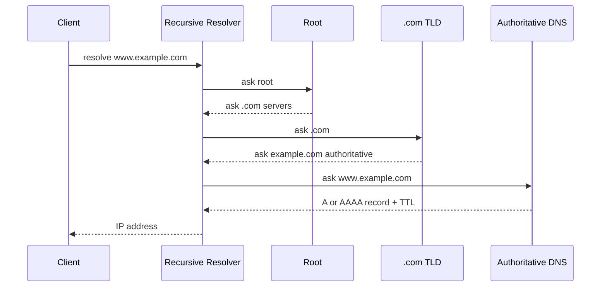

## 1. Hook

You remember people by names, but delivery drivers need addresses. If
you say "bring this to Maya," someone must translate Maya into a street
address. If the address book is wrong, the package goes nowhere. If the
address book is slow, every delivery starts slowly.

DNS is the internet's address book. Humans type names like
`example.com`; machines need IP addresses. DNS translates the name into
records that clients can use.

It looks simple when it works. When it fails, websites vanish even
though servers are healthy.

## 2. What Is It

(a) Plain-English one-liner: DNS translates domain names into records
such as IP addresses so clients can find services on the internet.

(b) Formal definition: the Domain Name System is a distributed,
hierarchical naming system that maps domain names to resource records
such as A, AAAA, CNAME, MX, TXT, NS, and SOA. Resolution usually
involves a recursive resolver querying root, top-level-domain, and
authoritative name servers, with caching controlled by TTL values
(see: MOD-01/01-osi-model-tcp-ip-stack).

## 3. The Problem It Solves

Before DNS, every host would need a local list mapping names to
addresses. That does not scale to billions of names, changing IPs,
mail routing, verification records, and global delegation.

After DNS, ownership is delegated. Root servers point to `.com`
servers. `.com` servers point to a domain's authoritative servers.
Authoritative servers answer records for that domain. Recursive
resolvers cache answers so every client does not query the hierarchy
from scratch.

DNS solves scalable naming. It makes service discovery global, cached,
and delegated.

## 4. Core Concept Breakdown

- **Domain name:** human-readable name such as `api.example.com`.
- **Recursive resolver:** server that performs lookups on behalf of
  clients and caches results.
- **Root server:** top of DNS hierarchy, points to TLD servers.
- **TLD server:** server for `.com`, `.org`, `.in`, and similar zones.
- **Authoritative server:** source of truth for a zone's DNS records.
- **A record:** maps a name to an IPv4 address.
- **AAAA record:** maps a name to an IPv6 address.
- **CNAME record:** aliases one name to another canonical name.
- **TTL:** time a resolver may cache an answer.
- **DNSSEC:** signatures that authenticate DNS data integrity.

## 5. How It Works

Step by step, resolving `www.example.com`:

1. **Browser checks local cache.** It may already know the answer.
2. **OS checks resolver cache.** The operating system may cache DNS.
3. **Query recursive resolver.** Usually ISP, corporate, or public DNS.
4. **Resolver asks root.** Root points to `.com` nameservers.
5. **Resolver asks `.com`.** TLD server points to `example.com`
   authoritative nameservers.
6. **Resolver asks authoritative server.** It returns A, AAAA, or CNAME
   records.
7. **Resolver follows CNAME if present.** Alias targets are resolved
   too.
8. **Resolver caches response.** TTL controls cache duration.
9. **Client receives IP address.** It can now connect to the service.
10. **Failures are cached too.** Negative caching can make fixes appear
    delayed.

Design review checks:

- **What is the TTL?** Low TTL speeds failover but increases query
  volume.
- **Who owns authoritative DNS?** Registrar, cloud DNS, CDN, or
  internal platform.
- **Do you need split-horizon DNS?** Internal and external clients may
  need different answers.
- **What is the DNS failover story?** DNS is not instant traffic
  steering.

## 6. Diagram



<!-- IMAGE: DNS hierarchy showing client, recursive resolver, root,
TLD, authoritative server, and cached response path -->

## 7. When to Use It

Use DNS for:

- **Public service naming.** Websites, APIs, mail, and CDN endpoints.
- **Cloud routing.** CNAMEs to load balancers, CDNs, and managed
  services.
- **Service verification.** TXT records for domain ownership, SPF,
  DKIM, and ACME challenges.
- **Internal naming.** Private zones for service discovery when TTL and
  caching fit.

## 8. When NOT to Use It

- **Do not use DNS for instant failover.** Caches may hold old answers
  until TTL expires, and some resolvers ignore low TTLs.
- **Do not put frequently changing per-request routing in DNS.** Use a
  load balancer or service mesh.
- **Do not chain CNAMEs deeply.** Each lookup adds latency and failure
  surface.
- **Do not forget negative caching.** An NXDOMAIN can linger after you
  add the missing record.

## 9. Real-World Example

**CDNs** use DNS to direct users toward nearby edge locations, often
combined with anycast and HTTP routing.

**Kubernetes** uses DNS internally so services can be reached by names
like `service.namespace.svc.cluster.local`.

**Email delivery** depends on DNS records: MX routes mail, SPF and DKIM
authenticate senders, and DMARC publishes policy.

Realistic number: public DNS TTLs often range from 60 seconds for
traffic-managed records to 3600 seconds or more for stable records.
Lower TTLs reduce cache duration but increase authoritative query load.

## 10. Production-Grade Code

```typescript
import { Resolver } from "node:dns/promises";

export async function resolveService(hostname: string): Promise<string[]> {
  const resolver = new Resolver();
  resolver.setServers(["1.1.1.1", "8.8.8.8"]);
  try {
    const [v4, v6] = await Promise.allSettled([
      resolver.resolve4(hostname),
      resolver.resolve6(hostname),
    ]);
    const addresses = [
      ...(v4.status === "fulfilled" ? v4.value : []),
      ...(v6.status === "fulfilled" ? v6.value : []),
    ];
    if (addresses.length === 0) throw new Error("no A or AAAA records");
    return addresses;
  } catch (err) {
    // DNS failure should be surfaced separately from TCP or HTTP
    // failure so incidents point at the right layer.
    throw new Error(`DNS resolution failed for ${hostname}: ${(err as Error).message}`);
  }
}
```

Why-not-what notes:

- The code asks for both IPv4 and IPv6 because modern services often
  publish both.
- DNS errors are wrapped distinctly so observability can separate name
  resolution from connection failures.
- Production clients usually use OS resolver behavior, but explicit
  resolution is useful for diagnostics.

## 11. Trade-offs Table

| Pros | Cons | What it costs you |
|---|---|---|
| Scales global naming through delegation | Cache delay makes changes slow | TTL planning |
| Reduces load through recursive caching | Debugging crosses many owners | DNS tracing tools |
| Supports many record types | Misconfiguration can break everything | Change review |
| Enables CDN and cloud indirection | CNAME chains add latency | Record hygiene |
| DNSSEC can authenticate answers | Operational complexity | Key management |

## 12. Comparison Table

| Record | Purpose | Example | Common use | Risk |
|---|---|---|---|---|
| A | name to IPv4 | `203.0.113.10` | websites and APIs | stale IP |
| AAAA | name to IPv6 | `2001:db8::1` | IPv6 clients | broken IPv6 path |
| CNAME | alias to name | `app.cdn.net` | CDN and managed services | extra lookups |
| MX | mail exchanger | `mail.example.com` | email routing | mail outage |
| TXT | arbitrary text | SPF, DKIM, verification | auth and ownership | syntax mistakes |

## 13. Numbers & Benchmarks

- **Root server letters:** 13 logical root server identities, served by
  many anycast instances globally.
- **UDP DNS payload:** classic DNS over UDP was 512 bytes before EDNS0
  extensions.
- **TTL range:** 60 to 3600 seconds is common for operational records.
- **Resolver cache:** recursive resolvers can serve many clients from
  one cached answer.
- **DNS lookup cost:** cold resolution can add tens to hundreds of
  milliseconds depending on resolver and network.

## 14. Common Pitfalls

- **Incident: deleted authoritative NS record.** The domain existed at
  registrar level but nobody could find the zone.
- **Incident: low TTL expected instant failover.** Some clients cached
  old answers longer and kept hitting the failed endpoint.
- **Incident: broken AAAA record.** IPv6 clients tried an unreachable
  address while IPv4 tests looked healthy.

## 15. Interview Q&A

**Q1. What is recursive DNS?** Model answer: a resolver that performs
the full lookup on behalf of a client and caches the result.

**Q2. What is authoritative DNS?** Model answer: the source of truth
for records in a DNS zone.

**Q3. What does TTL control?** Model answer: how long resolvers may
cache a DNS answer before asking again.

**Q4. CNAME vs A record?** Model answer: A points to an IPv4 address;
CNAME aliases one name to another name.

**Q5. Why can DNS changes take time?** Model answer: cached positive
and negative answers may remain until TTL or resolver policy expires.

## 16. Follow-up / Curveball Questions

**Curveball 1. `dig` shows new IP but users still hit old IP.** Answer
direction: their recursive resolver, OS, browser, or app cache may
still hold the old answer.

**Curveball 2. DNS resolves but TCP fails.** Answer direction: DNS did
its job. Check routing, firewall, load balancer, and service port.

**Curveball 3. Need blue-green deploy with instant rollback.** Answer
direction: DNS alone is weak. Use a load balancer, CDN routing, or
traffic manager with health checks and short cache path.

## 17. Cheat-Sheet Summary

- DNS maps names to records like A, AAAA, CNAME, MX, and TXT.
- Resolution walks recursive resolver, root, TLD, and authoritative DNS.
- TTL controls caching and therefore change speed.
- DNS is great for naming, not instant per-request routing.
- Debug DNS separately from TCP, TLS, and HTTP.

## 18. Further Reading

- RFC 1034, "Domain Names - Concepts and Facilities":
  https://www.rfc-editor.org/rfc/rfc1034
- RFC 1035, "Domain Names - Implementation and Specification":
  https://www.rfc-editor.org/rfc/rfc1035
- Cloudflare Learning Center, "What is DNS?":
  https://www.cloudflare.com/learning/dns/what-is-dns/

---

## COMPLETENESS CHECK

Section checklist (18):

1. Hook - Covered (address book analogy)
2. What Is It - Covered (plain-English and formal definitions)
3. The Problem It Solves - Covered (host lists before, delegated DNS after)
4. Core Concept Breakdown - Covered (10 concepts)
5. How It Works - Covered (10 resolution steps plus design checks)
6. Diagram - Covered (sequenceDiagram)
7. When to Use It - Covered (4 triggers)
8. When NOT to Use It - Covered (4 warnings)
9. Real-World Example - Covered (CDNs, Kubernetes, email)
10. Production-Grade Code - Covered (TypeScript DNS resolver)
11. Trade-offs Table - Covered (5 rows)
12. Comparison Table - Covered (5 record types)
13. Numbers & Benchmarks - Covered (5 figures)
14. Common Pitfalls - Covered (3 incident notes)
15. Interview Q&A - Covered (5 Q&As)
16. Follow-up / Curveball Questions - Covered (3 curveballs)
17. Cheat-Sheet Summary - Covered (5 lines)
18. Further Reading - Covered (3 URL-backed sources)

No em-dashes. No emojis. Cross-links included.
