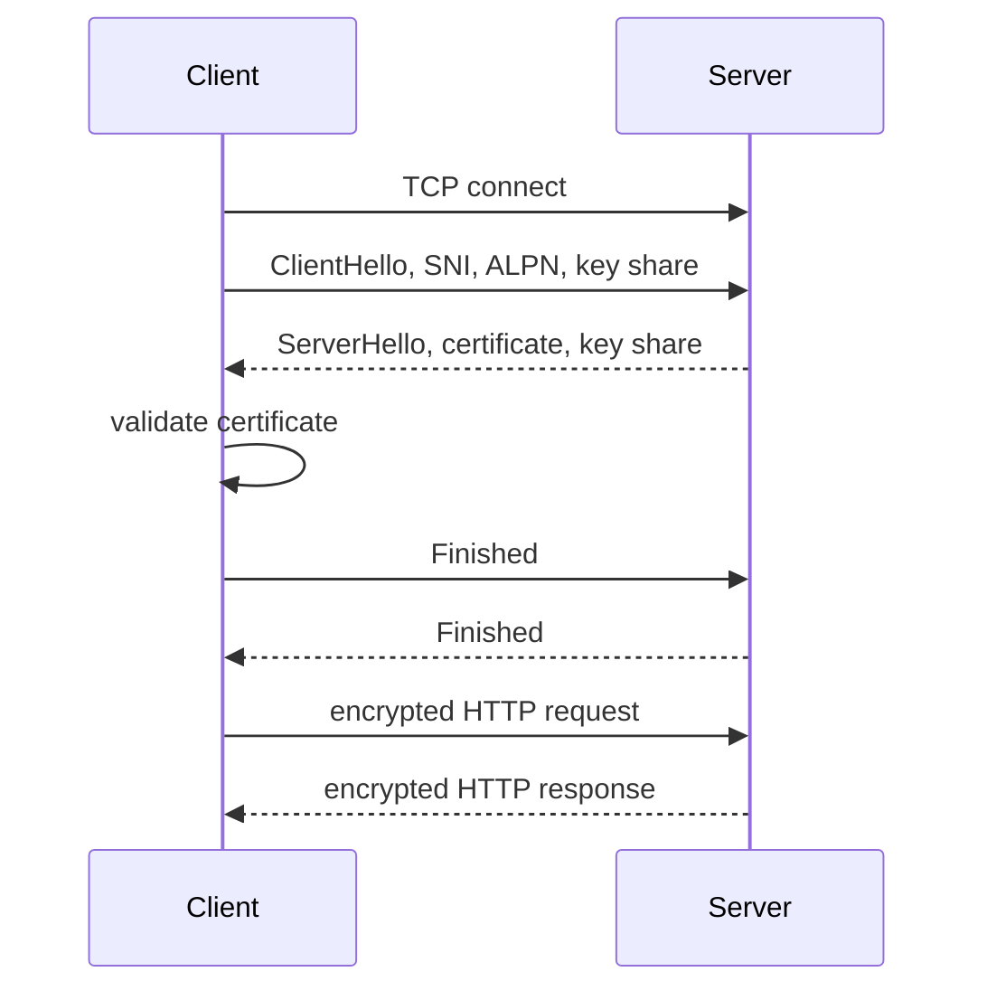

## 1. Hook

You want to send a private letter through a crowded room. First, you
need to know you are really talking to the right person. Then you need
to agree on a secret code without shouting the secret itself. After
that, you can exchange letters that everyone else can see but not read
or modify.

TLS does that for the web. It authenticates the server, negotiates
encryption keys, and protects HTTP traffic from eavesdropping and
tampering.

HTTPS is simply HTTP carried inside that protected tunnel.

## 2. What Is It

(a) Plain-English one-liner: TLS is the security protocol that lets a
client and server authenticate, agree on encryption keys, and protect
data; HTTPS is HTTP over TLS.

(b) Formal definition: Transport Layer Security is a cryptographic
protocol that provides confidentiality, integrity, and endpoint
authentication over a network transport. During the TLS handshake, the
client and server negotiate protocol version and cipher suite,
authenticate the server certificate, perform key exchange, derive
symmetric traffic keys, and then protect application data. TLS 1.3 is
the modern version and reduces handshake round trips compared with TLS
1.2 (see: MOD-01/02-http1-vs-http2-vs-http3-quic and
MOD-01/03-dns-and-dns-resolution).

## 3. The Problem It Solves

Before TLS, HTTP traffic could be read or modified by anyone on the
path: Wi-Fi attackers, compromised routers, proxies, or ISPs. Users
could not know whether the server was really their bank or a machine
pretending to be it.

After TLS, the browser validates the server certificate, negotiates
keys, and encrypts application data. Attackers can still see metadata
such as IP address and timing, but they cannot read or alter protected
HTTP contents without breaking cryptographic checks.

TLS solves secure channel establishment on an untrusted network.

## 4. Core Concept Breakdown

- **Certificate:** signed statement binding a public key to a domain.
- **Certificate authority:** trusted signer that browsers and operating
  systems recognize.
- **SNI:** hostname sent by client so server can choose the right
  certificate.
- **ALPN:** negotiation for application protocol such as HTTP/1.1,
  HTTP/2, or HTTP/3.
- **Key exchange:** method to agree on shared secrets without sending
  the secret directly.
- **Forward secrecy:** past sessions remain protected even if long-term
  key leaks later.
- **Cipher suite:** algorithms used for key exchange, encryption, and
  integrity.
- **Handshake:** negotiation and authentication phase before protected
  data.
- **Session resumption:** reusing prior security context to reduce
  setup cost.

## 5. How It Works

Step by step, TLS 1.3 for HTTPS:

1. **Client connects to server.** Usually TCP port 443 for HTTPS.
2. **Client sends ClientHello.** It includes supported TLS versions,
   cipher suites, random value, SNI, ALPN, and key share.
3. **Server replies with ServerHello.** It chooses parameters and sends
   its key share.
4. **Both derive handshake secrets.** Key exchange creates shared
   cryptographic material.
5. **Server sends certificate.** The certificate proves domain identity
   through a trusted chain.
6. **Client validates certificate.** It checks hostname, expiry,
   signature chain, and revocation behavior.
7. **Finished messages authenticate handshake.** Both sides prove they
   derived the same secrets.
8. **Application data is encrypted.** HTTP requests and responses are
   protected.
9. **Session may be resumed later.** Resumption reduces round trips.
10. **Certificate renewal must be automated.** Expired certificates are
    a common outage cause.

Design review checks:

- **Which TLS versions are allowed?** Disable obsolete versions.
- **Is certificate renewal automated and monitored?**
- **Does the load balancer terminate TLS or pass it through?**
- **Are private keys protected and rotated?**

## 6. Diagram



<!-- IMAGE: TLS 1.3 handshake timeline showing certificate validation,
key exchange, and encrypted HTTP data after Finished messages -->

## 7. When to Use It

Use TLS when:

- **Traffic crosses any untrusted network.** That includes public
  internet and many internal networks.
- **Credentials or personal data are involved.** Encryption and server
  authentication are mandatory.
- **Integrity matters.** TLS prevents undetected tampering.
- **Service identity matters.** Certificates help clients know the
  server name they reached.

## 8. When NOT to Use It

- **Do not skip TLS because traffic is internal.** Internal networks are
  not automatically trusted.
- **Do not use expired or self-signed certs in production clients.**
  That trains systems to ignore identity.
- **Do not terminate TLS without understanding trust boundaries.** Data
  is plaintext after termination unless re-encrypted.
- **Do not enable old protocols casually.** TLS 1.0 and 1.1 are
  obsolete.

## 9. Real-World Example

**Let's Encrypt** made automated free certificates common, helping move
the web toward HTTPS by default.

**Browsers** mark HTTP pages as insecure and enforce HTTPS features
such as secure cookies, service workers, and powerful APIs.

**CDNs and load balancers** commonly terminate TLS at the edge, then
connect to origins over TLS again in higher-security designs.

Realistic number: TLS 1.3 usually needs 1 RTT after TCP connection for
a full handshake. TLS 1.2 often needed 2 RTTs. Resumption and QUIC can
reduce setup cost.

## 10. Production-Grade Code

```typescript
import https from "node:https";
import fs from "node:fs";

export function startHttpsServer() {
  const server = https.createServer(
    {
      key: fs.readFileSync("server.key"),
      cert: fs.readFileSync("server.crt"),
      minVersion: "TLSv1.2",
    },
    (req, res) => {
      // TLS authenticates the server and encrypts bytes. Application
      // authorization still belongs in HTTP handlers.
      res.writeHead(200, { "content-type": "application/json" });
      res.end(JSON.stringify({ ok: true }));
    }
  );
  server.listen(8443);
  return server;
}
```

Why-not-what notes:

- `minVersion` blocks obsolete protocol versions.
- The code does not confuse TLS with user authentication; HTTPS proves
  server identity and protects the channel, not user permissions.
- In production, certificates are normally managed by a proxy, load
  balancer, or automated certificate agent.

## 11. Trade-offs Table

| Pros | Cons | What it costs you |
|---|---|---|
| Encrypts traffic | Handshake adds latency | TLS 1.3, resumption, connection reuse |
| Authenticates server identity | Certificate lifecycle can fail | Automation and expiry alerts |
| Protects integrity | Termination creates plaintext segment | Clear trust boundaries |
| Enables secure browser features | CPU cost for crypto | Hardware and tuning |
| Supports modern protocols | Misconfiguration is common | Security scanning |

## 12. Comparison Table

| Topic | TLS 1.2 | TLS 1.3 | Plain HTTP |
|---|---|---|---|
| Encryption | yes | yes | no |
| Full handshake RTT | often 2 | usually 1 | none |
| Forward secrecy | optional by suite | mandatory style | no |
| Server authentication | certificate | certificate | no |
| Modern recommendation | legacy allowed in some places | preferred | avoid for sensitive traffic |

## 13. Numbers & Benchmarks

- **TLS 1.3 full handshake:** usually 1 RTT after transport setup.
- **Certificate validity:** public certs are often valid for about 90
  days with automated renewal.
- **HTTPS port:** TCP 443 by convention.
- **RSA key sizes:** 2048-bit RSA has been a common baseline, while
  ECDSA is common for performance.
- **0-RTT data:** can reduce latency on resumption but has replay-risk
  constraints.

## 14. Common Pitfalls

- **Incident: expired certificate.** Service was healthy, but every
  browser rejected the site.
- **Incident: hostname mismatch.** Certificate covered `api.example.com`
  but clients connected to `internal-api.example.com`.
- **Incident: TLS terminated at edge only.** Internal hop carried
  plaintext through a less trusted network segment.

## 15. Interview Q&A

**Q1. What does TLS provide?** Model answer: confidentiality,
integrity, and authentication of the endpoint, usually the server.

**Q2. What is a certificate authority?** Model answer: a trusted party
that signs certificates binding domain names to public keys.

**Q3. What is SNI?** Model answer: Server Name Indication lets a client
tell the server which hostname it wants so the server can choose the
right certificate.

**Q4. Is HTTPS enough for authentication?** Model answer: no. HTTPS
authenticates the server and protects the channel; user authentication
still needs cookies, tokens, mutual TLS, or another mechanism.

**Q5. Why is TLS 1.3 faster?** Model answer: it simplifies negotiation
and typically completes full handshake in fewer round trips than TLS
1.2.

## 16. Follow-up / Curveball Questions

**Curveball 1. TLS works in browser but not mobile app.** Answer
direction: check certificate chain, hostname, pinned certs, clock, and
trust store differences.

**Curveball 2. Need end-to-end encryption through load balancer.**
Answer direction: use TLS passthrough or terminate and re-encrypt with
clear trust boundaries.

**Curveball 3. 0-RTT causes duplicate order submission.** Answer
direction: 0-RTT data can be replayed. Only allow it for idempotent
requests or protect with replay-safe design.

## 17. Cheat-Sheet Summary

- TLS secures the channel; HTTPS is HTTP over TLS.
- The handshake authenticates the server and derives traffic keys.
- Certificates bind public keys to domain names through CAs.
- TLS 1.3 is the modern default and reduces handshake cost.
- TLS does not replace application authentication or authorization.

## 18. Further Reading

- RFC 8446, "The Transport Layer Security Protocol Version 1.3":
  https://www.rfc-editor.org/rfc/rfc8446
- Mozilla SSL Configuration Generator:
  https://ssl-config.mozilla.org/
- Let's Encrypt documentation:
  https://letsencrypt.org/docs/

---

## COMPLETENESS CHECK

Section checklist (18):

1. Hook - Covered (private letter analogy)
2. What Is It - Covered (plain-English and formal definitions)
3. The Problem It Solves - Covered (plaintext HTTP before, secure channel after)
4. Core Concept Breakdown - Covered (9 concepts)
5. How It Works - Covered (10 TLS 1.3 steps plus design checks)
6. Diagram - Covered (sequenceDiagram)
7. When to Use It - Covered (4 triggers)
8. When NOT to Use It - Covered (4 warnings)
9. Real-World Example - Covered (Let's Encrypt, browsers, CDNs)
10. Production-Grade Code - Covered (TypeScript HTTPS server)
11. Trade-offs Table - Covered (5 rows)
12. Comparison Table - Covered (TLS 1.2, TLS 1.3, HTTP)
13. Numbers & Benchmarks - Covered (5 figures)
14. Common Pitfalls - Covered (3 incident notes)
15. Interview Q&A - Covered (5 Q&As)
16. Follow-up / Curveball Questions - Covered (3 curveballs)
17. Cheat-Sheet Summary - Covered (5 lines)
18. Further Reading - Covered (3 URL-backed sources)

No em-dashes. No emojis. Cross-links included.
