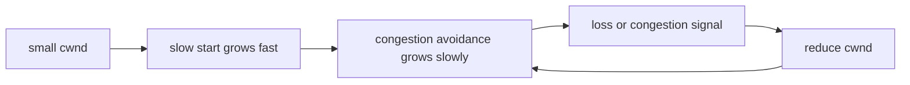

## 1. Hook

A hallway can handle only so many people. If everyone runs in at once,
the hallway jams and nobody moves quickly. A polite crowd starts slowly,
watches how crowded the hallway feels, speeds up when there is room,
and slows down when people bump into each other.

TCP congestion control is that hallway etiquette for the internet. It
helps senders discover how much data the network can handle without
overloading routers and links.

It is not about the receiver being too slow. It is about the network
path being shared and finite.

## 2. What Is It

(a) Plain-English one-liner: TCP congestion control adjusts how fast a
sender transmits data so it does not overload the network path.

(b) Formal definition: TCP congestion control is a set of algorithms
that regulate a sender's congestion window based on acknowledgements,
loss, delay, and other signals. Classic mechanisms include slow start,
congestion avoidance, fast retransmit, and fast recovery. Modern
algorithms such as CUBIC and BBR estimate capacity differently, but all
aim to balance throughput, fairness, latency, and stability (see:
MOD-01/04-tcp-vs-udp).

## 3. The Problem It Solves

Before congestion control, senders could blast packets as fast as they
wanted. Shared routers would queue, drop packets, and collapse under
load. More sending created less throughput because retransmissions and
queues dominated useful traffic.

After congestion control, a sender probes for available capacity. It
starts cautiously, increases the congestion window as ACKs arrive, and
backs off when loss or congestion signals appear. The network remains
usable for many flows instead of being dominated by the loudest sender.

Congestion control solves shared-path fairness and stability.

## 4. Core Concept Breakdown

- **Congestion window (cwnd):** sender-side limit on in-flight data.
- **Receive window:** receiver-side limit based on buffer capacity.
- **Slow start:** cwnd grows quickly from a small value to discover
  capacity.
- **Congestion avoidance:** cwnd grows more carefully after threshold.
- **Packet loss:** classic signal that network queues overflowed.
- **RTT:** round-trip time; delay signal used by some algorithms.
- **Fast retransmit:** resend after duplicate ACKs suggest loss.
- **CUBIC:** common loss-based TCP congestion algorithm.
- **BBR:** estimates bottleneck bandwidth and round-trip propagation
  time rather than treating loss as primary signal.

## 5. How It Works

Step by step, a TCP sender ramps up:

1. **Start with small cwnd.** Sender allows a small amount of in-flight
   data.
2. **ACKs return.** Each ACK suggests data left the network.
3. **Slow start grows quickly.** cwnd increases rapidly while no
   congestion is detected.
4. **Threshold is reached.** Sender enters congestion avoidance.
5. **Growth becomes gentler.** cwnd increases more slowly.
6. **Loss is detected.** Timeout or duplicate ACKs indicate missing
   packets.
7. **Sender reduces cwnd.** It backs off to relieve congestion.
8. **Lost data is retransmitted.** TCP preserves reliable byte stream.
9. **Algorithm continues probing.** It searches for stable throughput.
10. **Application sees throughput changes.** Large transfers speed up
    and slow down with network conditions.

Design review checks:

- **Is latency caused by queueing?** Bufferbloat can make throughput
  look fine while p99 latency suffers.
- **Are many flows competing?** Per-connection behavior affects
  fairness.
- **Is packet loss random or congestion?** Wireless loss can mislead
  loss-based algorithms.
- **Does the protocol run over UDP?** It still needs congestion behavior
  if it sends significant traffic.

## 6. Diagram



<!-- IMAGE: congestion window over time showing slow start curve,
congestion avoidance sawtooth, loss event, and reduced window -->

## 7. When to Use It

You use TCP congestion control automatically when:

- **Using TCP.** The operating system implements it.
- **Sending large responses.** Downloads, video chunks, backups, and
  replication streams are affected.
- **Tuning servers.** Socket buffers, pacing, and algorithm choice can
  matter.
- **Building UDP protocols.** You must add congestion control behavior
  yourself or use QUIC.

## 8. When NOT to Use It

- **Do not disable congestion control to gain speed.** It can harm the
  network and your own throughput.
- **Do not assume bandwidth equals low latency.** Queues can hide
  congestion until latency spikes.
- **Do not open many connections just to beat fairness.** It can starve
  other traffic and trigger rate limits.
- **Do not treat UDP as exempt.** High-rate UDP without congestion
  control is hostile.

## 9. Real-World Example

**Linux** commonly uses CUBIC as a default TCP congestion-control
algorithm in many distributions.

**Google BBR** is deployed widely for some workloads to improve
throughput and latency by modeling bottleneck bandwidth and RTT.

**QUIC** includes congestion control requirements because it runs over
UDP but still shares the same internet.

Realistic number: TCP slow start can double the congestion window each
round trip until a threshold or loss event. On high-latency paths, this
means a new connection may need several RTTs before reaching full
throughput.

## 10. Production-Grade Code

```go
package main

type CongestionWindow struct {
	Cwnd      int
	Ssthresh  int
}

func NewWindow() CongestionWindow {
	return CongestionWindow{Cwnd: 10, Ssthresh: 1000}
}

func (w *CongestionWindow) OnAck() {
	if w.Cwnd < w.Ssthresh {
		// Slow start probes capacity aggressively because the sender has
		// not yet seen evidence of congestion.
		w.Cwnd++
		return
	}
	// Congestion avoidance grows cautiously to reduce oscillation around
	// the path's capacity.
	if w.Cwnd%w.Ssthresh == 0 {
		w.Cwnd++
	}
}

func (w *CongestionWindow) OnLoss() {
	w.Ssthresh = max(2, w.Cwnd/2)
	w.Cwnd = w.Ssthresh
}
```

Why-not-what notes:

- This is a toy model of AIMD behavior, not a kernel TCP
  implementation.
- The important production idea is feedback: ACKs increase sending,
  congestion signals reduce it.
- Real algorithms use pacing, RTT, duplicate ACKs, selective ACKs, and
  detailed state machines.

## 11. Trade-offs Table

| Pros | Cons | What it costs you |
|---|---|---|
| Prevents congestion collapse | Can underuse some paths at first | Slow-start ramp-up |
| Shares network fairly | Loss-based signals can misread wireless loss | Algorithm choice |
| Built into TCP stacks | Hard to observe from app layer | Network metrics |
| Protects shared infrastructure | Queues can increase latency | Buffer and pacing tuning |
| QUIC can evolve faster in user space | More protocol complexity | Careful implementation |

## 12. Comparison Table

| Algorithm | Main signal | Growth style | Best fit | Caveat |
|---|---|---|---|---|
| Reno | loss | AIMD | classic baseline | lower throughput on high BDP paths |
| CUBIC | loss and cubic growth | aggressive at scale | modern internet TCP | can build queues |
| BBR | bandwidth and RTT model | paced | high throughput and lower queues | fairness interactions |
| QUIC congestion control | pluggable, RFC-guided | implementation-specific | HTTP/3 and UDP transports | userspace tuning |

## 13. Numbers & Benchmarks

- **Initial cwnd:** commonly around 10 TCP segments in modern stacks.
- **AIMD:** additive increase, multiplicative decrease is the classic
  fairness shape.
- **Bandwidth-delay product:** high-throughput long-distance paths need
  large in-flight windows.
- **Loss impact:** one loss event can cut cwnd significantly in
  loss-based algorithms.
- **RTT dependency:** throughput ramp-up is slower on higher RTT paths.

## 14. Common Pitfalls

- **Incident: many short connections.** Each request restarted slow
  start, wasting throughput on high-latency paths.
- **Incident: bufferbloat.** Large queues kept throughput high but p99
  latency became terrible.
- **Incident: UDP flood.** A custom telemetry protocol sent without
  congestion control and caused packet loss for other services.

## 15. Interview Q&A

**Q1. What is congestion control?** Model answer: sender-side rate
control that adjusts in-flight data to avoid overloading the network.

**Q2. What is slow start?** Model answer: rapid cwnd growth at the
start of a connection to discover available capacity.

**Q3. What happens on packet loss?** Model answer: TCP retransmits lost
data and usually reduces its congestion window.

**Q4. What is BDP?** Model answer: bandwidth-delay product, the amount
of data needed in flight to fully utilize a path.

**Q5. Why does UDP still need congestion control?** Model answer: the
network is shared. High-rate UDP can cause congestion collapse if it
does not back off.

## 16. Follow-up / Curveball Questions

**Curveball 1. Throughput is high but latency is awful.** Answer
direction: suspect queueing and bufferbloat; measure RTT under load.

**Curveball 2. File transfer starts slow then speeds up.** Answer
direction: slow start ramped congestion window over several RTTs.

**Curveball 3. Wireless network loses packets not due to congestion.**
Answer direction: loss-based algorithms may back off unnecessarily;
protocol and link-layer behavior matter.

## 17. Cheat-Sheet Summary

- Congestion control limits in-flight data to protect shared networks.
- cwnd grows with ACKs and shrinks on congestion signals.
- Slow start ramps quickly; congestion avoidance grows carefully.
- Loss, delay, and bandwidth models drive different algorithms.
- UDP protocols must still behave fairly.

## 18. Further Reading

- RFC 5681, "TCP Congestion Control":
  https://www.rfc-editor.org/rfc/rfc5681
- RFC 9002, "QUIC Loss Detection and Congestion Control":
  https://www.rfc-editor.org/rfc/rfc9002
- ACM Queue, "BBR: Congestion-Based Congestion Control":
  https://queue.acm.org/detail.cfm?id=3022184

---

## COMPLETENESS CHECK

Section checklist (18):

1. Hook - Covered (crowded hallway analogy)
2. What Is It - Covered (plain-English and formal definitions)
3. The Problem It Solves - Covered (congestion collapse before, controlled sending after)
4. Core Concept Breakdown - Covered (9 concepts)
5. How It Works - Covered (10 steps plus design checks)
6. Diagram - Covered (graph)
7. When to Use It - Covered (4 triggers)
8. When NOT to Use It - Covered (4 warnings)
9. Real-World Example - Covered (Linux CUBIC, BBR, QUIC)
10. Production-Grade Code - Covered (Go cwnd toy model)
11. Trade-offs Table - Covered (5 rows)
12. Comparison Table - Covered (4 algorithms)
13. Numbers & Benchmarks - Covered (5 figures)
14. Common Pitfalls - Covered (3 incident notes)
15. Interview Q&A - Covered (5 Q&As)
16. Follow-up / Curveball Questions - Covered (3 curveballs)
17. Cheat-Sheet Summary - Covered (5 lines)
18. Further Reading - Covered (3 URL-backed sources)

No em-dashes. No emojis. Cross-links included.
