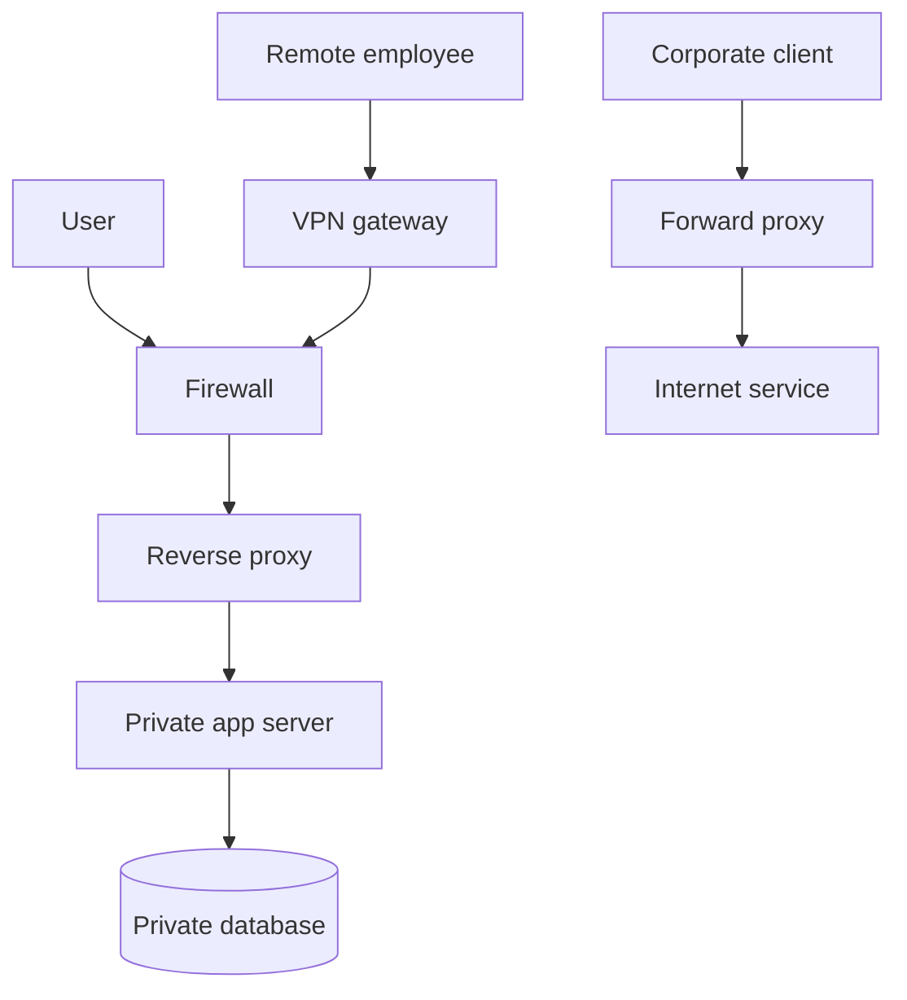

## 1. Hook

An office building has three helpers at the entrance. A security guard
decides who may enter. A private tunnel lets employees reach the office
from home as if they were nearby. A receptionist receives requests and
talks to internal employees on behalf of visitors.

A firewall is the guard. A VPN is the private tunnel. A proxy is the
receptionist.

They all sit near network boundaries, but they solve different
problems. Mixing them up leads to bad security designs and confusing
incident response.

## 2. What Is It

(a) Plain-English one-liner: firewalls filter traffic, VPNs create
encrypted private connectivity, and proxies relay traffic on behalf of
clients or servers.

(b) Formal definition: a firewall is a network security control that
allows or denies traffic based on rules such as IP, port, protocol,
state, identity, or application behavior. A VPN creates an encrypted
tunnel between endpoints or networks, extending private connectivity
over untrusted networks. A proxy terminates and forwards traffic,
acting as an intermediary that can inspect, cache, filter, authenticate,
or hide endpoints (see: MOD-01/01-osi-model-tcp-ip-stack).

## 3. The Problem It Solves

Before these controls, every service is directly reachable by anyone
who can route packets to it. Remote employees use public networks
without secure access. Clients know every internal server address.
Security policy is scattered inside applications.

After these controls, firewalls reduce reachable surface area, VPNs
protect remote connectivity, and proxies centralize traffic handling.
A system can expose one proxy while keeping application servers private.
Remote users can access internal systems through an authenticated
tunnel. Network policy becomes explicit.

They solve boundary control: who can reach what, through which path,
and with what inspection.

## 4. Core Concept Breakdown

- **Firewall rule:** allow or deny decision based on traffic attributes.
- **Stateful firewall:** tracks connection state, not only individual
  packets.
- **Network ACL:** usually stateless subnet-level rule set.
- **VPN tunnel:** encrypted channel carrying private traffic.
- **Site-to-site VPN:** connects two networks.
- **Client VPN:** connects one user device to a private network.
- **Forward proxy:** client-side intermediary for outbound traffic.
- **Reverse proxy:** server-side intermediary in front of applications.
- **TLS termination:** proxy decrypts TLS, inspects or routes, and may
  re-encrypt upstream.
- **Zero trust:** identity and policy per request, not just network
  location.

## 5. How It Works

Step by step, a request through a protected web service:

1. **Client resolves public name.** DNS points to a reverse proxy or
   load balancer.
2. **Firewall allows inbound 443.** Other ports remain closed.
3. **Reverse proxy accepts TLS.** It validates request shape and
   routing.
4. **Proxy applies policy.** Authentication, WAF rules, rate limits, or
   header checks may run.
5. **Proxy forwards to private service.** The backend is not directly
   public.
6. **Internal firewall allows proxy-to-service.** Only known paths are
   allowed.
7. **Service responds through proxy.** Client never sees private IP.
8. **Remote employee uses VPN if needed.** Device gets private network
   route after authentication.
9. **Logs are centralized.** Firewall, VPN, and proxy logs support
   incident response.
10. **Rules are reviewed.** Stale allow rules become security debt.

Design review checks:

- **What is directly internet reachable?**
- **Where is TLS terminated and re-encrypted?**
- **Are firewall rules identity-aware or only network-aware?**
- **Can logs answer who accessed what and when?**

## 6. Diagram



<!-- IMAGE: network boundary diagram showing firewall at perimeter, VPN
gateway for remote users, reverse proxy before app servers, and forward
proxy for outbound corporate traffic -->

## 7. When to Use It

Use firewalls when:

- **You need to reduce reachable surface area.**
- **Subnets or services need explicit allow rules.**
- **Compliance requires network segmentation.**
- **You need coarse traffic control before application code.**

Use VPNs when:

- **Private network access is required over untrusted networks.**
- **Site-to-site connectivity is needed.**
- **Remote users need legacy private resources.**

Use proxies when:

- **You need centralized routing, caching, authentication, or inspection.**
- **Backend services should remain private.**

## 8. When NOT to Use It

- **Do not treat VPN as complete security.** A connected device can
  still be compromised.
- **Do not put broad firewall allow rules everywhere.** `0.0.0.0/0`
  should be rare and reviewed.
- **Do not terminate TLS without understanding privacy obligations.**
- **Do not use a proxy as a magic fix for broken application auth.**

## 9. Real-World Example

**Cloud security groups** act like virtual firewalls around instances,
load balancers, and databases.

**Corporate VPNs** historically provided remote access to internal
networks, while many organizations now move toward zero-trust access
proxies for per-application control.

**Nginx, Envoy, HAProxy, and cloud load balancers** commonly act as
reverse proxies for TLS termination, routing, and observability.

Realistic number: a public web tier may expose only TCP 443 from the
internet, while the database allows TCP 5432 only from application
security groups. That single rule difference prevents direct database
exposure.

## 10. Production-Grade Code

```typescript
import http from "node:http";
const UPSTREAM_HOST = "127.0.0.1";
const UPSTREAM_PORT = 3000;

http.createServer((req, res) => {
  const allowed = req.headers["x-api-key"] === process.env.INTERNAL_API_KEY;
  if (!allowed) {
    res.writeHead(401);
    res.end("unauthorized");
    return;
  }
  // The proxy centralizes a boundary check before traffic reaches the
  // private app. The app should still enforce its own authorization.
  const upstream = http.request(
    {
      host: UPSTREAM_HOST,
      port: UPSTREAM_PORT,
      path: req.url,
      method: req.method,
      headers: {
        ...req.headers,
        "x-forwarded-for": req.socket.remoteAddress ?? "unknown",
      },
    },
    (upstreamRes) => {
      res.writeHead(upstreamRes.statusCode ?? 502, upstreamRes.headers);
      upstreamRes.pipe(res);
    }
  );
  upstream.on("error", () => {
    res.writeHead(502);
    res.end("bad gateway");
  });
  req.pipe(upstream);
}).listen(8080);
```

Why-not-what notes:

- This demonstrates reverse proxy boundary logic, not a full security
  gateway.
- The backend still needs authorization because proxy controls can be
  misconfigured or bypassed internally.
- Production proxies add TLS, structured logs, rate limits, timeouts,
  and upstream health checks.

## 11. Trade-offs Table

| Pros | Cons | What it costs you |
|---|---|---|
| Firewalls reduce exposed attack surface | Rules can sprawl | Review and ownership |
| VPN encrypts private connectivity | Broad network access can be risky | Device posture and MFA |
| Reverse proxies centralize routing | Proxy becomes critical path | Scaling and high availability |
| Forward proxies control outbound traffic | Can break apps if too strict | Exception management |
| TLS termination simplifies backends | Creates plaintext segment | Re-encryption and trust boundaries |

## 12. Comparison Table

| Tool | Direction | Main job | Layer focus | Common risk |
|---|---|---|---|---|
| Firewall | inbound or outbound | allow or deny traffic | L3/L4, sometimes L7 | broad rules |
| VPN | tunnel | private connectivity | L3/L4 | over-trust network location |
| Forward proxy | outbound | represent client | L7 | bypass paths |
| Reverse proxy | inbound | represent server | L7 | misrouting or header trust |
| WAF | inbound web | inspect HTTP attacks | L7 | false positives |

## 13. Numbers & Benchmarks

- **Common web exposure:** TCP 443 only for public HTTPS.
- **Least privilege:** database ports should usually be private, not
  internet reachable.
- **VPN overhead:** encryption and tunneling add CPU and packet overhead.
- **Proxy latency:** a nearby reverse proxy often adds low milliseconds,
  but inspection and TLS can add more.
- **Rule count:** hundreds of unmanaged firewall rules become hard to
  audit safely.

## 14. Common Pitfalls

- **Incident: database public IP exposed.** Firewall allowed world
  access to a database port after a temporary debug rule was forgotten.
- **Incident: VPN treated as trust.** A compromised laptop reached many
  internal systems because network access implied authorization.
- **Incident: proxy trusted spoofed headers.** Backend accepted
  `X-Forwarded-For` from the client instead of only from trusted proxy.

## 15. Interview Q&A

**Q1. Firewall vs proxy?** Model answer: firewall filters traffic;
proxy terminates and forwards traffic as an intermediary.

**Q2. Forward proxy vs reverse proxy?** Model answer: forward proxy
represents clients going out; reverse proxy represents servers to
incoming clients.

**Q3. What does a VPN provide?** Model answer: encrypted private
connectivity over an untrusted network, not automatic application
authorization.

**Q4. What is TLS termination?** Model answer: a proxy or load balancer
decrypts TLS, then forwards traffic upstream.

**Q5. Why use network segmentation?** Model answer: to limit what can
talk to what, reducing blast radius after compromise.

## 16. Follow-up / Curveball Questions

**Curveball 1. Service is behind VPN. Do we still need auth?** Answer
direction: yes. VPN gives network access, not user-level authorization.

**Curveball 2. Reverse proxy adds user headers. Can backend trust them?**
Answer direction: only if traffic can come solely from trusted proxy
paths and spoofed client headers are stripped.

**Curveball 3. Firewall blocks health checks.** Answer direction:
allow health-check source ranges explicitly and monitor rule changes.

## 17. Cheat-Sheet Summary

- Firewalls filter traffic.
- VPNs create encrypted private connectivity.
- Proxies relay traffic and can inspect, route, cache, or authenticate.
- Reverse proxies protect servers; forward proxies represent clients.
- Network controls reduce exposure but do not replace app authorization.

## 18. Further Reading

- Cloudflare Learning Center, "What is a firewall?":
  https://www.cloudflare.com/learning/security/what-is-a-firewall/
- Cloudflare Learning Center, "What is a VPN?":
  https://www.cloudflare.com/learning/access-management/what-is-a-vpn/
- Nginx reverse proxy documentation:
  https://docs.nginx.com/nginx/admin-guide/web-server/reverse-proxy/

---

## COMPLETENESS CHECK

Section checklist (18):

1. Hook - Covered (building guard, tunnel, receptionist analogy)
2. What Is It - Covered (plain-English and formal definitions)
3. The Problem It Solves - Covered (open network before, boundary controls after)
4. Core Concept Breakdown - Covered (10 concepts)
5. How It Works - Covered (10 steps plus design checks)
6. Diagram - Covered (flowchart)
7. When to Use It - Covered (firewall, VPN, proxy triggers)
8. When NOT to Use It - Covered (4 warnings)
9. Real-World Example - Covered (security groups, VPN, reverse proxies)
10. Production-Grade Code - Covered (TypeScript reverse proxy sketch)
11. Trade-offs Table - Covered (5 rows)
12. Comparison Table - Covered (5 tools)
13. Numbers & Benchmarks - Covered (5 figures)
14. Common Pitfalls - Covered (3 incident notes)
15. Interview Q&A - Covered (5 Q&As)
16. Follow-up / Curveball Questions - Covered (3 curveballs)
17. Cheat-Sheet Summary - Covered (5 lines)
18. Further Reading - Covered (3 URL-backed sources)

No em-dashes. No emojis. Cross-links included.
