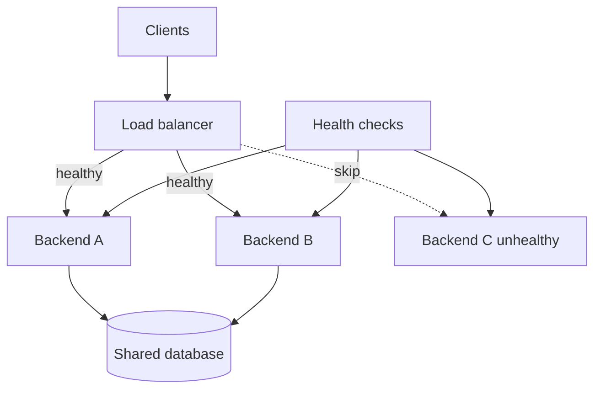

## 1. Hook

A popular cafe has one cashier and a long line. The cafe adds three
cashiers and one host at the entrance. The host sends customers to
available cashiers, avoids a cashier whose register is broken, and
keeps the line moving.

Load balancing is that host for servers. It spreads traffic across
healthy backends so one server does not become the whole system's
bottleneck.

Good load balancing is not just round robin. It is health checks,
timeouts, algorithms, connection behavior, and failure handling.

## 2. What Is It

(a) Plain-English one-liner: load balancing distributes client traffic
across multiple healthy servers to improve availability, scalability,
and latency.

(b) Formal definition: a load balancer is a network or application
component that accepts client traffic and forwards it to one of many
backend instances based on algorithms, health checks, routing policy,
connection state, and sometimes request content. Load balancers operate
at Layer 4 using transport information or Layer 7 using application
information such as HTTP headers and paths (see:
MOD-01/09-firewalls-vpns-proxies).

## 3. The Problem It Solves

Before load balancing, one server handles all traffic. Scaling means
buying a bigger box. Maintenance means downtime. A crash means users
cannot reach the service.

After load balancing, clients hit a stable endpoint while traffic is
spread across many backends. Failed backends are removed from rotation.
New instances can be added during scale-out. Deployments can drain one
backend at a time.

Load balancing solves traffic distribution and failure masking at the
service entry point.

## 4. Core Concept Breakdown

- **Frontend listener:** address and port clients connect to.
- **Backend pool:** servers eligible to receive traffic.
- **Health check:** probe that decides whether a backend is usable.
- **Round robin:** rotates requests across backends.
- **Least connections:** sends to backend with fewest active
  connections.
- **Weighted routing:** sends more traffic to stronger or preferred
  backends.
- **Session affinity:** keeps a client routed to the same backend.
- **Layer 4 load balancing:** routes by IP, port, and connection.
- **Layer 7 load balancing:** routes by HTTP method, path, host, or
  headers.
- **Connection draining:** stops new traffic while existing requests
  finish.

## 5. How It Works

Step by step, handling an HTTP request:

1. **Client connects to load balancer.** DNS points to the balancer.
2. **Balancer accepts connection.** It may terminate TLS.
3. **Health state is checked.** Unhealthy backends are skipped.
4. **Algorithm chooses backend.** Round robin, least connections, hash,
   or weighted policy.
5. **Request is forwarded.** Layer 7 balancer can add headers such as
   `X-Forwarded-For`.
6. **Backend responds.** Response flows back through balancer.
7. **Metrics are recorded.** Latency, errors, active connections, and
   backend health are tracked.
8. **Unhealthy backend is removed.** Failed health checks stop routing.
9. **Backend can drain.** During deploy, existing requests finish while
   new ones go elsewhere.
10. **Autoscaling changes pool.** New instances join after passing
    health checks.

Design review checks:

- **Layer 4 or Layer 7?** Need request-aware routing or raw transport?
- **What does health mean?** Process alive is weaker than dependency-
  aware readiness.
- **Do you need sticky sessions?** If yes, ask why state is not shared.
- **What happens when all backends are unhealthy?**

## 6. Diagram



<!-- IMAGE: load balancer distributing traffic to two healthy backends,
skipping one unhealthy backend, with health-check arrows -->

## 7. When to Use It

Use load balancing when:

- **More than one backend serves the same function.**
- **You need high availability.** One backend can fail without full
  outage.
- **You need horizontal scale.** Add instances behind one endpoint.
- **You need controlled deploys.** Drain and replace instances safely.

## 8. When NOT to Use It

- **Do not load balance stateful servers without session strategy.**
- **Do not route to backends that only pass shallow health checks.**
- **Do not assume load balancer fixes slow code.** It spreads load; it
  does not reduce per-request work.
- **Do not hide overload until every backend fails.** Use rate limiting
  and autoscaling signals.

## 9. Real-World Example

**AWS Elastic Load Balancing**, **Google Cloud Load Balancing**, and
**Cloudflare Load Balancing** provide managed load balancers with health
checks, TLS termination, and global routing options.

**Nginx, HAProxy, and Envoy** are common software load balancers and
reverse proxies.

Realistic number: a service with 10 backends can tolerate one backend
failure if the load balancer removes it quickly, but remaining backends
must each absorb about 11 percent more traffic. Capacity planning must
include failure headroom.

## 10. Production-Grade Code

```typescript
import http from "node:http";

const backends = [
  "http://127.0.0.1:3001",
  "http://127.0.0.1:3002",
  "http://127.0.0.1:3003",
];

let next = 0;

function chooseBackend(): string {
  const backend = backends[next % backends.length];
  next++;
  return backend;
}

http.createServer((req, res) => {
  const target = new URL(req.url ?? "/", chooseBackend());
  const upstream = http.request(target, { method: req.method, headers: req.headers }, (up) => {
    res.writeHead(up.statusCode ?? 502, up.headers);
    up.pipe(res);
  });
  upstream.on("error", () => {
    // Production load balancers pair retries with budgets and health
    // checks. Blind retries can duplicate non-idempotent requests.
    res.writeHead(502);
    res.end("bad gateway");
  });
  req.pipe(upstream);
}).listen(8080);
```

Why-not-what notes:

- This is a minimal round-robin proxy to show routing mechanics, not a
  replacement for Nginx, HAProxy, Envoy, or managed load balancers.
- Production balancers need health checks, timeouts, retries, TLS,
  draining, and observability.
- Retry behavior must respect idempotency.

## 11. Trade-offs Table

| Pros | Cons | What it costs you |
|---|---|---|
| Improves availability | Load balancer becomes critical component | Redundancy and monitoring |
| Enables horizontal scaling | Bad health checks route to broken nodes | Readiness design |
| Supports rolling deploys | Draining adds deployment complexity | Lifecycle hooks |
| Can terminate TLS centrally | Plaintext upstream risk | Re-encryption policy |
| L7 routing is powerful | More CPU and configuration complexity | Proxy tuning |

## 12. Comparison Table

| Type | Uses | Best fit | Strength | Caveat |
|---|---|---|---|---|
| DNS load balancing | DNS answers | coarse global routing | simple | cache delay |
| Layer 4 load balancer | IP and port | high-throughput TCP/UDP | fast | no HTTP awareness |
| Layer 7 load balancer | HTTP content | APIs and web apps | smart routing | more overhead |
| Client-side balancing | client picks backend | service mesh or RPC | avoids central hop | client complexity |
| Global load balancing | geography and health | multi-region apps | regional failover | consistency and DNS/cache behavior |

## 13. Numbers & Benchmarks

- **Health interval:** 5 to 30 seconds is common, depending on failure
  sensitivity.
- **Failure threshold:** 2 to 3 failed checks before removal is common.
- **Capacity headroom:** N+1 planning means remaining servers survive
  one backend loss.
- **L4 vs L7:** L4 is usually faster; L7 gives request-aware routing.
- **Connection draining:** often 30 to 300 seconds depending on request
  duration.

## 14. Common Pitfalls

- **Incident: shallow health check.** `/health` returned 200 while the
  database dependency was down, so traffic kept routing to broken pods.
- **Incident: sticky sessions blocked scaling.** User sessions lived in
  memory, so adding backends did not help evenly.
- **Incident: retry amplified writes.** Load balancer retried POST
  requests and duplicated order creation.

## 15. Interview Q&A

**Q1. What does a load balancer do?** Model answer: accepts traffic and
distributes it across healthy backend instances.

**Q2. L4 vs L7 load balancing?** Model answer: L4 routes using
transport info like IP and port; L7 routes using application data like
HTTP host, path, and headers.

**Q3. What is a health check?** Model answer: a probe used to decide if
a backend should receive traffic.

**Q4. What is connection draining?** Model answer: stop sending new
requests to a backend while allowing existing requests to finish.

**Q5. Why avoid sticky sessions?** Model answer: they make scaling and
failover harder unless state is externalized or affinity is truly
needed.

## 16. Follow-up / Curveball Questions

**Curveball 1. All backends are unhealthy.** Answer direction: fail
closed with clear 503, shed load, alert, and avoid routing to known bad
instances unless explicitly configured.

**Curveball 2. One backend is much stronger.** Answer direction: use
weighted routing or autoscale pool sizes.

**Curveball 3. Need canary deploy.** Answer direction: use weighted L7
routing, header-based routing, or separate target groups with metrics
and rollback.

## 17. Cheat-Sheet Summary

- Load balancers distribute traffic across healthy backends.
- Health checks and draining are as important as the routing algorithm.
- L4 is transport-aware; L7 is application-aware.
- Sticky sessions are a trade-off, not a default.
- Load balancing improves availability only if capacity and health
  checks are designed well.

## 18. Further Reading

- HAProxy documentation, load balancing algorithms:
  https://www.haproxy.com/documentation/haproxy-configuration-tutorials/core-concepts/load-balancing/
- Nginx HTTP load balancing documentation:
  https://docs.nginx.com/nginx/admin-guide/load-balancer/http-load-balancer/
- AWS Elastic Load Balancing user guide:
  https://docs.aws.amazon.com/elasticloadbalancing/latest/userguide/what-is-load-balancing.html

---

## COMPLETENESS CHECK

Section checklist (18):

1. Hook - Covered (cafe host analogy)
2. What Is It - Covered (plain-English and formal definitions)
3. The Problem It Solves - Covered (single server before, balanced pool after)
4. Core Concept Breakdown - Covered (10 concepts)
5. How It Works - Covered (10 steps plus design checks)
6. Diagram - Covered (flowchart)
7. When to Use It - Covered (4 triggers)
8. When NOT to Use It - Covered (4 warnings)
9. Real-World Example - Covered (cloud LBs, Nginx/HAProxy/Envoy, headroom number)
10. Production-Grade Code - Covered (TypeScript round-robin proxy)
11. Trade-offs Table - Covered (5 rows)
12. Comparison Table - Covered (5 types)
13. Numbers & Benchmarks - Covered (5 figures)
14. Common Pitfalls - Covered (3 incident notes)
15. Interview Q&A - Covered (5 Q&As)
16. Follow-up / Curveball Questions - Covered (3 curveballs)
17. Cheat-Sheet Summary - Covered (5 lines)
18. Further Reading - Covered (3 URL-backed sources)

No em-dashes. No emojis. Cross-links included.
