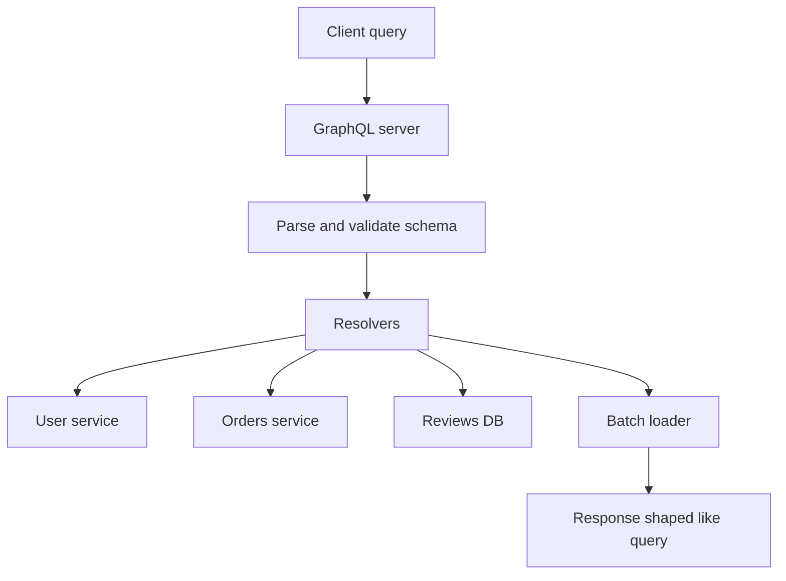

## 1. Hook

At a buffet, you choose exactly what goes on your plate. You do not
take a fixed lunch box with food you dislike, then walk back for the
items missing from it. That flexibility is pleasant, but the kitchen
must still control cost. If every guest can ask for every ingredient in
the building, the buffet collapses.

GraphQL is the buffet for API reads. Clients ask for the exact fields
they need. The server answers from a typed graph.

The power is flexibility. The danger is letting clients ask questions
that are too expensive.

## 2. What Is It

(a) Plain-English one-liner: GraphQL is an API query language where
clients request exactly the fields they need from a typed graph.

(b) Formal definition: GraphQL is a specification for a type system,
query language, execution semantics, and introspection model for APIs.
Clients send queries, mutations, or subscriptions against a schema.
Resolvers fetch field data from backing services or databases. GraphQL
is transport-agnostic but commonly served over HTTP (see:
MOD-02/01-rest-api-design-principles).

## 3. The Problem It Solves

Before GraphQL, one mobile screen might call `/user`, `/orders`,
`/recommendations`, and `/reviews`, then throw away half the fields.
REST endpoints either overfetch with broad responses or underfetch with
many round trips.

After GraphQL, the client sends one query describing the shape it needs.
The server resolves fields and returns the same shape. Mobile, web, and
admin clients can ask for different fields without creating one custom
endpoint per screen.

GraphQL solves client-shaped reads. It does not remove backend
complexity; it moves composition into the GraphQL layer.

## 4. Core Concept Breakdown

- **Schema:** typed contract defining objects, fields, queries, and
  mutations.
- **Query:** read operation selecting fields.
- **Mutation:** write operation with explicit side effects.
- **Resolver:** function that returns data for a field.
- **Type:** object, scalar, enum, interface, union, or input type.
- **Selection set:** fields requested by the client.
- **Introspection:** ability to ask the schema about itself.
- **N+1 problem:** field resolvers trigger one query per parent item.
- **DataLoader/batching:** groups repeated loads into one backend call.
- **Query complexity:** estimated cost of a query.

## 5. How It Works

Step by step, serving a product page:

1. **Schema defines Product.** Fields include id, title, price, and
   reviews.
2. **Client sends query.** It asks only for fields used by the screen.
3. **Server parses and validates.** Unknown fields fail before
   execution.
4. **Root resolver runs.** `product(id)` loads base product data.
5. **Field resolvers run.** Price, images, reviews, and seller data may
   come from different systems.
6. **Batching prevents N+1.** Many product IDs become one catalog call.
7. **Authorization applies per field or object.** Sensitive fields need
   policy checks.
8. **Complexity limits protect server.** Depth, cost, and timeout are
   bounded.
9. **Response mirrors query shape.** Clients get predictable JSON.
10. **Schema evolves compatibly.** Add fields; deprecate before
    removing.

Design review checks:

- **What is the query cost limit?**
- **How are N+1 resolver calls batched?**
- **Which fields need authorization?**
- **Is GraphQL for public clients, internal BFFs, or both?**

## 6. Diagram



<!-- IMAGE: GraphQL query on the left and matching JSON response on the
right, with resolver arrows to user, orders, and reviews services -->

## 7. When to Use It

Use GraphQL when:

- **Clients need different read shapes.** Mobile and web screens vary.
- **REST causes underfetching or overfetching.**
- **A typed graph improves frontend velocity.**
- **A BFF or gateway can own resolver performance and security.**

## 8. When NOT to Use It

- **Do not use GraphQL to hide a bad domain model.**
- **Do not expose unbounded query depth.** It becomes a denial-of-
  service vector.
- **Do not ignore caching.** HTTP caching is less straightforward than
  REST resource caching.
- **Do not put all writes into vague mutations.** Mutations still need
  clear business semantics.

## 9. Real-World Example

**GitHub's GraphQL API** lets clients ask for nested repository, issue,
pull request, and user data in one typed query.

**Shopify's Admin API** uses GraphQL heavily because commerce admin
screens need flexible resource graphs.

Realistic number: a naive GraphQL query over 50 orders that resolves
customer with one backend call per order creates 51 calls. With
batching, it can be 2 calls: one for orders and one batched customer
lookup.

## 10. Production-Grade Code

```typescript
type Product = { id: string; title: string; sellerId: string };
type Seller = { id: string; name: string };

type Loaders = {
  productById(id: string): Promise<Product | null>;
  sellersById(ids: string[]): Promise<Map<string, Seller>>;
};

export async function resolveProductCard(
  id: string,
  loaders: Loaders
): Promise<{ id: string; title: string; sellerName: string } | null> {
  const product = await loaders.productById(id);
  if (!product) return null;
  const sellers = await loaders.sellersById([product.sellerId]);
  const seller = sellers.get(product.sellerId);

  // Resolver code should batch backend access by ID so a flexible query
  // does not become an accidental N+1 production incident.
  return {
    id: product.id,
    title: product.title,
    sellerName: seller?.name ?? "unknown",
  };
}
```

Why-not-what notes:

- The resolver returns a client-shaped object while preserving backend
  ownership.
- The loader interface is batch-friendly even when resolving one item.
- Production GraphQL servers add auth, query limits, tracing, and
  persisted queries.

## 11. Trade-offs Table

| Pros | Cons | What it costs you |
|---|---|---|
| Clients request exact fields | Query cost can explode | Depth and complexity limits |
| Strong schema and introspection | Resolver layer can hide N+1 calls | Batching and tracing |
| Reduces endpoint sprawl | HTTP caching is harder | Persisted queries and CDN strategy |
| Great for varied client views | Authorization can be field-level complex | Policy design |
| Evolves by adding fields | Breaking changes still need discipline | Deprecation process |

## 12. Comparison Table

| Approach | Client flexibility | Caching | Typing | Best fit | Caveat |
|---|---|---|---|---|---|
| REST | medium | strong HTTP caching | optional | resource APIs | over/underfetching |
| GraphQL | high | custom strategy | strong schema | varied read views | query complexity |
| gRPC | low to medium | not HTTP cache friendly | strong IDL | internal RPC | browser friction |
| BFF endpoints | medium | endpoint-specific | optional | screen APIs | endpoint sprawl |

## 13. Numbers and Benchmarks

- **N+1 shape:** 1 list query plus N child resolver calls is the classic
  GraphQL performance bug.
- **Depth limit:** many public APIs cap query depth or node count.
- **Persisted queries:** reduce parsing cost and prevent arbitrary query
  text from unknown clients.
- **Schema growth:** adding fields is usually safe; removing fields
  requires deprecation windows.
- **Latency:** one GraphQL request can still be slow if resolvers call
  services sequentially.

## 14. Common Pitfalls

- **Incident: unbounded nested query.** A client requested friends of
  friends of friends and overloaded the graph.
- **Incident: resolver N+1.** Product list page made thousands of
  backend calls after a harmless-looking field was added.
- **Incident: missing field auth.** Admin-only field appeared in a
  public query because object-level auth was not enough.

## 15. Interview Q&A

**Q1. What problem does GraphQL solve?** Model answer: clients can
request exactly the data shape they need from a typed graph, reducing
overfetching and underfetching.

**Q2. What is a resolver?** Model answer: a function that returns data
for a schema field.

**Q3. What is the N+1 problem?** Model answer: resolving each child
field with a separate backend call, causing calls to grow with list
size.

**Q4. How do you protect GraphQL APIs?** Model answer: auth, depth
limits, query cost limits, persisted queries, timeouts, and resolver
tracing.

**Q5. GraphQL vs REST?** Model answer: REST is resource-centric and
cache-friendly; GraphQL is query-shape-centric and flexible.

## 16. Follow-up / Curveball Questions

**Curveball 1. A GraphQL query is slow but each resolver is fast.**
Answer direction: inspect resolver count, sequential execution,
batching, and downstream fan-out.

**Curveball 2. Need CDN caching.** Answer direction: use persisted
queries, cache normalized objects, or keep cache-heavy resources in
REST.

**Curveball 3. Client asks for fields user cannot see.** Answer
direction: enforce field or object authorization in resolvers, not only
at gateway level.

## 17. Cheat-Sheet Summary

- GraphQL lets clients ask for exact fields from a typed schema.
- Resolvers map graph fields to backend data.
- It reduces overfetching but can create N+1 and cost issues.
- Protect GraphQL with auth, limits, batching, and tracing.
- Use it for flexible reads, not as a cure for poor boundaries.

## 18. Further Reading

- GraphQL specification:
  https://spec.graphql.org/
- GraphQL official learn docs:
  https://graphql.org/learn/
- GitHub GraphQL API documentation:
  https://docs.github.com/en/graphql

---

## COMPLETENESS CHECK

Section checklist (18):

1. Hook - Covered (buffet analogy)
2. What Is It - Covered (plain-English and formal definitions)
3. The Problem It Solves - Covered (overfetch/underfetch before, shaped query after)
4. Core Concept Breakdown - Covered (10 concepts)
5. How It Works - Covered (10 steps plus design checks)
6. Diagram - Covered (flowchart)
7. When to Use It - Covered (4 triggers)
8. When NOT to Use It - Covered (4 warnings)
9. Real-World Example - Covered (GitHub, Shopify, N+1 number)
10. Production-Grade Code - Covered (TypeScript resolver and batch-friendly loader)
11. Trade-offs Table - Covered (5 rows)
12. Comparison Table - Covered (4 approaches)
13. Numbers and Benchmarks - Covered (5 figures)
14. Common Pitfalls - Covered (3 incident notes)
15. Interview Q&A - Covered (5 Q&As)
16. Follow-up / Curveball Questions - Covered (3 curveballs)
17. Cheat-Sheet Summary - Covered (5 lines)
18. Further Reading - Covered (3 URL-backed sources)

No em-dashes. No emojis. Cross-links included.
