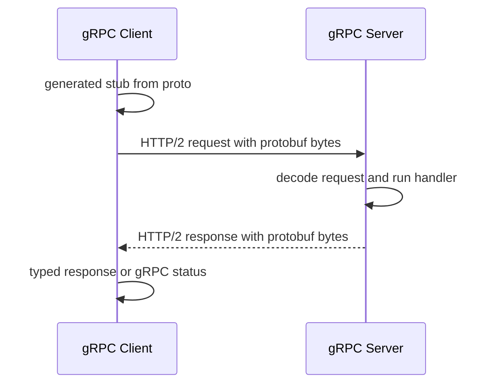

## 1. Hook

Two teams can communicate by mailing essays to each other, or by using
a shared form with exact boxes: name, amount, date, status. The form is
less flexible, but it is fast, compact, and hard to misunderstand.

gRPC and Protocol Buffers are that shared form for service-to-service
communication. You define messages and methods in a schema. Code is
generated. Calls are typed.

The result feels less like "send JSON to a URL" and more like "call a
method on another service," even though the network is still involved.

## 2. What Is It

(a) Plain-English one-liner: gRPC is a high-performance RPC framework,
and Protocol Buffers define the typed messages and service contracts it
usually uses.

(b) Formal definition: gRPC is an open-source remote procedure call
framework using HTTP/2 for transport, Protocol Buffers by default for
interface definition and binary serialization, and generated client and
server code across languages. It supports unary calls, server
streaming, client streaming, bidirectional streaming, deadlines,
cancellation, metadata, and authentication. Protocol Buffers are a
schema-based binary serialization format with forward and backward
compatibility rules (see: MOD-02/01-rest-api-design-principles).

## 3. The Problem It Solves

Before gRPC, internal services often used hand-written JSON APIs with
weak contracts. Field names drifted. Clients found errors at runtime.
Large payloads consumed bandwidth. Streaming required custom protocols.

After gRPC, a `.proto` file defines service methods and messages.
Clients and servers generate code from the same contract. Binary
encoding is compact. HTTP/2 gives multiplexing and streaming. Deadlines
and cancellations are part of call behavior.

gRPC solves typed internal RPC. It is especially strong when many
services in different languages need stable contracts.

## 4. Core Concept Breakdown

- **RPC:** remote procedure call, a method call across process or
  network boundary.
- **Proto file:** schema defining messages and services.
- **Message:** typed data structure with numbered fields.
- **Service:** collection of RPC methods.
- **Unary call:** one request, one response.
- **Streaming:** server, client, or bidirectional streams.
- **Deadline:** caller's time limit propagated to server.
- **Metadata:** key-value headers around calls.
- **Backward compatibility:** field numbers and optional fields let
  schemas evolve safely.
- **Interceptor:** middleware for auth, logging, tracing, or retries.

## 5. How It Works

Step by step, building a user service:

1. **Write `.proto` contract.** Define `GetUserRequest`, `User`, and
   `UserService`.
2. **Generate code.** Protobuf compiler creates typed clients and
   server interfaces.
3. **Server implements methods.** Business logic fills the generated
   interface.
4. **Client creates stub.** The stub looks like a local method but
   performs network I/O.
5. **Request is serialized.** Protobuf encodes fields by number and
   wire type.
6. **gRPC sends over HTTP/2.** Streams, headers, and flow control are
   handled by the framework.
7. **Server deserializes.** Generated code restores typed request.
8. **Deadline may cancel work.** Server should stop if caller deadline
   expires.
9. **Response is serialized.** Client receives typed response or status.
10. **Schema evolves carefully.** Never reuse field numbers; add fields
    compatibly.

Design review checks:

- **Is this internal RPC or public browser API?**
- **Are deadlines and retries defined?**
- **Will clients tolerate schema evolution?**
- **Is streaming truly needed or just fashionable?**

## 6. Diagram



<!-- IMAGE: proto file generating typed client and server code, with
protobuf binary messages flowing over HTTP/2 between services -->

## 7. When to Use It

Use gRPC when:

- **Internal services need typed contracts.**
- **Low-latency binary RPC matters.**
- **Streaming calls are useful.**
- **Multiple languages need generated clients and servers.**
- **Deadlines, cancellation, and metadata should be standard.**

## 8. When NOT to Use It

- **Do not use gRPC for simple public browser APIs without a plan.**
  Browser support needs gRPC-Web or a gateway.
- **Do not use it when human inspectability is more important than
  compactness.**
- **Do not break protobuf compatibility by reusing field numbers.**
- **Do not ignore deadlines.** RPC without deadlines fails badly under
  partial outages.

## 9. Real-World Example

**Google** created Protocol Buffers and gRPC-like RPC patterns for
large-scale internal service communication.

**Kubernetes** components use gRPC in places such as Container Runtime
Interface communication between kubelet and runtimes.

**Envoy xDS APIs** use gRPC/protobuf for dynamic configuration streams.

Realistic number: protobuf payloads are often significantly smaller
than equivalent JSON for structured data, especially when field names
repeat heavily. The exact gain depends on data shape.

## 10. Production-Grade Code

```go
package main

import (
	"context"
	"errors"
	"time"
)

type GetUserRequest struct {
	Id string
}

type User struct {
	Id    string
	Email string
}

type UserStore interface {
	Find(ctx context.Context, id string) (User, error)
}

type UserServer struct {
	Store UserStore
}

func (s UserServer) GetUser(ctx context.Context, req GetUserRequest) (User, error) {
	if req.Id == "" {
		return User{}, errors.New("missing user id")
	}
	ctx, cancel := context.WithTimeout(ctx, 200*time.Millisecond)
	defer cancel()
	// Deadlines are part of production RPC correctness. Without them,
	// callers can wait until thread pools and queues are exhausted.
	return s.Store.Find(ctx, req.Id)
}
```

Why-not-what notes:

- This mirrors generated gRPC handler shape without requiring generated
  files in the lesson.
- Context carries deadline and cancellation, which should propagate to
  downstream calls.
- Real gRPC servers return structured status codes rather than plain
  errors.

## 11. Trade-offs Table

| Pros | Cons | What it costs you |
|---|---|---|
| Strong typed contracts | Less human-readable than JSON | Tooling and generated code |
| Compact binary payloads | Browser usage needs extra layer | gRPC-Web or gateway |
| Built-in streaming | Operational debugging can be harder | Tracing and reflection |
| Deadlines and cancellation are standard | Schema compatibility rules matter | Protobuf discipline |
| Multi-language code generation | More ceremony than simple REST | Build pipeline integration |

## 12. Comparison Table

| Approach | Contract | Transport | Best fit | Caveat |
|---|---|---|---|---|
| REST JSON | resource docs or OpenAPI | HTTP | public APIs | weak runtime typing |
| GraphQL | schema graph | usually HTTP | flexible reads | query cost |
| gRPC | protobuf IDL | HTTP/2 | internal RPC | browser friction |
| Message queue | event schema | broker | async workflows | eventual consistency |

## 13. Numbers and Benchmarks

- **HTTP/2:** gRPC uses multiplexed streams over one connection.
- **Field numbers:** protobuf wire format uses numbers, not names.
- **Deadlines:** production RPCs commonly use tens to hundreds of
  milliseconds internally.
- **Streaming:** server, client, and bidirectional streaming are built
  into gRPC.
- **Compatibility:** never reuse or change meaning of protobuf field
  numbers.

## 14. Common Pitfalls

- **Incident: no deadline.** A stuck downstream service caused every
  gRPC caller to wait and exhaust workers.
- **Incident: reused field number.** Old clients decoded a new field as
  a different old meaning.
- **Incident: streaming without flow control.** A fast producer
  overwhelmed a slow client.

## 15. Interview Q&A

**Q1. What is gRPC good for?** Model answer: typed, efficient internal
RPC with code generation, deadlines, and streaming.

**Q2. What is protobuf?** Model answer: schema and binary wire format
using numbered fields for compact compatible serialization.

**Q3. Why field numbers matter?** Model answer: they are the wire
identity. Reusing them breaks old clients.

**Q4. gRPC vs REST?** Model answer: gRPC is method and schema oriented,
great for internal RPC; REST is resource and HTTP oriented, great for
public compatibility.

**Q5. What is a deadline?** Model answer: caller time budget propagated
through RPC so work can be cancelled when no longer useful.

## 16. Follow-up / Curveball Questions

**Curveball 1. Need browser clients.** Answer direction: use gRPC-Web,
a JSON gateway, or REST/GraphQL for browser-facing APIs.

**Curveball 2. Need to add a field.** Answer direction: add a new
optional field number; do not rename semantics or reuse removed fields.

**Curveball 3. Need long-lived bidirectional stream.** Answer direction:
manage flow control, keepalive, authentication renewal, and backpressure.

## 17. Cheat-Sheet Summary

- gRPC is typed RPC, usually over HTTP/2 with protobuf.
- Protobuf schemas generate client and server code.
- Deadlines and cancellation are core production features.
- Use gRPC for internal service calls and streaming.
- Respect protobuf compatibility rules forever.

## 18. Further Reading

- gRPC official introduction:
  https://grpc.io/docs/what-is-grpc/introduction/
- Protocol Buffers overview:
  https://protobuf.dev/overview/
- gRPC core concepts:
  https://grpc.io/docs/what-is-grpc/core-concepts/

---

## COMPLETENESS CHECK

Section checklist (18):

1. Hook - Covered (shared form analogy)
2. What Is It - Covered (plain-English and formal definitions)
3. The Problem It Solves - Covered (weak JSON contracts before, typed RPC after)
4. Core Concept Breakdown - Covered (10 concepts)
5. How It Works - Covered (10 steps plus design checks)
6. Diagram - Covered (sequenceDiagram)
7. When to Use It - Covered (5 triggers)
8. When NOT to Use It - Covered (4 warnings)
9. Real-World Example - Covered (Google, Kubernetes CRI, Envoy xDS)
10. Production-Grade Code - Covered (Go RPC handler shape)
11. Trade-offs Table - Covered (5 rows)
12. Comparison Table - Covered (4 approaches)
13. Numbers and Benchmarks - Covered (5 figures)
14. Common Pitfalls - Covered (3 incident notes)
15. Interview Q&A - Covered (5 Q&As)
16. Follow-up / Curveball Questions - Covered (3 curveballs)
17. Cheat-Sheet Summary - Covered (5 lines)
18. Further Reading - Covered (3 URL-backed sources)

No em-dashes. No emojis. Cross-links included.
