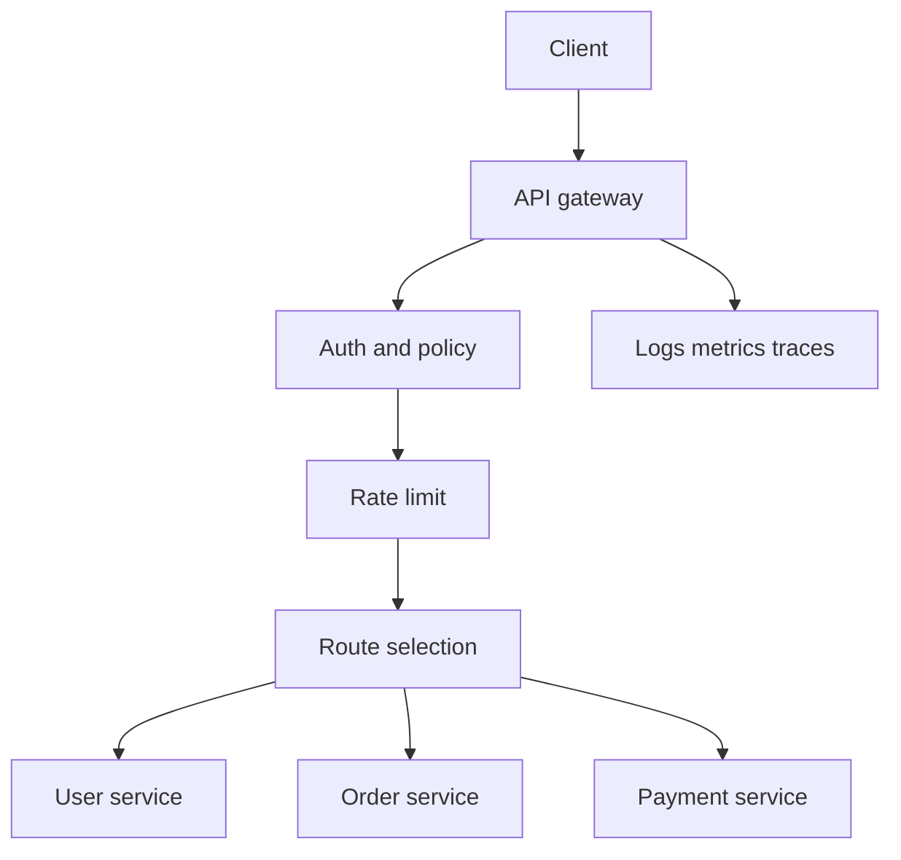

## 1. Hook

A large office does not let visitors wander into every room. The front
desk checks identity, points people to the right floor, records visits,
blocks suspicious behavior, and sometimes answers simple questions
without bothering employees.

An API gateway is that front desk for services. Clients see one entry
point. Behind it, many services can exist.

The gateway is useful because boundaries need shared policy. It is
dangerous when it becomes a place where all business logic goes to
hide.

## 2. What Is It

(a) Plain-English one-liner: an API gateway is a front-door service that
routes API traffic to backend services and applies shared policies like
auth, rate limiting, logging, and transformation.

(b) Formal definition: an API gateway is an application-layer
intermediary that receives client API requests, enforces cross-cutting
policies, routes requests to upstream services, and returns responses.
It may handle TLS termination, authentication, authorization hooks,
rate limiting, request validation, response transformation, protocol
translation, observability, and canary routing. It builds on reverse
proxy and load balancing fundamentals (see:
MOD-01/10-load-balancing-fundamentals).

## 3. The Problem It Solves

Before a gateway, every service exposes its own public endpoint and
reimplements auth, rate limiting, CORS, logging, and request shaping.
Clients learn internal service topology. Security policy drifts.

After a gateway, clients call one stable edge. The gateway validates
tokens, applies limits, routes `/users` to identity and `/orders` to
ordering, and emits consistent access logs. Backend services stay
private and focus on domain logic.

The gateway solves edge policy consolidation. It should not become the
system's domain brain.

## 4. Core Concept Breakdown

- **Route:** rule mapping request host, path, method, or header to an
  upstream.
- **Upstream:** backend service receiving forwarded traffic.
- **Authentication:** verifying caller identity.
- **Authorization hook:** checking whether identity may access route.
- **Rate limit:** controlling request volume per key.
- **TLS termination:** decrypting HTTPS at the gateway.
- **Request validation:** rejecting malformed requests early.
- **Transformation:** adapting headers or payloads.
- **Observability:** access logs, metrics, traces, and request IDs.
- **Policy drift:** inconsistent edge behavior across services.

## 5. How It Works

Step by step, request through a gateway:

1. **Client calls public API host.** DNS points to gateway.
2. **Gateway terminates TLS.** It may re-encrypt to upstream.
3. **Gateway authenticates.** It validates session, API key, or JWT.
4. **Gateway authorizes route.** It checks coarse policy.
5. **Gateway applies rate limits.** Abusive callers are rejected early.
6. **Gateway validates request shape.** Bad requests fail before
   backend work.
7. **Gateway chooses upstream.** Route and canary rules select service.
8. **Request is forwarded.** Correlation headers are added.
9. **Response is observed and returned.** Metrics and logs include
   status, latency, and upstream.
10. **Backend still enforces domain auth.** Gateway checks are not a
    substitute for service-owned authorization.

Design review checks:

- **Which policies belong at edge vs service?**
- **Can the gateway fail independently?**
- **Are request IDs propagated?**
- **Is business logic leaking into gateway config?**

## 6. Diagram



<!-- IMAGE: API gateway as single public entry point applying auth,
rate limit, routing, and observability before private services -->

## 7. When to Use It

Use an API gateway when:

- **Many services need one public entry point.**
- **Cross-cutting edge policy should be consistent.**
- **Clients should not know internal topology.**
- **Canary, routing, or protocol translation is needed.**
- **Central observability at the edge is valuable.**

## 8. When NOT to Use It

- **Do not put core business rules in the gateway.**
- **Do not make it a single undeployable bottleneck.**
- **Do not trust gateway auth as the only authorization layer.**
- **Do not transform every payload casually.** Hidden contracts become
  hard to debug.

## 9. Real-World Example

**Kong, Apigee, AWS API Gateway, NGINX, Envoy, and Cloudflare** are
common gateway or gateway-like products.

**Microservice platforms** often use gateways for public traffic and
service meshes for east-west internal traffic.

Realistic number: a gateway handling 50 public APIs can remove repeated
auth, CORS, rate-limit, and logging code from every service, but it
also becomes a critical path that needs high availability.

## 10. Production-Grade Code

```typescript
import http from "node:http";

const upstreams: Record<string, { host: string; port: number }> = {
  "/users": { host: "127.0.0.1", port: 3001 },
  "/orders": { host: "127.0.0.1", port: 3002 },
};

function matchRoute(path: string) {
  return Object.entries(upstreams).find(([prefix]) => path.startsWith(prefix))?.[1];
}

http.createServer((req, res) => {
  const apiKey = req.headers["x-api-key"];
  if (apiKey !== process.env.API_KEY) {
    res.writeHead(401).end("unauthorized");
    return;
  }

  const upstream = matchRoute(req.url ?? "/");
  if (!upstream) {
    res.writeHead(404).end("route not found");
    return;
  }

  // The gateway owns coarse edge checks and routing. Backend services
  // still own domain authorization and business invariants.
  const out = http.request({ ...upstream, path: req.url, method: req.method, headers: req.headers }, (up) => {
    res.writeHead(up.statusCode ?? 502, up.headers);
    up.pipe(res);
  });
  out.on("error", () => res.writeHead(502).end("bad gateway"));
  req.pipe(out);
}).listen(8080);
```

Why-not-what notes:

- The example shows routing and coarse auth with built-in Node modules.
- Production gateways add timeouts, retries, structured logging, TLS,
  rate limits, and health checks.
- Backend authorization is still required because internal callers may
  bypass the gateway.

## 11. Trade-offs Table

| Pros | Cons | What it costs you |
|---|---|---|
| Centralizes edge policy | Critical-path dependency | HA deployment |
| Hides service topology | Can become business-logic dumping ground | Governance |
| Simplifies clients | Adds hop and latency | Performance tuning |
| Improves observability | Misrouting affects many APIs | Route testing |
| Enables canary and version routing | Config complexity grows | Change control |

## 12. Comparison Table

| Component | Main role | Layer | Best fit | Caveat |
|---|---|---|---|---|
| Load balancer | distribute traffic | L4/L7 | backend pools | limited API policy |
| Reverse proxy | forward and terminate | L7 | web/app fronting | may be low-level |
| API gateway | API policy and routing | L7 | public APIs | can overcentralize |
| Service mesh | service-to-service policy | L4/L7 | internal traffic | operational complexity |
| BFF | client-specific shaping | L7 | frontend experiences | duplicate logic risk |

## 13. Numbers and Benchmarks

- **Gateway latency:** a healthy local gateway often adds low
  milliseconds, but auth and transforms can add more.
- **Availability:** gateway uptime bounds public API uptime unless
  redundant.
- **Rate limit keys:** common keys are user ID, API key, IP, route, or
  tenant.
- **Route count:** hundreds of routes need automated tests and owner
  metadata.
- **Payload transforms:** large body rewrites can become CPU and memory
  hotspots.

## 14. Common Pitfalls

- **Incident: gateway outage took every API down.** Services were
  healthy but unreachable from public clients.
- **Incident: authorization only at gateway.** Internal service call
  bypassed gateway and accessed data without domain checks.
- **Incident: route shadowing.** A broad `/users/*` route captured a
  more specific admin endpoint.

## 15. Interview Q&A

**Q1. What does an API gateway do?** Model answer: central entry point
for routing API traffic and applying shared policies such as auth, rate
limits, logging, and transformations.

**Q2. API gateway vs load balancer?** Model answer: load balancer
distributes traffic; gateway understands API routes and policies.

**Q3. Should gateway own authorization?** Model answer: coarse
authorization can happen at gateway, but domain authorization must
remain in services.

**Q4. What is protocol translation?** Model answer: gateway converts
between client protocol and upstream protocol, such as REST to gRPC.

**Q5. What is the main risk?** Model answer: central bottleneck and
business logic accumulation.

## 16. Follow-up / Curveball Questions

**Curveball 1. Gateway validates JWT. Is service auth still needed?**
Answer direction: yes. Service must check resource-level permission.

**Curveball 2. One route needs 10-second timeout.** Answer direction:
make route-specific timeout explicit; global timeout changes can harm
other APIs.

**Curveball 3. Gateway transforms response shape for mobile.** Answer
direction: consider BFF if transformation becomes client-specific
product logic.

## 17. Cheat-Sheet Summary

- API gateway is the API front door.
- It centralizes routing, auth hooks, rate limits, logs, and policy.
- It should not own core business rules.
- Backends still enforce domain authorization.
- Gateways need HA, route tests, and observability.

## 18. Further Reading

- AWS API Gateway developer guide:
  https://docs.aws.amazon.com/apigateway/latest/developerguide/welcome.html
- Kong API gateway docs:
  https://docs.konghq.com/gateway/
- Microsoft Architecture Center, "Gateway Routing pattern":
  https://learn.microsoft.com/en-us/azure/architecture/patterns/gateway-routing

---

## COMPLETENESS CHECK

Section checklist (18):

1. Hook - Covered (office front desk analogy)
2. What Is It - Covered (plain-English and formal definitions)
3. The Problem It Solves - Covered (policy drift before, edge consolidation after)
4. Core Concept Breakdown - Covered (10 concepts)
5. How It Works - Covered (10 steps plus design checks)
6. Diagram - Covered (flowchart)
7. When to Use It - Covered (5 triggers)
8. When NOT to Use It - Covered (4 warnings)
9. Real-World Example - Covered (gateway products, microservice platforms)
10. Production-Grade Code - Covered (TypeScript built-in proxy gateway)
11. Trade-offs Table - Covered (5 rows)
12. Comparison Table - Covered (5 components)
13. Numbers and Benchmarks - Covered (5 figures)
14. Common Pitfalls - Covered (3 incident notes)
15. Interview Q&A - Covered (5 Q&As)
16. Follow-up / Curveball Questions - Covered (3 curveballs)
17. Cheat-Sheet Summary - Covered (5 lines)
18. Further Reading - Covered (3 URL-backed sources)

No em-dashes. No emojis. Cross-links included.
