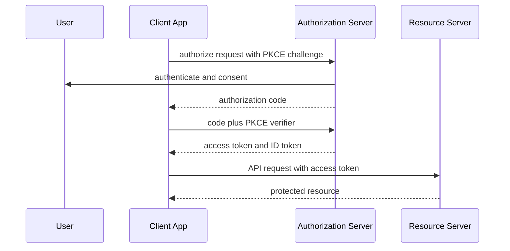

## 1. Hook

You want a photo-printing shop to print pictures from your cloud album.
You should not give the shop your cloud password. Instead, the cloud
service asks you, "Do you allow this shop to read your photos?" If you
agree, the shop receives a limited pass. The pass can read photos, but
cannot change your password or read your email.

That is OAuth 2.0: delegated authorization without sharing passwords.

OpenID Connect adds identity on top: it also lets an app learn who the
user is, in a standardized way.

## 2. What Is It

(a) Plain-English one-liner: OAuth 2.0 lets users delegate limited
access to apps, while OpenID Connect adds user login and identity
information on top of OAuth.

(b) Formal definition: OAuth 2.0 is an authorization framework where a
resource owner grants a client limited access to protected resources
through access tokens issued by an authorization server. OpenID Connect
(OIDC) is an identity layer on top of OAuth 2.0 that defines ID tokens,
standard scopes, user info, discovery, and authentication semantics.
OAuth answers "can this client access this resource?" OIDC answers
"who is the authenticated user?" (see:
MOD-02/06-authentication-vs-authorization).

## 3. The Problem It Solves

Before OAuth, third-party apps asked users for passwords. That gave the
app full account power, made revocation hard, and trained users to
share secrets.

After OAuth, the app redirects the user to the authorization server.
The user consents. The app receives an authorization code, exchanges it
for tokens, and calls APIs with limited scope. The password never goes
to the third-party app.

OIDC solves the login version of the problem by standardizing an ID
token and user identity claims so apps do not invent custom login
protocols.

## 4. Core Concept Breakdown

- **Resource owner:** usually the user.
- **Client:** application requesting access.
- **Authorization server:** issues tokens after authentication and
  consent.
- **Resource server:** API that accepts access tokens.
- **Authorization code:** short-lived code exchanged for tokens.
- **PKCE:** proof key for code exchange, protecting public clients.
- **Access token:** credential for API access.
- **Refresh token:** credential to obtain new access tokens.
- **Scope:** permission string limiting access.
- **ID token:** OIDC token describing authenticated user identity.

## 5. How It Works

Step by step, authorization code with PKCE:

1. **Client creates PKCE verifier and challenge.**
2. **Client redirects user to authorization server.** Request includes
   client ID, redirect URI, scopes, state, and code challenge.
3. **User authenticates.** Authorization server verifies user.
4. **User consents if needed.** Server records delegated permission.
5. **Authorization server redirects back with code.**
6. **Client verifies state.** This defends against CSRF and mix-up
   attacks.
7. **Client exchanges code and verifier.** Authorization server checks
   PKCE.
8. **Server returns tokens.** Access token, optional refresh token, and
   ID token for OIDC.
9. **Client calls resource server.** It sends access token in
   Authorization header.
10. **Resource server validates token.** It checks issuer, audience,
    expiry, signature or introspection, and scope.

Design review checks:

- **Are you doing login or API delegation?** Use OIDC for login.
- **Is PKCE required?** It should be for public clients.
- **Which audience is each token for?**
- **Where are refresh tokens stored and rotated?**

## 6. Diagram



<!-- IMAGE: OAuth authorization code with PKCE flow showing browser
redirects, token exchange, access token to API, and ID token to client -->

## 7. When to Use It

Use OAuth 2.0 when:

- **A client needs delegated API access.**
- **Users should not share passwords with third-party apps.**
- **Scopes, consent, and revocation matter.**
- **Service-to-service access needs token-based delegation.**

Use OIDC when:

- **The application needs user login.**
- **Standard identity claims and discovery are useful.**

## 8. When NOT to Use It

- **Do not use plain OAuth access tokens as proof of login.** Use OIDC
  ID tokens or userinfo with correct validation.
- **Do not use implicit flow for modern browser apps.** Authorization
  code with PKCE is preferred.
- **Do not store refresh tokens insecurely in browsers.**
- **Do not skip audience and issuer validation.**

## 9. Real-World Example

**Google Sign-In** uses OpenID Connect to let apps authenticate users
without handling Google passwords.

**GitHub OAuth Apps** allow users to grant limited repository or
profile access to applications.

**Auth0, Okta, Microsoft Entra ID, and Cognito** provide authorization
servers that implement OAuth and OIDC flows.

Realistic number: access tokens often live for minutes to an hour,
while refresh tokens live longer and therefore need stronger storage,
rotation, and revocation controls.

## 10. Production-Grade Code

```typescript
import crypto from "node:crypto";

export function base64url(input: Buffer): string {
  return input.toString("base64").replace(/\+/g, "-").replace(/\//g, "_").replace(/=+$/, "");
}

export function createPkcePair(): { verifier: string; challenge: string } {
  const verifier = base64url(crypto.randomBytes(32));
  const challenge = base64url(crypto.createHash("sha256").update(verifier).digest());
  return { verifier, challenge };
}

export function createState(): string {
  // State binds the redirect response to the browser session so an
  // attacker cannot inject an authorization response into another flow.
  return base64url(crypto.randomBytes(24));
}
```

Why-not-what notes:

- PKCE protects the authorization code because only the original client
  has the verifier.
- State is separate from PKCE; it protects the client redirect flow.
- Production clients store verifier and state server-side or in secure
  same-site browser storage tied to the auth attempt.

## 11. Trade-offs Table

| Pros | Cons | What it costs you |
|---|---|---|
| Avoids password sharing | Many roles and tokens to understand | Correct flow selection |
| Scopes limit delegated access | Misvalidation causes severe bugs | Token validation discipline |
| OIDC standardizes login | Redirect flows are complex | State, nonce, and PKCE handling |
| Refresh tokens improve UX | Long-lived secrets are risky | Rotation and secure storage |
| Broad ecosystem support | Provider differences exist | Integration testing |

## 12. Comparison Table

| Concept | OAuth 2.0 | OpenID Connect | SAML |
|---|---|---|---|
| Primary job | delegated authorization | user authentication identity layer | enterprise federation |
| Token focus | access token | ID token plus access token | SAML assertion |
| Common clients | APIs, apps | login apps | enterprise SSO |
| Modern browser flow | auth code with PKCE | auth code with PKCE | redirect POST binding |
| Main risk | wrong token audience/scope | treating ID and access tokens interchangeably | XML complexity |

## 13. Numbers and Benchmarks

- **Authorization code lifetime:** often minutes.
- **Access token lifetime:** often 5 to 60 minutes.
- **PKCE:** recommended for public clients and broadly used for SPAs
  and mobile apps.
- **Scopes:** should be specific enough to limit blast radius.
- **Redirect URI:** must be exact-match registered to prevent code
  theft.

## 14. Common Pitfalls

- **Incident: access token accepted as ID token.** App logged users in
  based on token meant for a different API.
- **Incident: missing state check.** Attacker injected an OAuth
  response and linked victim session to attacker account.
- **Incident: refresh token stolen from browser storage.** Long-lived
  access persisted after account compromise.

## 15. Interview Q&A

**Q1. OAuth vs OIDC?** Model answer: OAuth is delegated authorization;
OIDC adds authentication and identity with ID tokens.

**Q2. What is PKCE?** Model answer: proof key for code exchange. It
binds the authorization code to the client that started the flow.

**Q3. Access token vs ID token?** Model answer: access token is for
resource server authorization; ID token is for client login identity.

**Q4. Why avoid implicit flow?** Model answer: tokens are returned
directly through the browser; modern guidance prefers auth code with
PKCE.

**Q5. What must an API validate?** Model answer: signature or
introspection, issuer, audience, expiry, scope, and sometimes token
binding or client.

## 16. Follow-up / Curveball Questions

**Curveball 1. SPA needs login.** Answer direction: use authorization
code with PKCE, short-lived access tokens, careful refresh strategy, and
OIDC validation.

**Curveball 2. API receives ID token.** Answer direction: reject it.
APIs should receive access tokens with correct audience and scope.

**Curveball 3. Multiple identity providers.** Answer direction: track
issuer per token, use discovery metadata, and avoid mixing subject IDs
across issuers.

## 17. Cheat-Sheet Summary

- OAuth delegates API access with access tokens.
- OIDC adds login identity with ID tokens.
- Authorization code with PKCE is the modern default for user flows.
- Validate issuer, audience, expiry, signature, and scopes.
- Never confuse access tokens, ID tokens, and refresh tokens.

## 18. Further Reading

- RFC 6749, "The OAuth 2.0 Authorization Framework":
  https://www.rfc-editor.org/rfc/rfc6749
- RFC 7636, "Proof Key for Code Exchange":
  https://www.rfc-editor.org/rfc/rfc7636
- OpenID Connect Core specification:
  https://openid.net/specs/openid-connect-core-1_0.html

---

## COMPLETENESS CHECK

Section checklist (18):

1. Hook - Covered (photo printing delegation analogy)
2. What Is It - Covered (plain-English and formal definitions)
3. The Problem It Solves - Covered (password sharing before, delegation after)
4. Core Concept Breakdown - Covered (10 concepts)
5. How It Works - Covered (10 PKCE steps plus design checks)
6. Diagram - Covered (sequenceDiagram)
7. When to Use It - Covered (OAuth and OIDC triggers)
8. When NOT to Use It - Covered (4 warnings)
9. Real-World Example - Covered (Google, GitHub, identity providers)
10. Production-Grade Code - Covered (TypeScript PKCE and state helpers)
11. Trade-offs Table - Covered (5 rows)
12. Comparison Table - Covered (OAuth, OIDC, SAML)
13. Numbers and Benchmarks - Covered (5 facts)
14. Common Pitfalls - Covered (3 incident notes)
15. Interview Q&A - Covered (5 Q&As)
16. Follow-up / Curveball Questions - Covered (3 curveballs)
17. Cheat-Sheet Summary - Covered (5 lines)
18. Further Reading - Covered (3 URL-backed sources)

No em-dashes. No emojis. Cross-links included.
