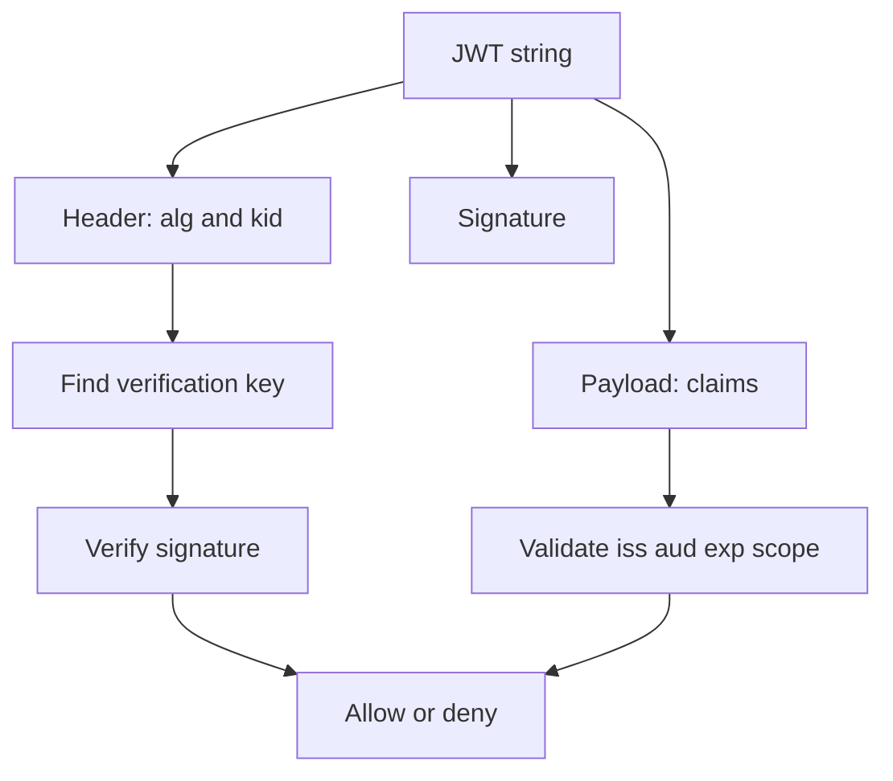

## 1. Hook

A concert wristband has information printed on it: event, access area,
date, and a tamper-proof mark. Security can inspect it quickly without
calling the ticket office every time. But if someone steals the
wristband, they can use it until it expires or is rejected.

A JWT is like that wristband. It carries claims and a signature. A
server can validate it locally.

That convenience is powerful, but token theft, bad validation, and
revocation are real design problems.

## 2. What Is It

(a) Plain-English one-liner: a JWT is a compact signed token containing
claims that can be verified by another party.

(b) Formal definition: JSON Web Token (JWT) is a compact URL-safe
claims representation encoded as three Base64url parts: header,
payload, and signature. A signed JWT is a JWS; an encrypted JWT is a
JWE. JWTs commonly carry identity or authorization claims such as
issuer, subject, audience, expiry, issued-at time, scopes, and roles.
Correct validation requires checking signature, algorithm, issuer,
audience, expiry, and application-specific claims (see:
MOD-02/06-authentication-vs-authorization).

## 3. The Problem It Solves

Before JWTs, every API request might need a database lookup or session
store call to learn who the caller is. That central lookup can be slow
or hard to share across services.

After JWTs, an authorization server signs a token. APIs validate the
signature and claims locally using a shared secret or public key. This
supports stateless-ish authorization across services.

JWTs solve portable claims. They do not solve revocation or permission
freshness automatically.

## 4. Core Concept Breakdown

- **Header:** token metadata such as algorithm and key ID.
- **Payload:** JSON claims.
- **Signature:** cryptographic proof token was issued by trusted party.
- **Issuer (`iss`):** authority that issued token.
- **Subject (`sub`):** principal the token describes.
- **Audience (`aud`):** intended recipient API or client.
- **Expiry (`exp`):** time after which token is invalid.
- **JWK/JWKS:** JSON Web Key set for public key discovery.
- **Algorithm confusion:** accepting attacker-chosen algorithm.
- **Revocation:** invalidating token before expiry, hard with pure
  stateless tokens.

## 5. How It Works

Step by step, API validates a JWT:

1. **Client sends bearer token.** Usually `Authorization: Bearer`.
2. **API splits token.** Header, payload, and signature are parsed.
3. **API reads key ID.** It finds the correct verification key.
4. **API checks allowed algorithm.** Never trust arbitrary `alg`.
5. **API verifies signature.** Token must match trusted key.
6. **API validates issuer.** Token must come from expected authority.
7. **API validates audience.** Token must be intended for this API.
8. **API validates expiry and not-before.** Old or premature tokens are
   rejected.
9. **API checks scopes or roles.** Authorization still requires policy.
10. **API logs subject and token ID carefully.** Do not log full tokens.

Design review checks:

- **Is this token for this API?**
- **How short is the access token lifetime?**
- **How are keys rotated?**
- **How is revocation handled for high-risk events?**

## 6. Diagram



<!-- IMAGE: JWT split into header, payload, signature, then validation
pipeline checking key, signature, issuer, audience, expiry, and scope -->

## 7. When to Use It

Use JWTs when:

- **Multiple services need to validate tokens locally.**
- **Short-lived access tokens are acceptable.**
- **Claims are small and stable.**
- **An authorization server can sign and rotate keys.**
- **APIs validate issuer and audience strictly.**

## 8. When NOT to Use It

- **Do not store secrets or sensitive PII in plain signed JWTs.** Signed
  does not mean encrypted.
- **Do not use long-lived JWTs when revocation matters.**
- **Do not trust decoded payload without verifying signature.**
- **Do not put huge permission lists in tokens.** They become stale and
  large.

## 9. Real-World Example

**OIDC ID tokens** are JWTs containing identity claims for the client.

**OAuth access tokens** are often JWTs in modern systems, though they
can also be opaque reference tokens.

**Kubernetes service account tokens** use JWT-style tokens for workload
identity.

Realistic number: a JWT can easily exceed 1 KB when it includes many
claims. Large tokens in cookies or headers affect every request and can
hit proxy header limits.

## 10. Production-Grade Code

```typescript
import crypto from "node:crypto";

function base64url(input: Buffer): string {
  return input.toString("base64").replace(/\+/g, "-").replace(/\//g, "_").replace(/=+$/, "");
}

export function signHs256(payload: object, secret: string): string {
  const header = { alg: "HS256", typ: "JWT" };
  const encodedHeader = base64url(Buffer.from(JSON.stringify(header)));
  const encodedPayload = base64url(Buffer.from(JSON.stringify(payload)));
  const signingInput = `${encodedHeader}.${encodedPayload}`;
  const signature = base64url(crypto.createHmac("sha256", secret).update(signingInput).digest());
  return `${signingInput}.${signature}`;
}

export function verifyHs256(token: string, secret: string): object {
  const [h, p, s] = token.split(".");
  if (!h || !p || !s) throw new Error("malformed token");
  const expected = base64url(crypto.createHmac("sha256", secret).update(`${h}.${p}`).digest());
  if (!crypto.timingSafeEqual(Buffer.from(s), Buffer.from(expected))) {
    throw new Error("bad signature");
  }
  const payload = JSON.parse(Buffer.from(p, "base64url").toString("utf8"));
  // Signature verification is necessary but not sufficient. Production
  // code must also validate iss, aud, exp, nbf, scopes, and key policy.
  return payload;
}
```

Why-not-what notes:

- The snippet demonstrates signing mechanics without external packages.
- Production systems should prefer vetted JWT libraries and asymmetric
  keys for multi-service validation.
- Signature verification alone is not authorization.

## 11. Trade-offs Table

| Pros | Cons | What it costs you |
|---|---|---|
| Local validation without DB call | Revocation is hard | Short lifetimes and deny lists |
| Portable claims across services | Claims can become stale | Token refresh strategy |
| Standard ecosystem | Validation mistakes are severe | Library and config discipline |
| Works with asymmetric keys | Key rotation needed | JWKS and cache handling |
| Compact compared with verbose JSON sessions | Still adds header size | Claim minimization |

## 12. Comparison Table

| Token type | Validation | Revocation | Best fit | Caveat |
|---|---|---|---|---|
| JWT access token | local signature | hard before expiry | distributed APIs | stale claims |
| Opaque token | introspection lookup | easier | centralized auth | auth server dependency |
| Session cookie | server lookup | easy | web apps | session store |
| API key | lookup or hash check | easy | machine clients | weak user context |

## 13. Numbers and Benchmarks

- **JWT parts:** header, payload, signature.
- **Common claims:** `iss`, `sub`, `aud`, `exp`, `iat`, `nbf`, `jti`.
- **Access token lifetime:** often minutes to one hour.
- **Clock skew allowance:** systems often allow small leeway, such as
  tens of seconds.
- **Header limits:** proxies may reject very large Authorization or
  Cookie headers.

## 14. Common Pitfalls

- **Incident: decoded without verifying.** API trusted attacker-edited
  role claim.
- **Incident: missing audience check.** Token for one API was accepted
  by another API.
- **Incident: long-lived admin JWT leaked.** No revocation path existed
  for a 30-day bearer token.

## 15. Interview Q&A

**Q1. What is inside a JWT?** Model answer: Base64url header, payload,
and signature.

**Q2. Is JWT encrypted?** Model answer: not by default. Signed JWTs are
integrity-protected but readable.

**Q3. What must you validate?** Model answer: algorithm, signature,
issuer, audience, expiry, not-before, and relevant scopes or claims.

**Q4. Why is revocation hard?** Model answer: stateless validation does
not call a central store, so APIs may accept token until expiry unless
deny lists or introspection are used.

**Q5. JWT vs session cookie?** Model answer: JWT can be validated
locally by many services; session cookie references server-side state
that is easier to revoke.

## 16. Follow-up / Curveball Questions

**Curveball 1. User role changes but JWT still says admin.** Answer
direction: use short token lifetime, token version, introspection, or
deny list for sensitive changes.

**Curveball 2. Token has `alg: none`.** Answer direction: reject it.
Allowed algorithms must be configured server-side.

**Curveball 3. Need to put email and address in token.** Answer
direction: avoid unnecessary PII; tokens are often logged, stored, and
sent on every request.

## 17. Cheat-Sheet Summary

- JWT is signed claims: header, payload, signature.
- Signed does not mean encrypted.
- Validate signature, issuer, audience, expiry, and scopes.
- Keep access tokens short-lived and claims small.
- JWTs trade local validation for harder revocation.

## 18. Further Reading

- RFC 7519, "JSON Web Token":
  https://www.rfc-editor.org/rfc/rfc7519
- RFC 8725, "JWT Best Current Practices":
  https://www.rfc-editor.org/rfc/rfc8725
- Auth0 JWT introduction:
  https://jwt.io/introduction

---

## COMPLETENESS CHECK

Section checklist (18):

1. Hook - Covered (concert wristband analogy)
2. What Is It - Covered (plain-English and formal definitions)
3. The Problem It Solves - Covered (central lookup before, portable claims after)
4. Core Concept Breakdown - Covered (10 concepts)
5. How It Works - Covered (10 validation steps plus design checks)
6. Diagram - Covered (flowchart)
7. When to Use It - Covered (5 triggers)
8. When NOT to Use It - Covered (4 warnings)
9. Real-World Example - Covered (OIDC, OAuth, Kubernetes)
10. Production-Grade Code - Covered (TypeScript HS256 mechanics)
11. Trade-offs Table - Covered (5 rows)
12. Comparison Table - Covered (4 token types)
13. Numbers and Benchmarks - Covered (5 facts)
14. Common Pitfalls - Covered (3 incident notes)
15. Interview Q&A - Covered (5 Q&As)
16. Follow-up / Curveball Questions - Covered (3 curveballs)
17. Cheat-Sheet Summary - Covered (5 lines)
18. Further Reading - Covered (3 URL-backed sources)

No em-dashes. No emojis. Cross-links included.
