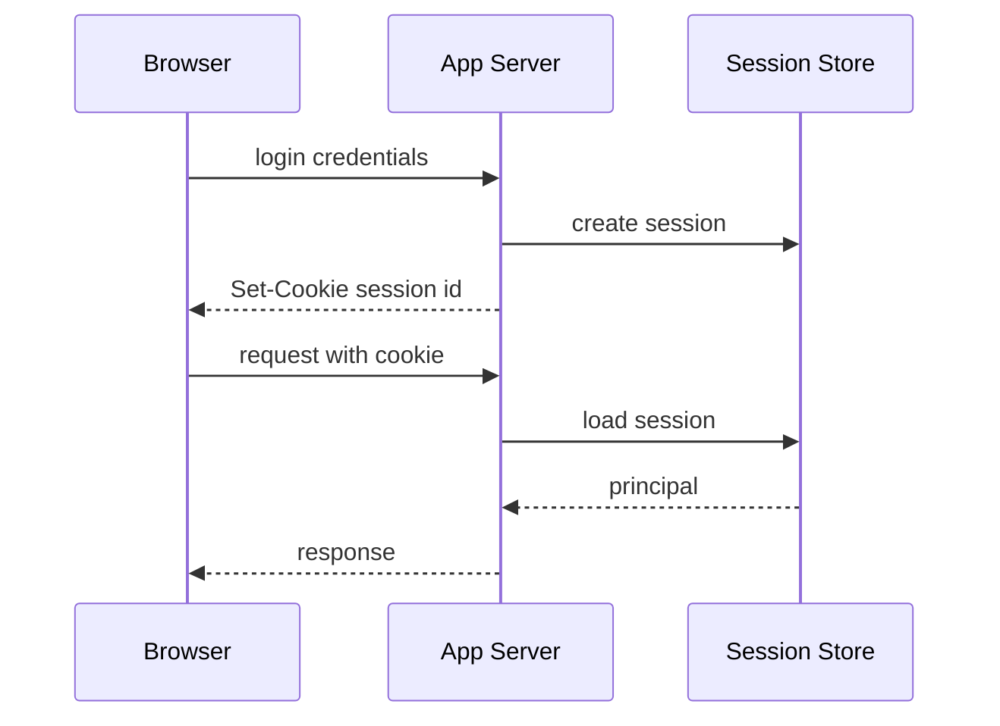

## 1. Hook

A hotel can handle room access in two ways. It can keep a guest ledger
at the front desk and ask guests to show a room card that maps to an
entry in the ledger. Or it can give guests a smart card containing
signed access details that doors can verify locally.

The ledger is session-based auth. The smart card is token-based auth.

Sessions are easier to revoke centrally. Tokens are easier to validate
across services. Neither is automatically more secure; storage,
expiry, and validation decide safety.

## 2. What Is It

(a) Plain-English one-liner: session-based auth stores login state on
the server and gives clients a session ID, while token-based auth gives
clients a token that APIs validate.

(b) Formal definition: session-based authentication creates server-side
state representing an authenticated principal and sends the client a
session identifier, commonly in an HTTP cookie. Token-based
authentication issues a bearer or proof-bound token containing or
referencing claims, commonly used in Authorization headers or cookies.
Sessions centralize state and revocation; tokens distribute validation
and require careful expiry, storage, and audience checks (see:
MOD-02/07-oauth2-and-openid-connect and MOD-02/08-jwt-json-web-tokens).

## 3. The Problem It Solves

Before choosing a model, teams mix web login, mobile API auth, and
service auth into one vague "token" story. Cookies are stored in local
storage. JWTs live for months. Session stores become bottlenecks.

After choosing deliberately, browser apps often use secure, HttpOnly,
SameSite cookies for sessions. APIs may use short-lived access tokens.
Mobile apps use platform secure storage. Services use workload tokens
or mTLS.

The choice solves auth state ownership: does the server remember login,
or does the client carry verifiable credentials?

## 4. Core Concept Breakdown

- **Session ID:** opaque identifier pointing to server-side session.
- **Cookie:** browser storage mechanism often used for sessions.
- **HttpOnly:** cookie flag preventing JavaScript access.
- **SameSite:** cookie policy reducing CSRF risk.
- **Bearer token:** whoever holds it can use it.
- **Access token:** short-lived token for API access.
- **Refresh token:** longer-lived token for getting new access tokens.
- **Revocation:** invalidating credentials before natural expiry.
- **CSRF:** browser automatically sends cookies cross-site unless
  protections apply.
- **XSS:** attacker script can steal tokens accessible to JavaScript.

## 5. How It Works

Step by step, session login:

1. **User submits credentials.**
2. **Server verifies credentials.**
3. **Server creates session record.**
4. **Server sets secure HttpOnly cookie.**
5. **Browser sends cookie on later requests.**
6. **Server loads session and principal.**
7. **Server checks authorization.**
8. **Logout deletes session.**
9. **Session expiry limits lifetime.**
10. **CSRF defenses protect cookie-based mutation.**

Step by step, token API auth:

1. **Authorization server issues access token.**
2. **Client stores token carefully.**
3. **Client sends bearer token.**
4. **API validates token and claims.**
5. **Client refreshes when access token expires.**

Design review checks:

- **Is the client a browser, mobile app, or service?**
- **Where is the credential stored?**
- **How is logout or compromise handled?**
- **Which attack matters more: CSRF or token theft through XSS?**

## 6. Diagram



<!-- IMAGE: side-by-side flow showing session cookie lookup against
server store and bearer token validation locally by an API -->

## 7. When to Use It

Use sessions when:

- **Traditional browser web app login is needed.**
- **Central logout and revocation matter.**
- **Server-side session storage is acceptable.**
- **You want HttpOnly cookies to reduce token theft from XSS.**

Use tokens when:

- **Multiple APIs need local validation.**
- **Mobile or service clients call APIs.**
- **OAuth/OIDC flows are used.**
- **Short-lived access plus refresh fits the UX.**

## 8. When NOT to Use It

- **Do not store long-lived bearer tokens in localStorage.**
- **Do not use cookies without CSRF protections for mutations.**
- **Do not make JWTs long-lived to avoid refresh logic.**
- **Do not assume logout works for stateless tokens without a
  revocation design.**

## 9. Real-World Example

**Traditional Rails, Django, and Express apps** commonly use
server-side sessions with secure cookies.

**OAuth/OIDC APIs** commonly use short-lived access tokens and refresh
tokens.

**Many SPAs** now use authorization code with PKCE and careful browser
storage because implicit-flow token handling caused security problems.

Realistic number: browser sessions may last hours or days with idle
timeouts. Access tokens often last minutes to one hour. Refresh tokens
may last days or weeks but need rotation and theft detection.

## 10. Production-Grade Code

```typescript
import crypto from "node:crypto";

type Session = { userId: string; expiresAt: number };
const sessions = new Map<string, Session>();

export function createSession(userId: string, ttlMs: number): string {
  const id = crypto.randomBytes(32).toString("base64url");
  sessions.set(id, { userId, expiresAt: Date.now() + ttlMs });
  return id;
}

export function readSession(id: string | undefined): Session | null {
  if (!id) return null;
  const session = sessions.get(id);
  if (!session) return null;
  if (session.expiresAt < Date.now()) {
    sessions.delete(id);
    return null;
  }
  // Session IDs are opaque. The client cannot alter userId or expiry
  // because that state lives server-side.
  return session;
}
```

Why-not-what notes:

- Session IDs are random references, not encoded user data.
- Server-side state makes revocation simple: delete the session.
- Production stores need persistence, rotation, secure cookies, CSRF
  protection, and distributed cache behavior.

## 11. Trade-offs Table

| Pros | Cons | What it costs you |
|---|---|---|
| Sessions are easy to revoke | Session store dependency | Scalable shared store |
| HttpOnly cookies reduce token theft by JS | CSRF must be handled | SameSite and CSRF tokens |
| Tokens validate across services | Revocation is harder | Short expiry and deny lists |
| Tokens fit mobile and APIs | Storage is tricky | Secure storage |
| Opaque sessions keep claims fresh | Every request may need lookup | Cache and store sizing |

## 12. Comparison Table

| Dimension | Session-based | Token-based |
|---|---|---|
| State location | server | client-carried or introspected |
| Revocation | easy | harder unless introspected |
| Browser storage | secure cookie | cookie or storage, with risk |
| API scale | needs session store | local validation possible |
| Main attack | CSRF and session fixation | token theft and stale claims |

## 13. Numbers and Benchmarks

- **Session ID entropy:** use at least 128 bits; 256 bits is common.
- **Access token lifetime:** often 5 to 60 minutes.
- **Refresh token rotation:** recommended for public clients.
- **Cookie flags:** Secure, HttpOnly, and SameSite are baseline for
  session cookies.
- **Session store latency:** adds to every authenticated request if not
  cached.

## 14. Common Pitfalls

- **Incident: JWT in localStorage stolen by XSS.** Attacker reused token
  until expiry.
- **Incident: cookie session without CSRF.** Cross-site form submitted
  a state-changing request.
- **Incident: logout did not revoke JWT.** User logged out but old
  access token kept working.

## 15. Interview Q&A

**Q1. Session vs token?** Model answer: session stores state server-side
and sends an ID; token carries or references claims and is validated by
APIs.

**Q2. Why are cookies risky?** Model answer: browsers send them
automatically, so CSRF must be handled.

**Q3. Why are bearer tokens risky?** Model answer: whoever steals the
token can use it until expiry or revocation.

**Q4. Which is better for browser apps?** Model answer: often secure
HttpOnly cookies with CSRF protections, but architecture and identity
provider constraints matter.

**Q5. How does logout work?** Model answer: delete server session or
revoke refresh token; short-lived access tokens may remain valid until
expiry unless denied.

## 16. Follow-up / Curveball Questions

**Curveball 1. Need instant admin permission removal.** Answer
direction: sessions or introspected tokens make revocation easier; JWTs
need short TTL or deny list.

**Curveball 2. SPA wants localStorage because it is easy.** Answer
direction: XSS token theft risk is high. Prefer secure cookie/BFF or
carefully designed token storage.

**Curveball 3. Multi-region session store is slow.** Answer direction:
regional sessions, sticky routing, token validation, or replicated
session stores each trade consistency and latency.

## 17. Cheat-Sheet Summary

- Sessions keep auth state server-side.
- Tokens carry or reference auth claims to APIs.
- Sessions revoke easily; tokens scale validation better.
- Cookies need CSRF defense; bearer tokens need theft defense.
- Choose by client type, revocation needs, and storage safety.

## 18. Further Reading

- OWASP Session Management Cheat Sheet:
  https://cheatsheetseries.owasp.org/cheatsheets/Session_Management_Cheat_Sheet.html
- OWASP Cross-Site Request Forgery Prevention Cheat Sheet:
  https://cheatsheetseries.owasp.org/cheatsheets/Cross-Site_Request_Forgery_Prevention_Cheat_Sheet.html
- OAuth 2.0 for Browser-Based Apps:
  https://www.rfc-editor.org/rfc/rfc9700

---

## COMPLETENESS CHECK

Section checklist (18):

1. Hook - Covered (hotel ledger vs smart card analogy)
2. What Is It - Covered (plain-English and formal definitions)
3. The Problem It Solves - Covered (mixed auth state before, deliberate model after)
4. Core Concept Breakdown - Covered (10 concepts)
5. How It Works - Covered (session and token steps plus design checks)
6. Diagram - Covered (sequenceDiagram)
7. When to Use It - Covered (sessions and tokens)
8. When NOT to Use It - Covered (4 warnings)
9. Real-World Example - Covered (web frameworks, OAuth/OIDC, SPAs)
10. Production-Grade Code - Covered (TypeScript session store)
11. Trade-offs Table - Covered (5 rows)
12. Comparison Table - Covered (2 approaches across 5 dimensions)
13. Numbers and Benchmarks - Covered (5 facts)
14. Common Pitfalls - Covered (3 incident notes)
15. Interview Q&A - Covered (5 Q&As)
16. Follow-up / Curveball Questions - Covered (3 curveballs)
17. Cheat-Sheet Summary - Covered (5 lines)
18. Further Reading - Covered (3 URL-backed sources)

No em-dashes. No emojis. Cross-links included.
