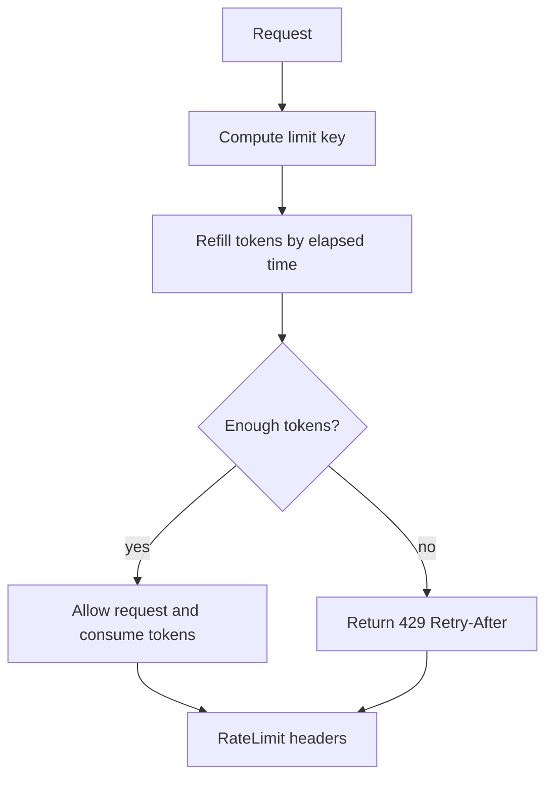

## 1. Hook

A museum lets visitors enter in groups. If everyone rushes in at once,
the halls jam and nobody enjoys the visit. The museum can allow 100
people per minute, slow entry when rooms fill, and block someone trying
to cut the line repeatedly.

Rate limiting is the rule that says how many requests are allowed.
Throttling is the act of slowing or shaping traffic when limits are
near or exceeded.

Together, they protect systems from overload and abuse.

## 2. What Is It

(a) Plain-English one-liner: rate limiting caps how many requests a
caller can make, while throttling slows or rejects traffic to protect
capacity.

(b) Formal definition: API rate limiting enforces request quotas over
time windows or token budgets per identity, IP, tenant, route, or
resource. Throttling is the runtime behavior applied when traffic
exceeds policy, such as delaying, rejecting with 429, reducing priority,
or shaping throughput. Common algorithms include fixed window, sliding
window, token bucket, and leaky bucket (see:
MOD-02/01-rest-api-design-principles).

## 3. The Problem It Solves

Before rate limits, one client can consume all API capacity, a bug can
loop infinitely, or an attacker can brute force endpoints. Every caller
feels the outage.

After rate limits, callers get explicit budgets. Excess requests fail
fast with `429 Too Many Requests` and `Retry-After`. Critical traffic
can have reserved capacity. Abuse can be isolated.

Rate limiting solves fairness and protection. It is not a replacement
for capacity planning or authentication.

## 4. Core Concept Breakdown

- **Limit key:** identity being limited, such as user, IP, API key, or
  tenant.
- **Quota:** allowed number of requests or units.
- **Window:** time period for counting.
- **Fixed window:** simple counter reset each interval.
- **Sliding window:** smoother count over recent time.
- **Token bucket:** tokens refill over time and allow bursts.
- **Leaky bucket:** requests drain at steady rate.
- **429:** HTTP status for too many requests.
- **Retry-After:** header telling client when to retry.
- **Cost unit:** weighted request cost beyond simple request count.

## 5. How It Works

Step by step, token bucket:

1. **Choose limit key.** Example: API key plus route.
2. **Set bucket capacity.** Maximum burst size.
3. **Set refill rate.** Tokens added per second.
4. **Request arrives.**
5. **Compute elapsed time.** Refill tokens since last request.
6. **Check token count.**
7. **If enough tokens, consume cost and allow.**
8. **If not enough, reject or delay.**
9. **Return rate-limit headers.** Clients need remaining budget and
   retry guidance.
10. **Monitor limit hits.** Tune policy based on real traffic.

Design review checks:

- **What identity is limited?**
- **Are limits per route, tenant, or global?**
- **Do expensive endpoints cost more?**
- **Is failure a 429, delay, queue, or ban?**

## 6. Diagram



<!-- IMAGE: token bucket showing tokens refilling over time, bursts
consuming tokens, and rejected requests when bucket is empty -->

## 7. When to Use It

Use rate limiting when:

- **Public APIs face unknown clients.**
- **Expensive operations need protection.**
- **Tenants need fairness.**
- **Login, password reset, and OTP endpoints need abuse control.**
- **Downstream capacity is limited.**

## 8. When NOT to Use It

- **Do not rate-limit only by IP for authenticated APIs.** NAT can group
  many users, and attackers can rotate IPs.
- **Do not hide overload by queuing forever.**
- **Do not use one global limit for all endpoints.** Costs differ.
- **Do not omit client guidance.** Good clients need headers.

## 9. Real-World Example

**GitHub's REST API** publishes rate-limit headers so clients can
adjust behavior.

**Stripe** uses rate and concurrency limit behavior to protect APIs and
returns clear errors.

**Login systems** commonly rate-limit by account, IP, and device
fingerprint to slow credential stuffing.

Realistic number: an API might allow 100 requests per minute per user
for ordinary reads but only 5 password reset attempts per hour per
account and IP.

## 10. Production-Grade Code

```typescript
type Bucket = { tokens: number; updatedAtMs: number };
const buckets = new Map<string, Bucket>();

export function allowTokenBucket(
  key: string,
  nowMs: number,
  capacity: number,
  refillPerSecond: number,
  cost = 1
): { allowed: boolean; retryAfterMs: number; remaining: number } {
  const current = buckets.get(key) ?? { tokens: capacity, updatedAtMs: nowMs };
  const elapsedSec = Math.max(0, (nowMs - current.updatedAtMs) / 1000);
  const tokens = Math.min(capacity, current.tokens + elapsedSec * refillPerSecond);

  if (tokens < cost) {
    buckets.set(key, { tokens, updatedAtMs: nowMs });
    const retryAfterMs = Math.ceil(((cost - tokens) / refillPerSecond) * 1000);
    return { allowed: false, retryAfterMs, remaining: Math.floor(tokens) };
  }

  const remaining = tokens - cost;
  buckets.set(key, { tokens: remaining, updatedAtMs: nowMs });
  return { allowed: true, retryAfterMs: 0, remaining: Math.floor(remaining) };
}
```

Why-not-what notes:

- Token bucket allows bursts up to capacity while preserving long-term
  refill rate.
- The response includes retry timing so clients can back off cleanly.
- Production distributed limiters need shared state or partitioned keys.

## 11. Trade-offs Table

| Pros | Cons | What it costs you |
|---|---|---|
| Protects capacity | Bad keys punish wrong users | Identity design |
| Limits abuse | Distributed counters are hard | Shared store or sharding |
| Gives fairness by tenant | Bursts may still hurt | Token bucket tuning |
| Encourages client backoff | 429 handling varies | Client docs |
| Can weight expensive calls | More policy complexity | Cost model |

## 12. Comparison Table

| Algorithm | Burst handling | Accuracy | Best fit | Caveat |
|---|---|---|---|---|
| Fixed window | poor at boundary | low | simple quotas | boundary spikes |
| Sliding window log | good | high | strict limits | memory cost |
| Sliding window counter | good | medium | common APIs | approximation |
| Token bucket | good | medium | burst-friendly APIs | tuning capacity |
| Leaky bucket | smooth | medium | steady output | queues add latency |

## 13. Numbers and Benchmarks

- **429:** standard status for rate limit rejection.
- **Retry-After:** standard retry guidance header.
- **Burst capacity:** token bucket capacity controls maximum burst.
- **Distributed limit:** one Redis round trip per request can become
  expensive at high QPS.
- **Multi-key limits:** production often combines user, tenant, IP, and
  route limits.

## 14. Common Pitfalls

- **Incident: IP-only limit blocked office.** One NAT IP represented
  hundreds of real users.
- **Incident: no limit on password reset.** Attackers spammed emails
  and exhausted provider quota.
- **Incident: global limit hit by one tenant.** Noisy tenant throttled
  every customer.

## 15. Interview Q&A

**Q1. Rate limiting vs throttling?** Model answer: rate limiting is the
policy; throttling is behavior applied when traffic exceeds policy.

**Q2. Why token bucket?** Model answer: it permits bursts while
enforcing long-term average rate.

**Q3. What status code for rate limit?** Model answer: 429 Too Many
Requests, ideally with Retry-After and rate-limit headers.

**Q4. What key should you limit by?** Model answer: depends on threat
and fairness: user, API key, tenant, route, IP, or combination.

**Q5. How do distributed rate limiters work?** Model answer: use shared
store, partitioned counters, local approximations, or hierarchical
limits depending on precision and latency.

## 16. Follow-up / Curveball Questions

**Curveball 1. Redis limiter becomes bottleneck.** Answer direction:
use local token buckets with periodic sync, sharded keys, approximate
limits, or edge limiting.

**Curveball 2. Need premium customer higher limits.** Answer direction:
make plan and tenant part of policy, with separate quotas and burst
capacity.

**Curveball 3. Attack rotates IPs.** Answer direction: combine
identity, device, behavior, account target, and risk scoring.

## 17. Cheat-Sheet Summary

- Rate limiting controls request volume.
- Throttling slows, delays, or rejects excess traffic.
- Token bucket supports bursts plus average rate.
- Choose limit keys carefully.
- Return 429 with retry guidance.

## 18. Further Reading

- RFC 6585, "Additional HTTP Status Codes" including 429:
  https://www.rfc-editor.org/rfc/rfc6585
- RFC 9333, "The RateLimit Fields for HTTP":
  https://www.rfc-editor.org/rfc/rfc9333
- Stripe rate limits documentation:
  https://docs.stripe.com/rate-limits

---

## COMPLETENESS CHECK

Section checklist (18):

1. Hook - Covered (museum entry analogy)
2. What Is It - Covered (plain-English and formal definitions)
3. The Problem It Solves - Covered (unbounded caller before, budgets after)
4. Core Concept Breakdown - Covered (10 concepts)
5. How It Works - Covered (10 token bucket steps plus design checks)
6. Diagram - Covered (flowchart)
7. When to Use It - Covered (5 triggers)
8. When NOT to Use It - Covered (4 warnings)
9. Real-World Example - Covered (GitHub, Stripe, login systems)
10. Production-Grade Code - Covered (TypeScript token bucket)
11. Trade-offs Table - Covered (5 rows)
12. Comparison Table - Covered (5 algorithms)
13. Numbers and Benchmarks - Covered (5 facts)
14. Common Pitfalls - Covered (3 incident notes)
15. Interview Q&A - Covered (5 Q&As)
16. Follow-up / Curveball Questions - Covered (3 curveballs)
17. Cheat-Sheet Summary - Covered (5 lines)
18. Further Reading - Covered (3 URL-backed sources)

No em-dashes. No emojis. Cross-links included.
