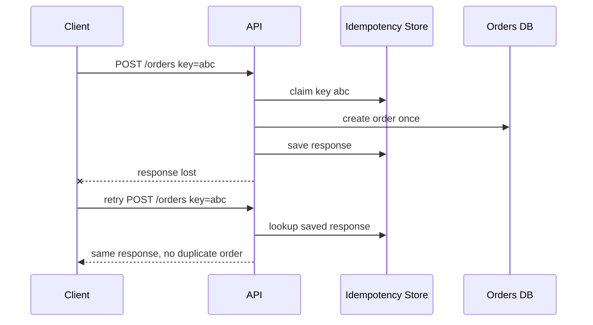

## 1. Hook

You click "pay" on a checkout page. The spinner freezes. Did the store
charge your card? If you click again, will you buy the same item twice?
The customer wants one order, not one order per nervous click.

Idempotency is the rule that repeating the same request has the same
effect as doing it once.

It is one of the quiet foundations of reliable APIs because networks
fail exactly when clients do not know whether the server acted.

## 2. What Is It

(a) Plain-English one-liner: idempotency means a repeated operation with
the same intent produces the same final effect as the first successful
operation.

(b) Formal definition: an API operation is idempotent if applying the
same operation multiple times has the same externally visible effect as
applying it once. In HTTP semantics, GET, PUT, and DELETE are defined as
idempotent, while POST is not inherently idempotent. APIs often add
idempotency keys to POST operations so clients can safely retry after
timeouts, connection failures, or ambiguous responses (see:
MOD-02/01-rest-api-design-principles).

## 3. The Problem It Solves

Before idempotency, a client times out after sending `POST /orders`.
The server may have created the order, but the response was lost. If
the client retries, the server creates a second order and maybe a
second charge.

After idempotency, the client sends an `Idempotency-Key`. The server
stores the first result for that key and returns the same result for
retries. A timeout no longer forces the client to choose between
duplicate side effects and giving up.

Idempotency solves ambiguous retry safety.

## 4. Core Concept Breakdown

- **Idempotent method:** repeated identical call has same effect.
- **Idempotency key:** client-provided unique key for one operation
  intent.
- **Replay response:** server returns original result for duplicate key.
- **Request fingerprint:** hash of method, route, and body to detect key
  reuse with different payload.
- **TTL:** how long idempotency records are retained.
- **Atomic insert:** first request must claim key safely under race.
- **Conflict:** same key used for different request.
- **Retry:** client repeats after timeout or transient failure.
- **Side effect:** irreversible action such as charge, email, or order.
- **Exactly-once illusion:** idempotency gives safe retry, not magical
  exactly-once distributed execution.

## 5. How It Works

Step by step, idempotent order creation:

1. **Client generates unique key.** Usually UUID per create attempt.
2. **Client sends POST with key.** Header might be `Idempotency-Key`.
3. **Server computes request fingerprint.**
4. **Server atomically stores key as in progress.** Race losers wait or
   return conflict.
5. **Server performs operation once.** Create order and charge payment.
6. **Server stores final response.** Status code and body are saved.
7. **Client times out.** It does not know whether operation completed.
8. **Client retries same key.**
9. **Server returns stored response.** No duplicate side effect occurs.
10. **Record expires after TTL.** Retention balances safety and storage.

Design review checks:

- **What operations need safe retry?**
- **Where is the idempotency record stored transactionally?**
- **What if the same key has a different payload?**
- **How long must keys be retained?**

## 6. Diagram



<!-- IMAGE: retry timeline where first POST succeeds but response is
lost, retry with same idempotency key returns stored result -->

## 7. When to Use It

Use idempotency when:

- **Clients may retry ambiguous requests.**
- **POST creates costly or irreversible side effects.**
- **Payments, orders, shipments, or emails are involved.**
- **Network timeouts are expected.**
- **At-least-once message delivery triggers handlers.**

## 8. When NOT to Use It

- **Do not use one idempotency key for multiple business intents.**
- **Do not skip payload fingerprint checks.**
- **Do not keep keys forever without storage plan.**
- **Do not claim idempotency if side effects outside the transaction can
  duplicate.**

## 9. Real-World Example

**Stripe** popularized idempotency keys for safe retry of POST requests
such as payment creation.

**AWS APIs** often use client tokens for idempotent resource creation.

**Message consumers** use processed-message tables to make at-least-once
delivery safe.

Realistic number: idempotency records are often retained for 24 hours
or more for payment-style APIs, but retention depends on retry windows
and client behavior.

## 10. Production-Grade Code

```typescript
type SavedResponse = {
  fingerprint: string;
  status: number;
  body: unknown;
};

const store = new Map<string, SavedResponse>();

function fingerprint(method: string, path: string, body: unknown): string {
  return JSON.stringify({ method, path, body });
}

export async function handleIdempotentPost(
  key: string,
  method: string,
  path: string,
  body: unknown,
  create: () => Promise<{ status: number; body: unknown }>
): Promise<{ status: number; body: unknown }> {
  const fp = fingerprint(method, path, body);
  const existing = store.get(key);
  if (existing) {
    if (existing.fingerprint !== fp) throw new Error("idempotency key reused with different request");
    return { status: existing.status, body: existing.body };
  }

  // Production code must claim the key atomically in a database before
  // side effects. This in-memory map illustrates the response replay
  // contract, not the concurrency-safe storage layer.
  const response = await create();
  store.set(key, { fingerprint: fp, ...response });
  return response;
}
```

Why-not-what notes:

- Fingerprint prevents a client from accidentally reusing a key for a
  different operation.
- The saved response includes status and body, not only resource ID, so
  retries see consistent behavior.
- Production implementations use unique constraints and transactions.

## 11. Trade-offs Table

| Pros | Cons | What it costs you |
|---|---|---|
| Makes retries safe | Requires storage | Idempotency table and cleanup |
| Prevents duplicate side effects | Race handling is subtle | Atomic claim logic |
| Improves client reliability | Keys can be misused | Fingerprint validation |
| Works with POST creates | Response replay can store sensitive data | Redaction and encryption |
| Helps message consumers | Does not remove all distributed uncertainty | Reconciliation |

## 12. Comparison Table

| Technique | Best fit | Strength | Caveat |
|---|---|---|---|
| HTTP idempotent method | PUT, DELETE | semantic clarity | not every create fits |
| Idempotency key | POST side effects | safe retry | storage needed |
| Unique constraint | natural duplicate prevention | strong database guard | only covers one invariant |
| Message dedup table | event consumers | at-least-once handling | retention and cleanup |
| Compare-and-set | conditional updates | prevents lost update | requires versioning |

## 13. Numbers and Benchmarks

- **GET, PUT, DELETE:** idempotent by HTTP semantics.
- **POST:** not inherently idempotent.
- **Key entropy:** UUID v4 or 128-bit random values are common.
- **Retention:** 24 hours is common for payment APIs, but business
  retry windows decide.
- **Storage growth:** 1 million idempotent requests per day means 1
  million records per day before cleanup.

## 14. Common Pitfalls

- **Incident: duplicate charge.** Client retried after timeout and
  server created a second payment without idempotency key.
- **Incident: key reused for different payload.** Mobile app reused one
  key across checkout attempts and received old order result.
- **Incident: record saved after side effect only.** Process crashed
  after charge but before idempotency save, so retry charged again.

## 15. Interview Q&A

**Q1. What is idempotency?** Model answer: repeating the same operation
has the same effect as doing it once.

**Q2. Why do POST requests need idempotency keys?** Model answer: POST
often creates side effects; retries after ambiguous failure can
duplicate them.

**Q3. What should server store for an idempotency key?** Model answer:
key, fingerprint, status, response, state, timestamps, and possibly
resource reference.

**Q4. What if same key has different body?** Model answer: reject with
conflict because the key no longer represents one intent.

**Q5. Does idempotency mean exactly once?** Model answer: no. It means
repeated attempts are made safe by deduplication and replay.

## 16. Follow-up / Curveball Questions

**Curveball 1. Two identical requests arrive concurrently.** Answer
direction: atomic insert or lock on idempotency key; one wins, the
other waits or returns stored result.

**Curveball 2. Side effect is external payment provider.** Answer
direction: pass idempotency key downstream too, or store local claim
before external call and reconcile ambiguous states.

**Curveball 3. Key TTL expired then client retries.** Answer direction:
server may treat it as new. Choose TTL longer than realistic retry
window and document behavior.

## 17. Cheat-Sheet Summary

- Idempotency makes retries safe.
- Use idempotency keys for POST operations with side effects.
- Store request fingerprint and original response.
- Claim keys atomically before side effects.
- Idempotency reduces duplicates, but reconciliation is still needed.

## 18. Further Reading

- Stripe idempotent requests:
  https://docs.stripe.com/api/idempotent_requests
- AWS EC2 client tokens for idempotency:
  https://docs.aws.amazon.com/ec2/latest/devguide/ec2-api-idempotency.html
- RFC 9110, HTTP method semantics:
  https://www.rfc-editor.org/rfc/rfc9110

---

## COMPLETENESS CHECK

Section checklist (18):

1. Hook - Covered (checkout retry analogy)
2. What Is It - Covered (plain-English and formal definitions)
3. The Problem It Solves - Covered (duplicate POST before, key replay after)
4. Core Concept Breakdown - Covered (10 concepts)
5. How It Works - Covered (10 steps plus design checks)
6. Diagram - Covered (sequenceDiagram)
7. When to Use It - Covered (5 triggers)
8. When NOT to Use It - Covered (4 warnings)
9. Real-World Example - Covered (Stripe, AWS, message consumers)
10. Production-Grade Code - Covered (TypeScript idempotent POST wrapper)
11. Trade-offs Table - Covered (5 rows)
12. Comparison Table - Covered (5 techniques)
13. Numbers and Benchmarks - Covered (5 facts)
14. Common Pitfalls - Covered (3 incident notes)
15. Interview Q&A - Covered (5 Q&As)
16. Follow-up / Curveball Questions - Covered (3 curveballs)
17. Cheat-Sheet Summary - Covered (5 lines)
18. Further Reading - Covered (3 URL-backed sources)

No em-dashes. No emojis. Cross-links included.
