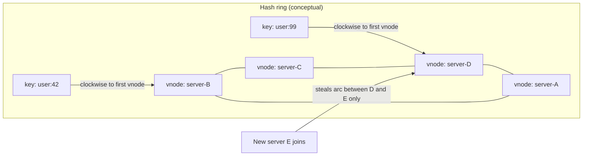

## 1. Hook

Ten pizza delivery drivers cover a city. Each driver owns a zone
drawn on a paper map pinned to the wall. When an order arrives, the
dispatcher finds the address on the map and hands the ticket to
whoever owns that zone. Simple, until the city adds an eleventh
driver.

If the dispatcher redraws zones by splitting every existing zone
in half, half the city suddenly gets a new driver overnight.
Regulars complain: "My usual driver doesn't know my gate code
anymore." Packages (data) moved even though most addresses did not
change their street.

A smarter dispatcher draws the city as a circle. She places driver
names evenly around the ring. Each address is also placed on the
ring (by hashing the street name to a point on the circle). The
ticket goes to the first driver name you meet walking clockwise
from that address. When driver eleven joins, she adds one name to
the ring and only the slices between her new name and her neighbors
change hands. Most addresses keep the same driver.

That circle is consistent hashing. It decides which server owns
which key so that adding or removing a server moves only a fraction
of keys, not nearly all of them.

## 2. What Is It

(a) Plain-English one-liner: consistent hashing maps both servers
and data keys onto the same ring so each key belongs to the next
server clockwise, and when a server joins or leaves only keys near
that server move.

(b) Formal definition: consistent hashing is a distributed hash
table scheme that assigns both nodes and keys to points on a fixed
identifier circle (typically `[0, 2^m)` via a hash function). A
key `k` is assigned to the first node whose hash value is greater
than or equal to `hash(k)` when traversing the ring clockwise
(successor node). When a node joins, it takes over keys from its
predecessor's arc; when a node leaves, its successor inherits its
arc. With `N` nodes and uniform key distribution, adding or
removing one node remaps approximately `1/N` of keys (expected),
compared to nearly all keys under naive `hash(k) mod N` remapping
(see: MOD-03/07-database-sharding-and-partitioning). **Virtual
nodes** (vnodes) place multiple hash points per physical server on
the ring to improve load balance when node counts are small.

## 3. The Problem It Solves

Before consistent hashing, teams mapped keys with `hash(key) % N`.
When `N` changed from 8 to 9 servers, almost every key landed on a
different server. A cache cluster invalidated en masse; a sharded
database required migrating most rows; a CDN reshuffled most objects.
The fleet could not elastic-scale without a thundering herd of
cache misses and data migration.

After consistent hashing, adding one node to a 100-node ring moves
roughly 1 percent of keys to the newcomer. The rest stay put. Cache
clusters (Memcached at Facebook, Dynamo-style stores) scale out
without cold-starting the entire dataset. Sharding layers (Cassandra,
DynamoDB, Riak) rebalance incrementally. The cost is a more complex
lookup (binary search on the ring or a sorted map), vnode tuning,
and awareness of hot spots when keys are not uniform.

## 4. Core Concept Breakdown

- **Hash ring:** a logical circle of hash values; both servers and
  keys hash to points on the same ring.
- **Successor rule:** key `k` belongs to the first server at or
  clockwise from `hash(k)`.
- **Node add:** the new server inserts its point(s) on the ring and
  inherits keys from its predecessor's arc only.
- **Node remove:** the removed server's successor absorbs its arc;
  other assignments unchanged.
- **Virtual nodes (vnodes):** each physical server owns multiple
  points on the ring (e.g. 256 vnodes per host) to spread load
  evenly when there are few physical machines.
- **Replication:** place copies on the next `R` distinct servers
  clockwise from the key (Dynamo-style); failure of one node does
  not lose the key if `R > 1`.
- **Load imbalance:** without vnodes, `N` random points on a ring
  leave uneven arc sizes; vnodes smooth the distribution.
- **Hot keys:** consistent hashing spreads keys uniformly but does
  not fix a key that is hot by itself; that key still lands on one
  node (see MOD-03/07-database-sharding-and-partitioning).

## 5. How It Works

Step by step, building a minimal consistent hash ring for a cache
cluster:

1. **Fix the hash space.** Use a 32-bit or 64-bit unsigned integer
   range. `hash(key)` and `hash(serverId)` both map into `[0, 2^32)`.
2. **Place servers on the ring.** For each physical server, insert
   `V` virtual nodes: `hash(serverId + ":" + i)` for `i` in
   `0..V-1`. More vnodes = smoother load (256 is a common default
   in Cassandra-style systems).
3. **Build a sorted map of ring points.** Store `(hashValue ->
   serverId)` in a sorted structure (TreeMap, sorted array) for
   O(log N) successor lookup.
4. **Assign a key.** Compute `h = hash(key)`. Find the smallest
   ring point `p >= h`; if none exists, wrap to the smallest point
   (the ring is circular). The server owning `p` stores the key.
5. **Read or write.** Same lookup: one successor for the primary
   copy; for replication factor `R`, walk clockwise to the next
   `R-1` distinct servers.
6. **Add a server.** Insert its vnode points; for each new point,
   steal keys from the predecessor arc. Only keys in affected arcs
   migrate (background transfer in production).
7. **Remove a server.** Delete its vnode points; each arc merges
   into the next clockwise server. Again, only local arcs move.
8. **Monitor per-node key count and byte size.** Consistent hashing
   balances keys in expectation; a skewed key space or too few
   vnodes still produces stragglers. Alert on >20 percent deviation
   from mean load.
9. **Pair with gossip or a coordinator** for membership changes
   (see MOD-07/06-gossip-protocols). All clients must agree on the
   ring membership version before routing.
10. **Use managed rings when possible.** DynamoDB, Cassandra, and
    managed Redis Cluster embed consistent hashing; home-grown rings
    need versioned membership and staged transfers.

## 6. Diagram



<!-- IMAGE: circular hash ring diagram with colored arcs showing each
server's key range, one key marker, and a highlighted small arc that
changes ownership when a new server is inserted -->

## 7. When to Use It

Use consistent hashing when:

- **Server count changes frequently** (auto-scaling cache pools,
  elastic shard adds) and you cannot afford full key remapping.
- **You need O(1) or O(log N) key-to-node lookup** without a central
  directory that becomes a bottleneck.
- **Replication by successor walk** fits the storage model
  (Dynamo, Cassandra, Riak, Voldemort).
- **CDN or edge caches** map URLs to edge nodes with minimal
  reshuffle on node churn (Akamai-style schemes use variants of
  consistent hashing).

Use simpler `hash mod N` when:

- **N is fixed forever** (embedded system, single deployment size)
  and will never change without a full maintenance window anyway.

## 8. When NOT to Use It

- **You have severe hot keys.** Consistent hashing spreads keys, not
  traffic per key. A viral counter still melts one node; fix with
  key salting or a separate counter service (see:
  MOD-03/07-database-sharding-and-partitioning).
- **You need range queries local to a partition.** Consistent hashing
  is for point lookups; range scans by key require a different
  partition scheme (range sharding).
- **The team is small and N is stable.** A managed database or
  simple mod-N with rare resharding may cost less engineering than
  operating a custom ring with membership protocols.
- **Strong ordering across keys is required.** Keys on different
  nodes have no global order unless you add a coordinating layer.

## 9. Real-World Example

**Amazon Dynamo** (2007 paper) introduced consistent hashing with
virtual nodes for its production key-value store. Nodes join and
leave without full data reshuffle; replication walks the ring for
`N` successors. DynamoDB's partition model is a managed evolution
of the same idea at AWS scale.

**Apache Cassandra** places partitions on a ring with vnodes
(default 256 tokens per node in modern versions). Adding a node
streams only the SSTables for ranges it inherits, not the whole
cluster dataset.

**Memcached at Facebook** (historically) used consistent hashing
so adding a cache machine moved roughly `1/N` of keys, limiting
cache miss storms during scale-out.

Realistic number: a 50-node cache ring with 256 vnodes per node
and 100 million keys expects ~2 million keys (~2 percent) to move
when one node joins, vs ~98 million under mod-50 remapping.

## 10. Production-Grade Code

```typescript
// Minimal consistent hash ring with virtual nodes.
// Used for cache routing or application-level shard picking.
// Comments focus on WHY each choice exists in production.

import { createHash } from "node:crypto";

const VNODES_PER_NODE = 128;
const HASH_BITS = 32;
const MAX_HASH = 2 ** HASH_BITS;

function hashToRing(value: string): number {
  const digest = createHash("sha256").update(value).digest();
  // Use upper 32 bits for a stable unsigned ring coordinate.
  return digest.readUInt32BE(0);
}

export class ConsistentHashRing {
  // Sorted [position, nodeId] pairs for successor binary search.
  private ring: Array<{ pos: number; nodeId: string }> = [];

  constructor(nodeIds: string[], vnodesPerNode = VNODES_PER_NODE) {
    for (const nodeId of nodeIds) {
      this.addNode(nodeId, vnodesPerNode);
    }
    this.sortRing();
  }

  addNode(nodeId: string, vnodesPerNode = VNODES_PER_NODE): void {
    for (let i = 0; i < vnodesPerNode; i++) {
      const pos = hashToRing(`${nodeId}#${i}`);
      this.ring.push({ pos, nodeId });
    }
    this.sortRing();
  }

  removeNode(nodeId: string): void {
    this.ring = this.ring.filter((entry) => entry.nodeId !== nodeId);
  }

  // Primary owner: first vnode at or after hash(key), wrap around.
  getNode(key: string): string {
    if (this.ring.length === 0) {
      throw new Error("empty ring");
    }
    const h = hashToRing(key);
    let lo = 0;
    let hi = this.ring.length - 1;
    while (lo < hi) {
      const mid = Math.floor((lo + hi) / 2);
      if (this.ring[mid].pos < h) {
        lo = mid + 1;
      } else {
        hi = mid;
      }
    }
    if (this.ring[lo].pos < h) {
      return this.ring[0].nodeId;
    }
    return this.ring[lo].nodeId;
  }

  // Replication factor R: next R distinct physical nodes clockwise.
  getNodes(key: string, replicaCount: number): string[] {
    if (this.ring.length === 0) {
      throw new Error("empty ring");
    }
    const h = hashToRing(key);
    const start = this.ring.findIndex((e) => e.pos >= h);
    const idx = start === -1 ? 0 : start;
    const seen = new Set<string>();
    const result: string[] = [];
    for (let i = 0; i < this.ring.length && result.length < replicaCount; i++) {
      const entry = this.ring[(idx + i) % this.ring.length];
      if (!seen.has(entry.nodeId)) {
        seen.add(entry.nodeId);
        result.push(entry.nodeId);
      }
    }
    return result;
  }

  private sortRing(): void {
    this.ring.sort((a, b) => a.pos - b.pos);
  }
}

// Example: route cache key to a Memcached host.
const ring = new ConsistentHashRing(["cache-1", "cache-2", "cache-3"]);
const owner = ring.getNode("session:abc123");
const replicas = ring.getNodes("session:abc123", 2);
```

Why-not-what notes:

- Vnodes use `nodeId#i` so one physical host owns many small arcs;
  without them, three nodes on a ring leave huge uneven slices.
- Binary search on a sorted ring is O(log VN) where VN is total
  virtual points; a jump consistent hash variant trades exact minimal
  movement for O(1) lookup in some CDN implementations.
- `getNodes` skips duplicate physical IDs when walking vnodes so
  replication factor means distinct hosts, not vnode duplicates.
- Membership changes require versioned ring state in production;
  this class omits transfer protocols intentionally.

## 11. Trade-offs Table

| Pros | Cons | What it costs you |
|---|---|---|
| Adding/removing a node moves ~1/N keys, not nearly all | More complex than mod-N; ring state must be synchronized | Membership protocol, staged data transfer, client library updates |
| O(log N) lookup with sorted ring | Hot keys still hot; hashing does not split traffic inside one key | Application-level salting or separate counter stores |
| Vnodes smooth load across uneven physical nodes | Many vnodes increase memory for ring metadata | Tune vnode count vs balance (64 to 512 typical) |
| Natural replication via clockwise walk | No cheap range scans by partition | Range queries need a secondary index or warehouse |
| Decades of production proof (Dynamo, Cassandra) | Home-grown rings drift without ops discipline | Prefer managed systems unless you are building storage |

## 12. Comparison Table

| Scheme | Keys moved when 1 node added (N=100) | Lookup cost | Load balance | Typical use |
|---|---|---|---|---|
| hash(key) mod N | ~100% (almost all) | O(1) | Even if uniform hash | Fixed-size clusters |
| Consistent hashing (no vnodes) | ~1/N | O(log N) | Uneven with few nodes | Early Dynamo prototypes |
| Consistent hashing + vnodes | ~1/N | O(log N) | Good | Cassandra, Riak, caches |
| Rendezvous hashing (HRW) | ~1/N | O(N) per key | Excellent | Small N, minimal state |
| Managed partition map (DynamoDB) | Opaque, incremental | O(1) via service | Excellent | AWS managed scale |

## 13. Numbers & Benchmarks

- **Key movement on node add:** expected fraction `1/N` for N nodes;
  at N=100, ~1 percent of keys move; at N=10, ~10 percent.
- **Vnode count:** Cassandra historically moved from 1 token per
  node (hot spots) to 256 vnodes default; doubling vnodes tightens
  load balance at the cost of more metadata.
- **Lookup latency:** in-process binary search on 12,800 ring
  points (50 nodes x 256 vnodes) is microseconds; network RTT dominates
  real cache/database calls.
- **Replication factor 3:** Dynamo-style systems tolerate 1 node
  loss without read unavailability if `W + R > N` quorum rules hold
  (see MOD-08/12-distributed-key-value-store-dynamodb).
- **Jump Consistent Hash** (Google, 2014): O(1) time, minimal memory,
  ~1/N movement; used when vnode metadata is too heavy.

## 14. Common Pitfalls

- **Too few vnodes on a small cluster.** Three physical nodes with
  one point each produce wildly uneven arcs; one node holds 50
  percent of keys. Raise vnodes per node before blaming the hash
  function.
- **Changing hash function or vnode count in production.** Every key
  remaps as if the ring was rebuilt. Version the ring config and
  migrate with dual-write, same as shard expansion (see:
  MOD-03/07-database-sharding-and-partitioning).
- **Ignoring data transfer bandwidth on node add.** Only 1/N keys move,
  but each moved key is a network copy; adding five nodes at once
  during peak can saturate links. Stream transfers with rate limits.

## 15. Interview Q&A

**Q1. Why not use `hash(key) % N`?** Model answer: when N changes,
mod-N remaps almost every key. Consistent hashing remaps only keys
in the arcs adjacent to the join/leave point, about 1/N. That
matters for caches (miss storm) and databases (migration cost).

**Q2. What are virtual nodes?** Model answer: multiple hash points
per physical server on the ring. They smooth load when there are
few machines; each server owns several small arcs instead of one
possibly huge arc.

**Q3. How does replication work on the ring?** Model answer: store
copies on the next R distinct servers clockwise from the key's
position. A node failure means the next replica serves reads until
repair or read-repair restores count (Dynamo model).

**Q4. Does consistent hashing fix hot keys?** Model answer: no. It
distributes different keys evenly; one extremely hot key still maps
to one primary owner. Use key splitting, local caching, or a
dedicated counter service.

**Q5. Consistent hashing vs rendezvous hashing?** Model answer:
consistent hashing: O(log N) lookup, ring state. Rendezvous (HRW):
score every node per key, pick max - better balance for small N,
O(N) lookup. Pick HRW for small stable sets; ring for large elastic
pools.

## 16. Follow-up / Curveball Questions

**Curveball 1. Two nodes crash simultaneously on a ring with RF=3.**
Answer direction: keys whose three replicas all landed on failed
nodes are unavailable until repair from remaining replicas on other
nodes; design RF and quorum so overlap probability is negligible;
use anti-entropy repair and hinted handoff (Dynamo).

**Curveball 2. Client ring view is stale; a node was removed but
client still sends to it.** Answer direction: versioned membership,
gossip propagation, exponential backoff to updated ring; stale
writes may need hinted handoff or redirect from a proxy.

**Curveball 3. You need even load but also locality (EU keys on EU
nodes).** Answer direction: separate rings per region or weighted
vnodes; geographic constraint breaks pure uniform hashing - accept
slightly uneven global balance for locality wins.

## 17. Cheat-Sheet Summary

- Keys and servers share one hash ring; each key goes to the next
  server clockwise.
- Add/remove a node: only ~1/N keys move (expected), not the whole
  dataset.
- Virtual nodes per physical server smooth load when N is small.
- Replication = walk clockwise to R distinct servers.
- Hot keys are not fixed by hashing; salting and caching still apply.

## 18. Further Reading

- Karger et al., "Consistent Hashing and Random Trees" (1997) -
  original theoretical foundation for minimal-movement hashing.
- DeCandia et al., "Dynamo: Amazon's Highly Available Key-value
  Store" (2007 SOSP) - production consistent hashing, vnodes,
  quorums, and hinted handoff.
- Lamping and Veach, "A Fast, Minimal Memory, Consistent Hash
  Algorithm" (2014) - Jump Consistent Hash for O(1) lookup.

## 19. Worked Numerical Example

**Setup:** a ring with hash space `0..11` (toy size). Three servers
with one vnode each (no vnodes for clarity):

| Server | hash(server) |
|---|---|
| A | 1 |
| B | 4 |
| C | 8 |

Sorted ring: A(1) -> B(4) -> C(8) -> wrap to A(1).

**Key assignment (successor rule):**

| Key | hash(key) | Successor (clockwise) | Owner |
|---|---|---|---|
| k1 | 0 | A (first >= 0) | A |
| k2 | 3 | B (first >= 3) | B |
| k3 | 5 | C (first >= 5) | C |
| k4 | 9 | A (wrap, first >= 9) | A |

Arc ownership:

- A owns `(C..A]` = keys hashing to 9, 0, 1 -> {k4, k1}
- B owns `(A..B]` = keys 2, 3, 4 -> {k2} (and 2,4 if they existed)
- C owns `(B..C]` = keys 5, 6, 7, 8 -> {k3}

**Node D joins with hash(D) = 6:**

New ring: A(1), B(4), D(6), C(8).

- Keys in `(B..D]` previously owned by C: hash values 5, 6 move
  from C to D. Only k3 (hash 5) moves in our table.
- k1, k2, k4 stay on the same server.

**Fraction moved:** 1 key out of 4 = 25 percent = roughly 1/N for
N=4 after add (expected ~1/(N-1) before add with 3 nodes would be
~33 percent for the joining node's stolen arc).

**With 256 vnodes on real hardware:** the same math holds per arc,
but arcs are tiny and numerous, so each physical node gains or loses
many small arcs that sum to ~1/N of all keys.

---

## COMPLETENESS CHECK

Section checklist (18 + optional 19):

1. Hook - Covered (pizza delivery zones vs circular ring)
2. What Is It - Covered (plain-English plus formal definition with vnodes)
3. The Problem It Solves - Covered (mod-N full remap vs minimal movement)
4. Core Concept Breakdown - Covered (8 bulleted parts)
5. How It Works - Covered (10 numbered steps)
6. Diagram - Covered (graph of ring with keys and vnode assignment; image placeholder)
7. When to Use It - Covered (4 triggers plus mod-N exception)
8. When NOT to Use It - Covered (4 anti-patterns)
9. Real-World Example - Covered (Dynamo, Cassandra, Memcached with 2% vs 98% figure)
10. Production-Grade Code - Covered (TypeScript ConsistentHashRing with vnodes and RF)
11. Trade-offs Table - Covered (5 rows)
12. Comparison Table - Covered (5 schemes across 5 dimensions)
13. Numbers & Benchmarks - Covered (5 figures including Jump Hash)
14. Common Pitfalls - Covered (3 incident-style notes)
15. Interview Q&A - Covered (5 Q&As)
16. Follow-up / Curveball Questions - Covered (3 curveballs)
17. Cheat-Sheet Summary - Covered (5 lines)
18. Further Reading - Covered (3 sources)
19. Worked Numerical Example - Covered (toy ring 0..11, node D joins, k3 moves)

No em-dashes. No emojis. Cross-links to MOD-03/07 and MOD-08/12 included.
