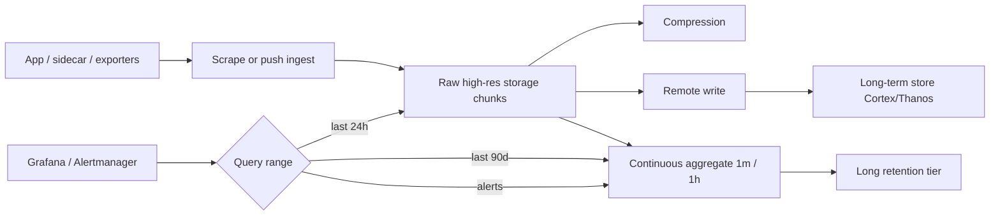

## 1. Hook

Your fitness tracker logs heart rate every second. A year later you
have 31 million points for one person. You never update yesterday's
heart rate at 3:04 PM - you only append new seconds and occasionally
delete chunks older than two years. Asking "what was the average heart
rate between 2:00 and 2:05 PM last Tuesday?" is a question about time,
not about joining twelve normalized tables.

A relational database can store `(timestamp, value)` rows, but once
billions accumulate, indexes bloat, aggregates crawl, and dropping old
data requires expensive `DELETE` scans. Time-series databases are built
for that shape: timestamps as first-class citizens, cheap appends, fast
range scans, compression, and automatic rollups so dashboards stay
sub-second even when raw data is enormous.

## 2. What Is It

(a) Plain-English one-liner: a time-series database stores measurements
tagged with timestamps and labels, optimized for continuously appending
new points and querying ranges and aggregates over time.

(b) Formal definition: a **time-series database (TSDB)** stores **series**
- sequences of `(timestamp, value)` pairs identified by a **metric name**
and **labels/tags** (e.g. `http_request_duration_seconds{service="api",region="us-east"}`).
Writes are append-mostly; in-place updates to historical timestamps are
rare or forbidden; queries are predominantly **range scans**, **downsampling**,
and **aggregations** (mean, max, rate, histogram_quantile) over time windows.
Storage uses specialized compression (delta-of-delta, Gorilla encoding),
**retention policies** (TTL per resolution tier), and **rollups** or
**continuous aggregates** (1 s raw -> 1 m -> 1 h). Examples: Prometheus,
TimescaleDB, InfluxDB, QuestDB, Amazon Timestream, M3. Distinct from
general OLTP SQL (see: MOD-03/01-sql-vs-nosql-when-to-use-it) and from
data warehouses optimized for ad-hoc joins (MOD-14/05-data-pipeline-etl-system).

## 3. The Problem It Solves

Before dedicated TSDBs, teams stored metrics and IoT events in Postgres
tables with `(device_id, ts, value)` and a B-tree index on `ts`. That
worked to millions of rows. At billions, index maintenance, autovacuum
after deletes, and `AVG(value) WHERE ts BETWEEN ...` over huge ranges
became operational nightmares. Partitioning helped (see:
MOD-03/07-database-sharding-and-partitioning) but compression, retention
tiers, and aggregation semantics were still DIY.

After adopting TSDB patterns, ingest pipelines append batches sorted by
time; compression ratios of 10-20x are common; dashboards query pre-
aggregated rollups for long ranges; raw high-resolution data expires
automatically. SREs get sub-second Grafana panels; IoT pipelines get
predictable write throughput per partition key.

The wrong tool still hurts: storing metrics in Redis without TTL fills
memory; running TSDB as system of record for relational billing fails
on joins and constraints. TSDB owns the time-range aggregate path;
SQL or warehouse owns everything else.

## 4. Core Concept Breakdown

- **Metric / series key:** metric name plus sorted label set uniquely
  identifies a time series in Prometheus model.
- **Cardinality:** count of unique series; high cardinality (per-user
  per-request labels) explodes memory in Prometheus-style engines.
- **Retention policy:** raw 7 days, 1-minute rollup 90 days, hourly 2 years -
  automatic tiered expiry.
- **Downsampling / rollups:** pre-compute AVG/SUM per 1 m window;
  queries over months hit rollups not raw points.
- **Append-only ingest:** batch writes sorted by time improve compression
  and sequential IO (pairs with LSM; see MOD-03/10-nosql-internals-lsm-trees-sstables-compaction).
- **Query functions:** `rate()`, `increase()`, `histogram_quantile()` -
  domain-specific over range vectors.
- **Scrape vs push:** Prometheus pull model vs Influx line protocol push;
  affects operability and cardinality control.
- **TSDB vs warehouse:** TSDB for operational metrics with second-level
  freshness; warehouse for historical BI joins across business entities.
- **Remote write / read:** Prometheus remote_write to long-term store
  (Cortex, Thanos, M3) extends retention beyond local disk.
- **Partition key (wide-column TSDB):** Influx/Timestream shard by tag
  set; same partition locality rules as Cassandra.

## 5. How It Works

Instrumenting API latency end-to-end with Prometheus + TimescaleDB pattern:

1. **Define metric names and low-cardinality labels.** `http_request_duration_seconds`
   with `service`, `region`, `method` - never `user_id` on every request.
2. **Emit from app** (OpenTelemetry SDK) or **scrape** `/metrics` every 15 s.
3. **Batch samples** into time-ordered write buffer; flush to TSDB ingest API.
4. **Store raw** in short-retention chunk (Prometheus 2 h blocks or Timescale
   hypertable chunk per day).
5. **Compress** older chunks (Gorilla, columnar, or Timescale compression).
6. **Continuous aggregate** job computes 1 m p99 latency per service.
7. **Grafana dashboard** queries 1 m rollup for 30-day view, raw for last 1 h.
8. **Alertmanager rule** fires on rollup series `p99 > 500ms for 5m` -
  cheaper than scanning raw.
9. **Expire** raw past retention; rollups keep longer horizon automatically.
10. **Capacity review monthly:** series count, ingest rate, compaction lag.

## 6. Diagram



<!-- IMAGE: Grafana dashboard showing raw 1s data zoomed to 1 hour and
rolled-up 1m data over 90 days from same metric with retention tier labels -->

## 7. When to Use It

Pick a TSDB when:

- **Metrics, IoT sensors, finance ticks, application telemetry** dominate
  workload - append + time-range aggregate access pattern.
- **Queries are always time-bounded** (`last 1h`, `between T1 and T2`)
  with aggregations, not arbitrary cross-entity joins.
- **Retention tiers and compression** are first-class requirements;
  ops cannot manually partition and vacuum monthly forever.
- **Alerting on thresholds** over rolling windows is core SRE workflow.

Consider **TimescaleDB on Postgres** when team wants SQL familiarity
and moderate scale. Consider **Prometheus** for Kubernetes metrics.
Consider **InfluxDB/QuestDB** for high-ingest IoT push pipelines.

## 8. When NOT to Use It

- **General OLTP** with heavy row updates and foreign keys - use SQL.
- **Unbounded label cardinality** (`user_id`, `request_id` per series)
  without sampling - TSDB memory and query engines die (top Prometheus
  incident class).
- **Cross-entity relational reporting** as primary access - warehouse
  or SQL with CDC, not TSDB OLTP path.
- **Exact per-event audit trail with updates** - TSDB append model
  fights corrections; use relational event log.

## 9. Real-World Example

**Uber** built M3 stack storing billions of metrics points for fleet and
marketplace monitoring; cardinality control, aggregation tiers, and
long-term remote storage are first-class SRE concerns documented in
their observability engineering posts.

**Prometheus** at CNCF powers default Kubernetes monitoring; 15 s scrape
interval standard; local TSDB retention often 15 days before remote_write
to Thanos/Cortex for multi-year retention.

**TimescaleDB** (Postgres extension) reports 90-95% compression on
telemetry hypertables in production case studies; teams keep SQL tooling
for moderate-scale metrics alongside business OLTP in same engine family.

**Cloudflare** publishes billions of edge metrics; pipeline uses specialized
time-series storage and rollups for dashboard queries at portal scale.

**InfluxDB** IOx engine targets petabyte-scale with object storage backend
for long retention IoT fleets.

Realistic mid-size SaaS: 10k HTTP requests/s with 5 histogram buckets =
50k samples/s ingest; ~4.3 billion points/day raw - impractical in
unpartitioned Postgres without TSDB compression and rollups; Prometheus
single node often caps around 1-10 million active series depending on RAM.

## 10. Production-Grade Code

```typescript
// Prometheus-style metrics with bounded cardinality and histogram
// export. Comments explain WHY labels are restricted.

const SERVICE_NAME = "checkout-api";
const REGION = "us-east-1";

interface HistogramState {
  buckets: Map<number, number>;
  sum: number;
  count: number;
}

const LATENCY_BUCKET_UPPER_BOUNDS = [0.05, 0.1, 0.25, 0.5, 1.0, 2.5];

export class RequestLatencyTracker {
  private readonly histogram: HistogramState;

  constructor() {
    const buckets = new Map<number, number>();
    for (const le of LATENCY_BUCKET_UPPER_BOUNDS) {
      buckets.set(le, 0);
    }
    this.histogram = { buckets, sum: 0, count: 0 };
  }

  observe(durationSeconds: number): void {
    this.histogram.sum += durationSeconds;
    this.histogram.count += 1;
    for (const le of this.histogram.buckets.keys()) {
      if (durationSeconds <= le) {
        this.histogram.buckets.set(
          le,
          (this.histogram.buckets.get(le) ?? 0) + 1
        );
      }
    }
  }

  // Labels: only low-cardinality dimensions. user_id here would
  // create one series per user - cardinality explosion.
  toPrometheusLines(): string {
    const base = `service="${SERVICE_NAME}",region="${REGION}"`;
    const lines: string[] = [];
    for (const [le, count] of this.histogram.buckets) {
      lines.push(
        `http_request_duration_seconds_bucket{${base},le="${le}"} ${count}`
      );
    }
    lines.push(`http_request_duration_seconds_sum{${base}} ${this.histogram.sum}`);
    lines.push(
      `http_request_duration_seconds_count{${base}} ${this.histogram.count}`
    );
    return lines.join("\n");
  }
}

// TimescaleDB hypertable insert pattern for custom business metrics
// where Prometheus pull model does not fit.
export async function insertBusinessMetric(
  db: { query: (sql: string, params: unknown[]) => Promise<void> },
  metric: { name: string; ts: Date; value: number; tags: Record<string, string> }
): Promise<void> {
  // JSONB tags for moderate cardinality dimensions only; index
  // (name, ts) on hypertable chunk boundary for range scan perf.
  await db.query(
    `INSERT INTO metrics (name, ts, value, tags)
       VALUES ($1, $2, $3, $4)`,
    [metric.name, metric.ts, metric.value, JSON.stringify(metric.tags)]
  );
}

// Alert evaluation should query rolled-up continuous aggregate, not raw.
export const P99_ALERT_QUERY = `
  SELECT service, avg(p99_ms) AS avg_p99
  FROM http_latency_1m
  WHERE bucket >= NOW() - INTERVAL '5 minutes'
  GROUP BY service
  HAVING avg(p99_ms) > 500
`;
```

Why-not-what notes:

- Histogram buckets fixed at construction - Prometheus convention requires
  stable bucket boundaries for `histogram_quantile` across scrapes.
- `SERVICE_NAME` and `REGION` only on labels - adding `path` with unbounded
  URI cardinality is the classic production outage pattern.
- `insertBusinessMetric` uses JSONB tags for flexibility but still requires
  cardinality review - not a license for per-user tags.
- Alert query targets `http_latency_1m` rollup table - scanning raw 1 s
  data for 5 m window across all services does not scale.

## 11. Trade-offs Table

| Pros | Cons | What it costs you |
|---|---|---|
| Fast time-range aggregates at billion-point scale | Poor fit for arbitrary relational queries | Separate metrics vs business OLTP stores |
| Built-in compression and retention tiers | Cardinality limits require discipline | Label standards, linting in CI for metric names |
| Native alerting and Grafana integration | Another pipeline to operate | Scrape config, remote_write, on-call for TSDB |
| Append-only ingest matches sensor/metrics workloads | Corrections and late data need explicit handling | Backfill jobs, out-of-order sample policies |
| Rollups keep long-range dashboards fast | Dual precision (raw + rollup) complexity | Continuous aggregate maintenance jobs |

## 12. Comparison Table

| Store | Model | Ingest | Best for | Cardinality risk | SQL? |
|---|---|---|---|---|---|
| Prometheus | Pull scrape | Batch blocks | K8s / service metrics | High | PromQL only |
| TimescaleDB | Hypertable chunks | SQL insert/copy | SQL teams, moderate scale | Moderate | Full SQL |
| InfluxDB | Line protocol | Push batches | IoT push pipelines | High without planning | Flux/InfluxQL |
| QuestDB | Columnar TS | High-rate push | Finance ticks, IoT | Moderate | SQL |
| Postgres plain | B-tree rows | OLTP inserts | Small telemetry only | Low until scale breaks | Full SQL |
| Warehouse | Columnar | ETL batch | Historical BI joins | N/A for real-time | Full SQL |

## 13. Numbers & Benchmarks

- **Prometheus series limit:** practical 1-10 million active series per
  server depending on RAM (rule of thumb: 1-3 KB per series overhead).
- **Gorilla compression:** Facebook paper cites ~12 bytes per point average
  for operational double values after compression.
- **Scrape 15 s:** 5,760 samples/day per series; 100k series = 576M
  samples/day raw before compression.
- **Timescale compression:** 90%+ on telemetry case studies; query 30-day
  rollup 10-100x faster than raw scan.
- **Cardinality incident threshold:** alert when active series grow >20%
  week-over-week without fleet growth - often label leak.

## 14. Common Pitfalls

- **High-cardinality labels** (`path="/users/12345"`, `user_id` on HTTP
  metrics). One series per user times bucket count melts RAM. Fix: aggregate
  to bounded buckets (`status_class="5xx"`), use tracing for per-request detail.
- **No retention policy.** Disk fills; compaction fails; Grafana still queries
  dead store. Define raw TTL and rollup retention in infrastructure-as-code.
- **Querying raw 1 s data for 90-day dashboard.** Query timeout incident.
  Use continuous aggregates or recording rules for long windows.
- **Using TSDB as billing source of truth.** Counters are approximate under
  retries; money stays in Postgres with TSDB for observability only.

## 15. Interview Q&A

**Q1. TSDB vs Postgres for metrics?** Model answer: TSDB when append +
time-range aggregation dominates at billion-point scale; Postgres/Timescale
when moderate volume and SQL ecosystem integration matter. Breakpoint is
operational pain on vacuum, compression, and query latency - often 100M-1B
rows depending on schema.

**Q2. What is cardinality and why does it matter?** Model answer: number
of unique time series (metric + label combinations); each series has memory
and index cost; unbounded labels multiply series count linearly with traffic
or users.

**Q3. How handle long retention?** Model answer: tiered downsampling (raw ->
1m -> 1h), remote_write to object-storage-backed long-term store (Thanos,
Cortex), expire raw automatically.

**Q4. rate() vs increase() in Prometheus?** Model answer: `rate()` per-second
average over range for counters handling resets; `increase()` total over range;
both require counter metric type; wrong type produces garbage.

**Q5. When Influx vs Prometheus?** Model answer: Prometheus for pull-based
service metrics on K8s; Influx for high-frequency push IoT devices sending
line protocol over cellular with custom retention per bucket.

**Q6. How design labels for a new microservice?** Model answer: allowlist
`service`, `region`, `method`, `status_class`; forbid `user_id`, `url_path`
full strings; document in observability RFC; CI lint on `/metrics` output.

## 16. Follow-up / Curveball Questions

**Curveball 1. Product wants per-user latency metric for 10M DAU.** Answer
direction: sample 1% users, aggregate in app to histogram per service,
or use tracing backend (Jaeger/Tempo) for per-user tail; not 10M Prometheus
series; exemplars link metrics to traces sparingly.

**Curveball 2. Metric disappeared after pod restart but counter should be monotonic.**
Answer direction: counters reset on restart; `rate()` handles reset if
scraped regularly; use persistent store or separate aggregate for lifetime
totals; document SLO on post-restart scrape gap.

**Curveball 3. Two teams share one Prometheus; cardinality doubled overnight.**
Answer direction: find label leak via TSDB status API / cardinality analysis
tools; add relabel drop rules; split by team via federation or separate
instances to blast-radius isolate.

## 17. Cheat-Sheet Summary

- TSDB = timestamp-first append storage + range aggregations + retention tiers.
- Control label cardinality ruthlessly; it is the top TSDB production killer.
- Rollups and recording rules keep long-window dashboards and alerts fast.
- Prometheus for K8s ops; Timescale when SQL needed; warehouse for BI history.
- Not a replacement for OLTP relational data or financial ledger.

## 18. Further Reading

- Pelkonen et al., "Gorilla: A Fast, Scalable, In-Memory Time Series
  Database" (Facebook) - compression and operational lessons.
- TimescaleDB documentation, "Hypertables and compression" - Postgres-native TS.
- Prometheus documentation, "Instrumentation best practices" and
  "Metric and label naming" - cardinality guidance.
- Uber engineering, M3 documentation - large-scale metrics backend design.

---

## COMPLETENESS CHECK

Section checklist (18):

1. Hook - Covered in depth (fitness tracker 31M points analogy)
2. What Is It - Covered in depth (plain-English + formal TSDB definition)
3. The Problem It Solves - Covered in depth (Postgres billions pain before, TSDB after)
4. Core Concept Breakdown - Covered in depth (10 bulleted parts)
5. How It Works - Covered in depth (10 numbered instrumentation steps)
6. Diagram - Covered in depth (ingest/raw/rollup/query flow + image placeholder)
7. When to Use It - Covered in depth (4 triggers + product picks)
8. When NOT to Use It - Covered in depth (4 anti-patterns)
9. Real-World Example - Covered in depth (Uber M3, Prometheus, Timescale, Cloudflare, Influx + numbers)
10. Production-Grade Code - Covered in depth (histogram tracker + Timescale insert + alert query)
11. Trade-offs Table - Covered in depth (5 rows)
12. Comparison Table - Covered in depth (6 stores across 6 dimensions)
13. Numbers & Benchmarks - Covered in depth (5 figures)
14. Common Pitfalls - Covered in depth (4 incident notes)
15. Interview Q&A - Covered in depth (6 Q&As)
16. Follow-up / Curveball Questions - Covered in depth (3 curveballs)
17. Cheat-Sheet Summary - Covered in depth (5 lines)
18. Further Reading - Covered in depth (4 sources)

No em-dashes. No emojis. Prereq MOD-03/01 linked.
