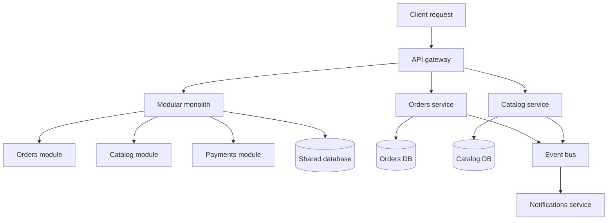

## 1. Hook

Imagine a busy restaurant with one huge kitchen. Every cook, oven,
sink, spice rack, and serving station lives in the same room. When
the room works well, the restaurant is fast: the chef can shout one
instruction, the pasta station can borrow a pan from the grill, and
everyone sees the same ticket board. But when the kitchen becomes
crowded, one broken freezer blocks the hallway, one confused order
slows every station, and renovating the dessert corner means closing
the whole restaurant.

Now imagine the same restaurant split into smaller kitchens: bakery,
grill, drinks, pasta, dessert. Each kitchen can improve its own
tools, hire its own specialists, and keep working when another area
is under maintenance. But the waiter now has to coordinate multiple
kitchens for one table. If pasta is ready but drinks are late, the
guest still sees a bad meal.

A monolith is the single big kitchen. Microservices are the separate
kitchens. The hard part is not deciding which one sounds more modern.
The hard part is deciding when the coordination cost of many kitchens
is worth paying.

## 2. What Is It

(a) Plain-English one-liner: a monolith packages many product
capabilities into one deployable application, while microservices
split capabilities into independently deployable services that talk
over the network.

(b) Formal definition: a monolithic architecture is a software system
whose modules are compiled, deployed, scaled, and usually released as
one unit, often backed by one primary database. A microservices
architecture decomposes the system into small, independently
deployable services aligned to business capabilities, each owning its
data and exposing contracts through APIs or events. The trade is local
simplicity in the monolith versus distributed coordination in
microservices. The networking and load balancing foundation matters
here (see: MOD-05/02-layer4-vs-layer7-load-balancing).

## 3. The Problem It Solves

Before teams name the choice, they often turn architecture into a
fashion argument. A team with six engineers breaks a product into
twenty services because they heard microservices scale. They spend the
next year debugging local development, tracing cross-service failures,
maintaining twenty CI pipelines, and answering "which service owns
this field?" instead of shipping the product.

The opposite failure also happens. A company grows one Rails or
Node.js application to 200 engineers. Every release touches the same
deployment train. A small checkout change waits behind a reporting
change. The order module needs 10x more CPU, but the whole monolith
must be scaled. Teams step on each other through shared tables and
global helper code.

The architecture choice solves the coordination problem. A monolith
minimizes distributed systems overhead when product and team size are
still modest. Microservices reduce organizational coupling when teams,
release schedules, scaling profiles, and data ownership have become
independent enough to justify the network boundary.

## 4. Core Concept Breakdown

- **Deployable unit:** monolith deploys one application; microservices
  deploy many independently versioned services.
- **Module boundary:** monolith boundaries are code-level; service
  boundaries are network, contract, and operational boundaries.
- **Data ownership:** a healthy service owns its database tables; a
  shared database between services recreates the monolith with worse
  failure modes.
- **Team boundary:** microservices work best when service boundaries
  map to long-lived team ownership and business capabilities.
- **Failure mode:** monolith failures are often process-wide;
  microservice failures are partial but require timeouts, retries, and
  fallback design.
- **Latency:** monolith calls are in-process microseconds;
  microservice calls are network milliseconds plus serialization and
  tail latency.
- **Release model:** monolith releases are coordinated; services can
  release independently only if contracts are backward compatible.
- **Observability:** monolith stack traces are local; microservices
  need logs, metrics, traces, and correlation IDs from day one.

## 5. How It Works

Step by step, deciding between a monolith and microservices:

1. **Start from product capabilities.** List domains like identity,
   catalog, checkout, payments, search, notification. Do not split by
   technical layers such as "controllers service" and "database
   service."
2. **Measure team independence.** If the same five engineers own all
   features, one deployable unit is usually cheaper. If ten teams need
   different release cadences, service boundaries begin to pay.
3. **Measure scaling differences.** If checkout needs strict
   reliability and search needs heavy CPU, separate scaling profiles
   may justify separation.
4. **Look for data ownership seams.** A service boundary is credible
   only when a team can say, "these records are ours, other services
   ask us for them."
5. **Estimate call frequency.** A boundary crossed on every page load
   can dominate latency. Keep chatty collaborators inside the same
   process until the contract stabilizes.
6. **Choose a deployment path.** Many teams start with a modular
   monolith: one deployable application with strict internal modules.
7. **Extract the first service only when pain is real.** Good first
   candidates are async notification, media processing, search
   indexing, or payments isolation.
8. **Add production guardrails before the second service.** Service
   discovery, tracing, dashboards, CI, API compatibility tests, and
   incident ownership must exist early.
9. **Never split the database casually.** Database ownership changes
   data consistency, joins, transactions, migrations, and backfills
   (see: MOD-03/13-database-transactions-and-isolation-levels).
10. **Review the architecture every quarter.** A monolith can become a
    modular monolith, and a service can be folded back if it creates
    more coordination cost than independence.

Senior design review questions before choosing microservices:

- **Can this team deploy, observe, and roll back 20 services at 2 AM?**
  If not, the architecture is ahead of the operating model.
- **Can each proposed service own its data without shared writes?** If
  the answer is no, start with module boundaries instead.
- **Can the business tolerate stale reads across the boundary?** If the
  flow requires one atomic invariant, keep it local or design an
  explicit saga.
- **Will the boundary reduce human coordination?** A service that still
  needs three teams in every change review is not independent.

## 6. Diagram



<!-- IMAGE: side-by-side architecture drawing showing a modular
monolith with internal modules and one database beside a microservice
system with separate services, separate databases, and an event bus -->

## 7. When to Use It

Use a monolith or modular monolith when:

- **The team is small or early.** Fewer than about 20 engineers usually
  gain more from simple deployment than from service independence.
- **The domain is still changing quickly.** Code-level boundaries are
  easier to move than network contracts and split databases.
- **Most requests need the same data.** Keeping joins local avoids
  API fan-out and read model duplication.
- **Operational maturity is low.** A team without tracing, alerting,
  CI discipline, and on-call ownership is not ready for many services.

Use microservices when:

- **Teams need independent delivery.** Multiple teams own stable
  domains and release on separate schedules.
- **Scaling profiles differ sharply.** Search, media, payments, and
  notifications may need different resource shapes.
- **Fault isolation matters.** A recommendation failure should not
  take checkout down.
- **Compliance or security isolation is real.** Payments or identity
  may need stricter access boundaries.

## 8. When NOT to Use It

- **Do not start with microservices to avoid clean code.** A messy
  monolith becomes a messy distributed system with network latency.
- **Do not keep one database behind many services.** Shared tables
  make teams coupled while removing the safety of local transactions.
- **Do not split chatty modules.** If two modules call each other ten
  times per request, they are probably not independent services yet.
- **Do not keep a monolith when deployment becomes a company-wide
  negotiation.** If every team waits for one release train, the
  monolith has become an organizational bottleneck.

## 9. Real-World Example

**Amazon** famously moved from a large internal application style to
service-oriented teams with owned APIs. The point was not technology
for its own sake; it was team autonomy and ownership at thousands of
engineers.

**Shopify** has discussed keeping a large Rails monolith while making
it highly modular. That is the counterexample: a monolith can scale
when boundaries, ownership, deployment, and tooling are disciplined.

**Netflix** used microservices heavily because video streaming,
recommendations, device APIs, billing, and encoding had different
scale and release needs.

**Shopify's modular monolith story** is the strongest reminder that
service count is not the score. Their public engineering writing
describes investing in component boundaries inside one Rails codebase
so developers could work with less coupling before reaching for network
boundaries.

Realistic number: a 10-engineer startup can often deploy a modular
monolith 20 to 50 times per day with one pipeline. The same product
split into 30 services may require 30 pipelines, shared tracing, and
several platform engineers before the architecture feels cheaper.

## 10. Production-Grade Code

```typescript
// A modular monolith boundary: modules communicate through explicit
// interfaces, so extraction later is possible without pretending that
// today's in-process call is already a network service.

type Money = { currency: "USD"; cents: number };

interface InventoryPort {
  reserve(sku: string, quantity: number): Promise<void>;
}

interface PaymentPort {
  authorize(orderId: string, amount: Money): Promise<string>;
}

interface OrderStore {
  save(order: Order): Promise<void>;
}

type Order = {
  id: string;
  sku: string;
  quantity: number;
  amount: Money;
  paymentAuthorizationId: string;
};

export class OrderService {
  constructor(
    private readonly inventory: InventoryPort,
    private readonly payments: PaymentPort,
    private readonly orders: OrderStore
  ) {}

  async placeOrder(input: {
    orderId: string;
    sku: string;
    quantity: number;
    amount: Money;
  }): Promise<Order> {
    await this.inventory.reserve(input.sku, input.quantity);

    // Payment is behind a port because it is a common first
    // extraction candidate: security, compliance, and uptime differ
    // from the rest of ordering.
    const paymentAuthorizationId = await this.payments.authorize(
      input.orderId,
      input.amount
    );

    const order: Order = { ...input, paymentAuthorizationId };
    await this.orders.save(order);
    return order;
  }
}
```

Why-not-what notes:

- The module depends on ports, not concrete infrastructure, so the
  boundary can remain in-process today and move over HTTP or events
  later.
- This is still a monolith if everything deploys together. The point
  is to earn a future service boundary without paying service overhead
  before the business needs it.
- The code avoids shared global helpers because global convenience is
  one of the fastest ways to make a monolith unextractable.

## 11. Trade-offs Table

| Pros | Cons | What it costs you |
|---|---|---|
| Monolith: simple local development and deployment | One bad deploy can affect the whole product | Strong module boundaries, test suites, and deployment discipline |
| Monolith: in-process calls are fast and easy to debug | Teams can block each other on release trains | Ownership rules and code review boundaries |
| Microservices: independent scaling and deployment | Network latency and partial failure become normal | Timeouts, retries, tracing, circuit breakers, and compatibility tests |
| Microservices: clearer team ownership when domains are stable | Data consistency across services is harder | Sagas, outbox patterns, read models, and reconciliation |
| Microservices: fault isolation | More infrastructure and on-call surface | Platform investment before feature teams feel the benefit |

## 12. Comparison Table

| Approach | Deploy unit | Data model | Best fit | Failure shape | Team cost |
|---|---|---|---|---|---|
| Layered monolith | one app | often shared DB | small teams, early product | process-wide | low |
| Modular monolith | one app | shared DB with module ownership | growing product with changing boundaries | process-wide but contained code | medium |
| Microservices | many services | database per service | many teams, stable domains | partial failures | high |
| Serverless functions | many functions | managed stores | event-heavy workloads | provider-level and per-function | medium to high |

## 13. Numbers & Benchmarks

- **Network hop cost:** an in-process function call is usually below
  1 microsecond; a same-region service call is commonly 1 to 10
  milliseconds before downstream work.
- **Service count pressure:** 30 services means 30 deployable units,
  30 dashboards, 30 alert surfaces, and many compatibility edges.
- **Team threshold:** below roughly 15 to 20 engineers, microservices
  usually cost more than they return unless one domain has special
  isolation needs.
- **Database split cost:** moving one table from a monolith to a
  service can require dual writes, backfill, read migration, and a
  rollback plan lasting weeks.
- **Latency budget:** a page with 8 sequential service hops at 20 ms
  each spends 160 ms before doing real work; parallel fan-out helps
  but increases failure handling.
- **Operational floor:** before the fifth production service, expect to
  need service ownership docs, SLOs, dashboards, alerts, trace IDs,
  release automation, and a runbook per service.
- **Coupling test:** if 80 percent of changes to service A require
  coordinated deploys with service B, the boundary is probably wrong.

## 14. Common Pitfalls

- **Incident: service split without data ownership.** The orders
  service still joined catalog tables directly. A catalog migration
  broke checkout because the boundary existed in code but not in
  data.
- **Incident: microservice without observability.** A 900 ms p99
  request crossed seven services, and no trace ID connected the logs.
  The team guessed for three hours during an outage.
- **Incident: monolith with no module boundaries.** A reporting helper
  imported checkout internals. A refactor meant for invoices changed
  checkout behavior and escaped tests.

## 15. Interview Q&A

**Q1. When would you choose a monolith over microservices?** Model
answer: when the team is small, the domain is still changing, and most
features share the same data. A modular monolith gives speed and keeps
future extraction possible.

**Q2. What is the strongest argument for microservices?** Model
answer: independent ownership at scale. If teams need independent
deployments, different scaling profiles, and fault isolation, the
network boundary can be worth it.

**Q3. Why is a shared database between services dangerous?** Model
answer: it preserves tight coupling while adding distributed system
costs. Services can break each other through schema changes and hidden
joins.

**Q4. How do you migrate from monolith to microservices safely?**
Model answer: build internal modules first, identify one stable domain,
extract behind a contract, move reads, then writes, then ownership.
Use strangler migration for larger flows (see:
MOD-06/10-strangler-fig-pattern).

**Q5. How do you avoid a distributed monolith?** Model answer: avoid
chatty synchronous chains, keep data ownership clear, enforce backward
compatible APIs, and prefer async events where immediate consistency is
not required.

## 16. Follow-up / Curveball Questions

**Curveball 1. The CTO says "microservices will make us scale." What
do you ask?** Answer direction: scale what: traffic, team ownership,
release frequency, compliance boundary, or database writes? Each has a
different answer.

**Curveball 2. One service needs to read data from five other services
for every request. Is that okay?** Answer direction: maybe, but it is
a read composition smell. Consider a read model, API composition, or a
different boundary (see: MOD-06/09-api-composition-vs-aggregator-pattern).

**Curveball 3. A monolith has 150 engineers but deploys safely 100
times per day. Must it split?** Answer direction: no. If module
boundaries, tests, ownership, and deploy tooling are strong, the
business problem may already be solved.

## 17. Cheat-Sheet Summary

- Monolith = one deployable unit; microservices = many independently
  deployable business services.
- Start with a modular monolith unless team scale or isolation proves
  the service boundary is worth it.
- A service boundary must include data ownership, contracts, and
  operational ownership.
- Microservices buy autonomy and fault isolation by spending latency,
  complexity, and platform effort.
- The worst shape is a distributed monolith: many services, shared
  data, chatty calls, and no independent ownership.

## 18. Further Reading

- Martin Fowler, "Microservice Architecture" - concise framing of
  service boundaries, independently deployable units, and trade-offs:
  https://martinfowler.com/articles/microservices.html
- Sam Newman, "Building Microservices" - practical service ownership,
  migration, and operational patterns:
  https://samnewman.io/books/building_microservices_2nd_edition/
- Shopify Engineering, "Deconstructing the Monolith" - a useful
  counterweight showing how modular monoliths can scale:
  https://shopify.engineering/deconstructing-monolith-designing-software-maximizes-developer-productivity

---

## COMPLETENESS CHECK

Section checklist (18):

1. Hook - Covered (restaurant kitchen analogy)
2. What Is It - Covered (plain-English and formal definitions)
3. The Problem It Solves - Covered (small-team and large-team failure modes)
4. Core Concept Breakdown - Covered (8 concepts)
5. How It Works - Covered (10 decision steps)
6. Diagram - Covered (flowchart with monolith and service paths)
7. When to Use It - Covered (monolith and microservice triggers)
8. When NOT to Use It - Covered (4 anti-patterns)
9. Real-World Example - Covered (Amazon, Shopify, Netflix, numbers)
10. Production-Grade Code - Covered (TypeScript modular monolith boundary)
11. Trade-offs Table - Covered (5 rows)
12. Comparison Table - Covered (4 approaches)
13. Numbers & Benchmarks - Covered (5 concrete figures)
14. Common Pitfalls - Covered (3 incident notes)
15. Interview Q&A - Covered (5 Q&As)
16. Follow-up / Curveball Questions - Covered (3 curveballs)
17. Cheat-Sheet Summary - Covered (5 lines)
18. Further Reading - Covered (3 sources)

No em-dashes. No emojis. Cross-links included.
