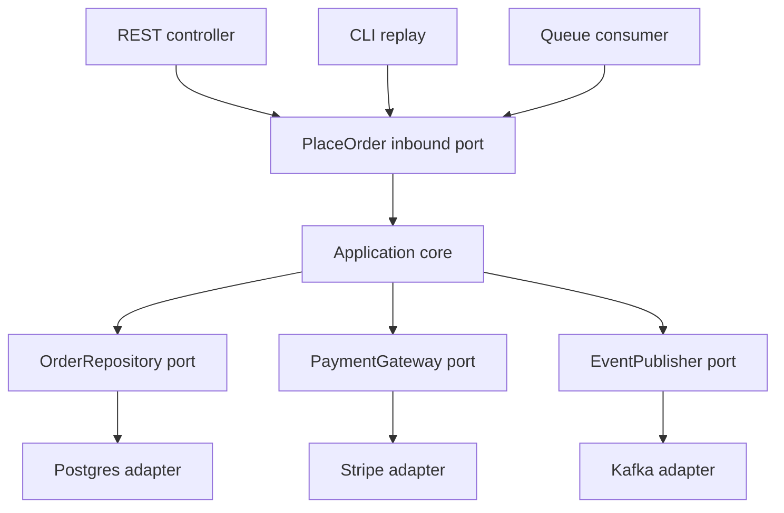

## 1. Hook

Picture a phone charger. The phone does not care whether electricity
comes from a wall socket, a laptop, a power bank, or a car. The phone
cares about one stable shape: a charging port with the right voltage
and connector. Adapters handle the messy outside world.

Now imagine a phone whose battery wires are soldered directly into
one wall socket. It works in that room, on that wall, until the owner
travels. Then the phone is useless because the business part is fused
to the external detail.

Hexagonal architecture treats your core application like the phone.
The business logic exposes ports. Databases, HTTP controllers, queues,
payment vendors, and CLI commands are adapters. When the outside world
changes, you swap adapters without rewriting the core.

## 2. What Is It

(a) Plain-English one-liner: hexagonal architecture puts business
logic at the center and connects it to external systems through
interfaces called ports and implementations called adapters.

(b) Formal definition: hexagonal architecture, also called ports and
adapters, is an architectural style where the application core
contains domain logic and use cases, inbound ports define ways to
drive the application, outbound ports define dependencies the
application needs, and adapters translate between those ports and
external technologies such as HTTP, SQL, message queues, files, and
third-party APIs. It is a tactical way to protect DDD-style domain
models from infrastructure coupling (see: MOD-06/02-domain-driven-design-ddd).

## 3. The Problem It Solves

Before hexagonal architecture, code often grows from frameworks
inward. A controller validates a request, calls an ORM model, talks to
Stripe, sends an email, and returns JSON. The business rule "premium
orders require fraud review above $500" is buried between Express
request parsing and database calls. Tests need a database and HTTP
server. Replacing Stripe or moving from REST to a queue means touching
business logic.

After hexagonal architecture, the use case owns the rule. It depends
on ports like PaymentGateway, OrderRepository, and FraudReviewQueue.
The Express controller is just an inbound adapter. Postgres and Stripe
are outbound adapters. Tests use in-memory adapters. The business
logic becomes portable and the framework becomes replaceable.

It solves dependency direction. The core stops depending on the
outside world; the outside world depends on the core's ports.

## 4. Core Concept Breakdown

- **Application core:** use cases and domain rules, free of framework
  imports and infrastructure code.
- **Inbound port:** an interface describing a way to drive the system,
  such as `PlaceOrder`.
- **Outbound port:** an interface describing something the core needs,
  such as `PaymentGateway` or `OrderRepository`.
- **Inbound adapter:** technology that calls the core: REST
  controller, GraphQL resolver, CLI command, queue consumer.
- **Outbound adapter:** technology called by the core through a port:
  SQL repository, Stripe client, Redis cache, email provider.
- **Dependency inversion:** outer layers depend on interfaces owned by
  the core, not the other way around.
- **Test seam:** ports make fake adapters natural, so use cases can be
  tested without databases or network calls.
- **Composition root:** startup code wires adapters to ports for the
  running environment.

## 5. How It Works

Step by step, designing a payment use case with ports and adapters:

1. **Write the use case in business language.** Example: "Place order
   and authorize payment."
2. **Identify inbound drivers.** Today it may be an HTTP endpoint;
   tomorrow it may be a queue message or CLI replay.
3. **Define outbound needs as ports.** The use case needs to save an
   order, authorize payment, and publish an event.
4. **Keep ports technology-neutral.** `authorize(amount)` is stable;
   `postStripeChargeJson(payload)` leaks a vendor into the core.
5. **Implement adapters outside the core.** PostgresOrderRepository
   and StripePaymentGateway live in infrastructure code.
6. **Wire dependencies at startup.** The composition root chooses real
   adapters in production and fake adapters in tests.
7. **Make controllers thin.** The controller maps HTTP input to a use
   case command and maps the result to HTTP output.
8. **Make tests target use cases.** Most tests run against in-memory
   adapters; a smaller set verifies real adapter integration.
9. **Replace infrastructure by adding adapters.** A new payment
   provider should not rewrite the use case.
10. **Avoid abstracting everything prematurely.** Ports are valuable
    where external change or test isolation matters, not around every
    one-line helper.

Port design test:

- **Name ports after business capability, not vendors.** Prefer
  `PaymentGateway.authorize` over `StripeClient.createCharge`.
- **Keep DTOs on the adapter side.** The core should speak domain
  types, not HTTP bodies, ORM rows, or SDK responses.
- **Make outbound ports narrow.** A query path that needs 3 fields
  should not depend on a repository with 80 methods.
- **Integration-test adapters separately.** Fast core tests are not a
  replacement for proving SQL transactions, queue semantics, or vendor
  behavior.

## 6. Diagram



<!-- IMAGE: hexagon diagram with application core in the center,
inbound adapters on the left, outbound adapters on the right, and
ports shown as stable boundaries -->

## 7. When to Use It

Use hexagonal architecture when:

- **Business rules matter.** You want rules isolated from HTTP,
  database, and vendor details.
- **External systems may change.** Payment providers, databases, or
  delivery mechanisms are not permanent.
- **You need fast unit tests.** Ports allow in-memory adapters for most
  behavior tests.
- **The same use case has multiple drivers.** HTTP endpoint, batch
  replay, queue consumer, and admin command can share the same core.

## 8. When NOT to Use It

- **Do not wrap every library in an interface.** A port is useful when
  it expresses application need, not when it mirrors a package API.
- **Do not use it as ceremony for simple CRUD.** A thin admin endpoint
  may not need a full port and adapter setup.
- **Do not let adapters leak inward.** If the core imports Express,
  Prisma, Kafka, or Stripe SDK types, the boundary is broken.
- **Do not hide performance-critical queries behind vague repositories.**
  Read-heavy paths may need explicit query ports or read models.

## 9. Real-World Example

**Payment systems** commonly use ports for payment providers because
Stripe, Adyen, PayPal, bank transfers, and internal ledgers have
different APIs but the core needs one business action: authorize,
capture, refund.

**Airline booking systems** often use adapters for global distribution
systems, payment rails, email, and inventory sources. The booking rule
must not depend directly on one vendor's protocol.

Realistic number: in a checkout service, 70 to 90 percent of tests can
run against in-memory ports in under a few seconds, while adapter
integration tests cover the smaller surface that touches Postgres,
Redis, or vendor sandboxes.

Concrete production shape: keep HTTP controllers, queue consumers, and
cron jobs as inbound adapters that all call the same use case. If a
batch replay path needs a separate code path, the "hexagon" has not
actually isolated the application core.

## 10. Production-Grade Code

```typescript
type Money = { currency: "USD"; cents: number };

type PlaceOrderCommand = {
  orderId: string;
  customerId: string;
  sku: string;
  amount: Money;
};

type OrderPlaced = {
  type: "OrderPlaced";
  orderId: string;
  customerId: string;
};

interface OrderRepository {
  save(order: { id: string; customerId: string; sku: string; amount: Money }): Promise<void>;
}

interface PaymentGateway {
  authorize(orderId: string, amount: Money): Promise<{ authorizationId: string }>;
}

interface EventPublisher {
  publish(event: OrderPlaced): Promise<void>;
}

export class PlaceOrderUseCase {
  constructor(
    private readonly orders: OrderRepository,
    private readonly payments: PaymentGateway,
    private readonly events: EventPublisher
  ) {}

  async execute(command: PlaceOrderCommand): Promise<{ authorizationId: string }> {
    const payment = await this.payments.authorize(command.orderId, command.amount);

    // Save after authorization because this business accepts only
    // authorized orders as durable orders. A different domain could
    // invert this order and compensate with a saga.
    await this.orders.save({
      id: command.orderId,
      customerId: command.customerId,
      sku: command.sku,
      amount: command.amount,
    });

    await this.events.publish({
      type: "OrderPlaced",
      orderId: command.orderId,
      customerId: command.customerId,
    });

    return payment;
  }
}

export class InMemoryOrderRepository implements OrderRepository {
  public readonly rows = new Map<string, PlaceOrderCommand>();

  async save(order: PlaceOrderCommand): Promise<void> {
    this.rows.set(order.orderId, order);
  }
}
```

Why-not-what notes:

- The core defines ports in terms of business needs: save order,
  authorize payment, publish event.
- The use case does not import framework or vendor types, so it can be
  tested without HTTP, SQL, or Stripe.
- The comment explains the business ordering decision, because that is
  the part future engineers must revisit.

## 11. Trade-offs Table

| Pros | Cons | What it costs you |
|---|---|---|
| Keeps domain logic independent from frameworks | More files and interfaces | Naming discipline and composition wiring |
| Makes tests fast with fake adapters | Poor ports can become leaky abstractions | Port design based on business needs |
| Allows adapter replacement | Not every dependency deserves a port | Judgment about change likelihood |
| Supports multiple inbound drivers | Can feel indirect for simple CRUD | Use-case layer and mapping code |
| Clarifies dependency direction | Developers may bypass ports for speed | Code review and architectural tests |

## 12. Comparison Table

| Approach | Dependency direction | Testability | Best fit | Main risk |
|---|---|---|---|---|
| Framework-first MVC | controller to ORM and services | medium | CRUD apps | business rules leak into controllers |
| Hexagonal architecture | adapters depend on core ports | high | rule-heavy services | too many shallow ports |
| Clean architecture | outer layers depend inward | high | large applications | ceremony if applied rigidly |
| Transaction script | use case methods call infrastructure | medium | simple workflows | duplicated rules |

## 13. Numbers & Benchmarks

- **Unit test speed:** in-memory adapter tests often run in 1 to 10 ms
  per case; database-backed tests commonly run 50 to 500 ms per case.
- **Adapter ratio:** a payment core might have 1 use case and 3 to 6
  adapters: HTTP, queue, Postgres, payment provider, event bus, test
  double.
- **Change cost:** switching an outbound vendor can be one adapter plus
  contract tests if the port is stable; without a port, changes spread
  through controllers and use cases.
- **Boundary smell:** if a domain file imports more than 1 external SDK
  type, the hexagon is probably leaking.
- **Test pyramid:** 70 percent or more of behavior tests can target the
  core when ports are clean.
- **Adapter contract count:** each outbound adapter should have a small
  contract test suite proving mapping, retries, timeout behavior, and
  error translation.
- **Boundary lint rule:** many teams enforce "domain cannot import
  infrastructure" with dependency linting so leaks are caught in CI.

## 14. Common Pitfalls

- **Incident: vendor type leaked inward.** The core returned
  `Stripe.Charge`, so adding PayPal required changing every caller.
- **Incident: fake repository hid a transaction bug.** Unit tests
  passed, but the SQL adapter saved two rows without a transaction.
  Adapter integration tests were missing.
- **Incident: repository became a dumping ground.** One `UserRepository`
  had 80 methods for unrelated read paths. The team needed narrower
  query ports.

## 15. Interview Q&A

**Q1. What is a port?** Model answer: an interface owned by the
application core that defines either how the core is driven or what
the core needs from the outside world.

**Q2. What is an adapter?** Model answer: technology-specific code
that translates between a port and the outside world, such as an HTTP
controller or Postgres repository.

**Q3. How is hexagonal architecture related to DDD?** Model answer:
DDD shapes the domain model and boundaries; hexagonal architecture
protects that model from infrastructure coupling.

**Q4. Does every dependency need an interface?** Model answer: no.
Create ports for meaningful application needs, not for every package.
Over-abstracting simple dependencies creates noise.

**Q5. Where should transaction handling live?** Model answer: usually
at the application service or unit-of-work boundary, because it spans
repository operations needed by one use case.

## 16. Follow-up / Curveball Questions

**Curveball 1. Your port mirrors the Stripe SDK exactly. Is that good?**
Answer direction: no. A port should express the business need, such as
authorize or refund, not expose vendor-specific vocabulary.

**Curveball 2. A read endpoint needs a highly optimized SQL query.
Should it go through the aggregate repository?** Answer direction:
not necessarily. Use a dedicated query port or read model so the write
model stays clean.

**Curveball 3. The team says adapters are boilerplate. What do you
measure?** Answer direction: test speed, vendor change frequency,
domain bug rate, and the number of places framework types leak into
business code.

## 17. Cheat-Sheet Summary

- Hexagonal architecture puts use cases and domain rules at the center.
- Ports are stable interfaces; adapters translate external technology.
- Inbound adapters drive the app; outbound adapters satisfy core needs.
- The core should not import framework, database, queue, or vendor SDK types.
- Use it where business rules, tests, or external change justify the boundary.

## 18. Further Reading

- Alistair Cockburn, "Hexagonal Architecture" - the original ports and
  adapters explanation:
  https://alistair.cockburn.us/hexagonal-architecture/
- Robert C. Martin, "Clean Architecture" - related dependency rule and
  layering model:
  https://blog.cleancoder.com/uncle-bob/2012/08/13/the-clean-architecture.html
- Vaughn Vernon, "Implementing Domain-Driven Design" - practical use
  with aggregates and repositories:
  https://www.informit.com/store/implementing-domain-driven-design-9780321834577

---

## COMPLETENESS CHECK

Section checklist (18):

1. Hook - Covered (phone charger analogy)
2. What Is It - Covered (plain-English and formal definitions)
3. The Problem It Solves - Covered (framework-first before, core-first after)
4. Core Concept Breakdown - Covered (8 concepts)
5. How It Works - Covered (10 steps)
6. Diagram - Covered (flowchart of ports and adapters)
7. When to Use It - Covered (4 triggers)
8. When NOT to Use It - Covered (4 warnings)
9. Real-World Example - Covered (payments, airlines, test ratio)
10. Production-Grade Code - Covered (TypeScript use case and ports)
11. Trade-offs Table - Covered (5 rows)
12. Comparison Table - Covered (4 approaches)
13. Numbers & Benchmarks - Covered (5 figures)
14. Common Pitfalls - Covered (3 incident notes)
15. Interview Q&A - Covered (5 Q&As)
16. Follow-up / Curveball Questions - Covered (3 curveballs)
17. Cheat-Sheet Summary - Covered (5 lines)
18. Further Reading - Covered (3 sources)

No em-dashes. No emojis. Cross-links included.
