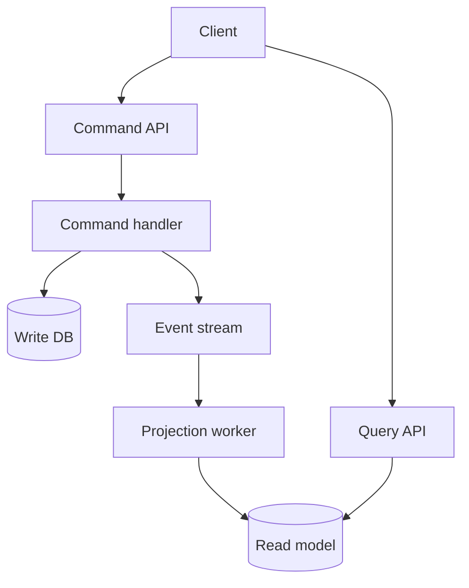

## 1. Hook

A library has two desks. One desk changes the library: check out a
book, return a book, pay a fine, update membership. The other desk
answers questions: where is a book, what are the most borrowed titles,
which books are overdue. If the same clerk tries to do both with one
notebook, the notebook becomes awkward. The checkout pages need strict
rules. The search pages need fast lookup and summaries.

Separating the desks makes the work clearer. The checkout desk protects
correctness. The information desk is optimized for reading.

CQRS is that separation in software. Commands change state. Queries
read state. They can share a database in small systems, but at scale
they often use different models because writing correctly and reading
quickly want different shapes.

## 2. What Is It

(a) Plain-English one-liner: CQRS separates writes that change the
system from reads that answer questions, often using different models
for each side.

(b) Formal definition: Command Query Responsibility Segregation (CQRS)
is an architectural pattern that separates command operations, which
validate intent and mutate state, from query operations, which return
read-only data. The command side is optimized for invariants and
transactions; the query side is optimized for read shape, latency, and
scale. CQRS often uses events to update read models asynchronously
(see: MOD-06/04-event-driven-architecture).

## 3. The Problem It Solves

Before CQRS, one model tries to serve two masters. The order table is
normalized for write correctness, but the product page wants a denormalized
view with order count, inventory, review summary, promotion label, and
shipping estimate. Engineers add joins, caches, read-only columns, and
database views to one schema until writes become slow and reads are
still awkward.

After CQRS, the write model protects business rules: place order,
cancel order, capture payment. Events or replication update read
models shaped for screens and reports: order history, dashboard, search
index, support timeline. The command model can stay normalized and
strict. The query model can be duplicated and denormalized.

CQRS solves model tension. It lets the write side and read side evolve
for different jobs.

## 4. Core Concept Breakdown

- **Command:** an intent to change state, such as `PlaceOrder` or
  `CancelSubscription`.
- **Command handler:** validates intent, enforces invariants, writes
  state, and emits events.
- **Query:** a read-only request that returns data and has no side
  effects.
- **Write model:** normalized domain model optimized for correctness.
- **Read model:** denormalized projection optimized for a specific read
  shape.
- **Projection:** process that updates read models from events or
  change streams.
- **Eventual consistency:** read models may lag behind writes by
  milliseconds or seconds.
- **Separate scaling:** read and write sides can use different
  databases, indexes, caches, and capacity plans.

## 5. How It Works

Step by step, applying CQRS to order history:

1. **Identify commands.** `PlaceOrder`, `CancelOrder`, `CapturePayment`
   are state-changing verbs.
2. **Identify queries.** `GetOrderHistory`, `GetOrderDetail`,
   `SearchOrders` are read-only questions.
3. **Build the command model for invariants.** The command side checks
   inventory, payment state, and cancellation rules.
4. **Emit an event after state changes.** `OrderPlaced` or
   `OrderCancelled` feeds projections.
5. **Build read models per screen.** The mobile order history can be
   one flat document per user, while support may need a timeline view.
6. **Accept read lag.** After placing an order, the UI may show a
   pending state until the read model catches up.
7. **Use idempotent projections.** Events may replay or duplicate, so
   projections must upsert deterministically.
8. **Expose separate APIs.** Command endpoints return acceptance or
   result IDs; query endpoints return read-optimized data.
9. **Monitor projection lag.** The read side is only as trustworthy as
   its freshness.
10. **Keep CQRS local when possible.** You can separate classes and
    handlers before separating databases.

Senior design review questions:

- **What is the read-your-write story?** Decide whether the client
  reads from the command result, waits for projection version, or shows
  pending state.
- **What is the rebuild story?** Every read model needs a documented
  way to reset and replay without corrupting totals.
- **What is the ownership story?** The read model has an owner, SLO,
  schema, and deletion policy, not just a convenient table.
- **What is the correctness source?** The write model or event log must
  remain the authority when projections disagree.

## 6. Diagram



<!-- IMAGE: CQRS split showing command API writing a normalized order
model and query API reading a denormalized order history projection -->

## 7. When to Use It

Use CQRS when:

- **Read and write shapes are very different.** Complex writes but
  simple denormalized reads are a strong signal.
- **Read traffic dwarfs write traffic.** Many products read 10 to 100
  times more than they write.
- **Different teams own read experiences and write invariants.**
  Support dashboards and checkout rules evolve differently.
- **You need projections for performance.** Search, timelines, and
  dashboards often need read models.

## 8. When NOT to Use It

- **Do not use CQRS for simple CRUD.** A small admin table rarely needs
  separate command and query models.
- **Do not hide strong consistency requirements.** If the user must
  read their own write immediately, design for it explicitly.
- **Do not create one read model for all reads.** That repeats the
  original problem. Read models should match specific queries.
- **Do not skip projection repair.** Read models drift; you need replay
  or rebuild procedures.

## 9. Real-World Example

**E-commerce order systems** commonly write normalized order and
payment state while reading denormalized order history, support
timeline, and analytics projections.

**Banking apps** often separate ledger write models from account
summary and transaction feed read models. The ledger protects
correctness; feeds are read optimized.

Realistic number: a consumer app may have 1 write for every 20 to 200
reads. A denormalized read model that answers in 10 ms can replace a
join-heavy query taking 200 ms to 800 ms under load.

Concrete example: order history is a read model, not the order source
of truth. It may store product title, thumbnail URL, payment label, and
shipment ETA in one row so mobile renders quickly, while the write side
keeps payment, catalog, and shipment rules in separate owned models.

## 10. Production-Grade Code

```typescript
type PlaceOrderCommand = {
  orderId: string;
  userId: string;
  totalCents: number;
};

type OrderHistoryRow = {
  orderId: string;
  userId: string;
  status: "PLACED" | "CANCELLED";
  totalCents: number;
  updatedAt: string;
};

interface OrderWriteStore {
  insertOrder(command: PlaceOrderCommand): Promise<void>;
}

interface EventBus {
  publish(event: OrderHistoryRow): Promise<void>;
}

interface OrderHistoryReadStore {
  upsert(row: OrderHistoryRow): Promise<void>;
  listForUser(userId: string, limit: number): Promise<OrderHistoryRow[]>;
}

export class PlaceOrderHandler {
  constructor(
    private readonly writes: OrderWriteStore,
    private readonly events: EventBus
  ) {}

  async execute(command: PlaceOrderCommand): Promise<void> {
    if (command.totalCents <= 0) throw new Error("order total must be positive");
    await this.writes.insertOrder(command);
    await this.events.publish({
      ...command,
      status: "PLACED",
      updatedAt: new Date().toISOString(),
    });
  }
}

export async function projectOrderHistory(
  event: OrderHistoryRow,
  readStore: OrderHistoryReadStore
): Promise<void> {
  // Projection writes are upserts so replaying the stream can rebuild
  // the read model without creating duplicate rows.
  await readStore.upsert(event);
}
```

Why-not-what notes:

- The command handler checks write-side invariants and does not return
  a read-shaped order history document.
- The projection is idempotent so replay is a normal maintenance tool.
- The read store interface is query-specific instead of pretending one
  repository should serve every screen.

## 11. Trade-offs Table

| Pros | Cons | What it costs you |
|---|---|---|
| Write model stays focused on invariants | Read models can lag behind writes | Pending UI states and lag monitoring |
| Read models match screens and scale independently | More moving parts than CRUD | Projection workers and rebuild scripts |
| Denormalized reads are fast | Duplicate data must be kept consistent | Replay, repair, and reconciliation |
| Different databases can fit different sides | Debugging crosses models | Correlation IDs and event audit trails |
| Supports event sourcing naturally | Overkill for simple workflows | Architectural restraint |

## 12. Comparison Table

| Approach | Write model | Read model | Consistency | Best fit | Risk |
|---|---|---|---|---|---|
| CRUD | same as read | same as write | strong locally | simple apps | model tension at scale |
| CQRS same DB | separate code paths | read tables or views | usually strong or near-real-time | moderate complexity | boundary may blur |
| CQRS async projections | normalized commands | denormalized projections | eventual | high-read systems | stale reads |
| Event sourcing + CQRS | event log | projections | eventual by default | audit-heavy domains | operational complexity |

## 13. Numbers & Benchmarks

- **Read/write ratio:** many consumer products see 10:1 to 200:1 reads
  to writes for core entities.
- **Projection lag:** user-facing read models often target sub-second
  to 5-second lag; analytics projections may tolerate minutes.
- **Query speed:** a precomputed read model can turn a 6-table join
  into a single key lookup.
- **Storage overhead:** denormalized read models can add 10 to 100
  percent duplicate storage for hot screens.
- **Rebuild time:** rebuilding a projection from 100 million events can
  take hours unless partitioned and parallelized.
- **Freshness budget:** write down whether a projection may be 100 ms,
  5 seconds, or 15 minutes stale. Different screens need different
  budgets.
- **Replay safety test:** projection code should pass the same event
  stream twice without duplicate rows or inflated counters.

## 14. Common Pitfalls

- **Incident: user could not see their order.** Checkout succeeded,
  but the order history projection lagged 30 seconds and the UI did
  not show a pending state.
- **Incident: projection was not replay-safe.** Rebuilding order
  history doubled totals because projection code inserted instead of
  upserted.
- **Incident: command handler returned read model fields.** The write
  side became coupled to a mobile screen and broke when the screen
  changed.

## 15. Interview Q&A

**Q1. What does CQRS separate?** Model answer: commands that change
state from queries that read state. The separation may be code-only or
may include different databases.

**Q2. Does CQRS require event sourcing?** Model answer: no. CQRS can
use ordinary tables and projections. Event sourcing often pairs with
CQRS but is a separate pattern.

**Q3. How do you handle stale reads?** Model answer: expose pending
states, read from the write side for critical read-your-write flows,
or track projection version and lag.

**Q4. Why not use one database view for all reads?** Model answer:
read models should be shaped by query needs. One universal read view
becomes another overloaded model.

**Q5. How do projections stay correct?** Model answer: idempotent
upserts, version checks, replay support, monitoring, and reconciliation
jobs.

## 16. Follow-up / Curveball Questions

**Curveball 1. The CEO wants instant order confirmation and order
history. Does CQRS fail?** Answer direction: no. Return confirmation
from the command side and show a pending or direct write-side read
until projection catches up.

**Curveball 2. Read model data disagrees with write model. Which is
truth?** Answer direction: the write model is source of truth unless
event sourcing makes the log the source. Rebuild or repair projections.

**Curveball 3. Can CQRS be inside a monolith?** Answer direction: yes.
Separate command handlers and query handlers first; split databases
only if scale or ownership needs it.

## 17. Cheat-Sheet Summary

- CQRS separates state-changing commands from read-only queries.
- The write model protects invariants; the read model serves screens.
- Read models are often denormalized and eventually consistent.
- Projections must be idempotent, replayable, and monitored for lag.
- Use CQRS for model tension and read scale, not for simple CRUD.

## 18. Further Reading

- Martin Fowler, "CQRS" - concise pattern overview and cautions.
  https://martinfowler.com/bliki/CQRS.html
- Greg Young talks on CQRS and event sourcing - original practical
  framing from high-complexity domains:
  https://cqrs.wordpress.com/documents/cqrs-introduction/
- Microsoft Architecture Center on CQRS - operational guidance and
  examples for cloud systems:
  https://learn.microsoft.com/en-us/azure/architecture/patterns/cqrs

---

## COMPLETENESS CHECK

Section checklist (18):

1. Hook - Covered (library two-desk analogy)
2. What Is It - Covered (plain-English and formal definitions)
3. The Problem It Solves - Covered (one overloaded model before, split models after)
4. Core Concept Breakdown - Covered (8 concepts)
5. How It Works - Covered (10 steps)
6. Diagram - Covered (flowchart command and query paths)
7. When to Use It - Covered (4 triggers)
8. When NOT to Use It - Covered (4 warnings)
9. Real-World Example - Covered (commerce, banking, read/write figures)
10. Production-Grade Code - Covered (TypeScript command handler and projection)
11. Trade-offs Table - Covered (5 rows)
12. Comparison Table - Covered (4 approaches)
13. Numbers & Benchmarks - Covered (5 figures)
14. Common Pitfalls - Covered (3 incident notes)
15. Interview Q&A - Covered (5 Q&As)
16. Follow-up / Curveball Questions - Covered (3 curveballs)
17. Cheat-Sheet Summary - Covered (5 lines)
18. Further Reading - Covered (3 sources)

No em-dashes. No emojis. Cross-links included.
