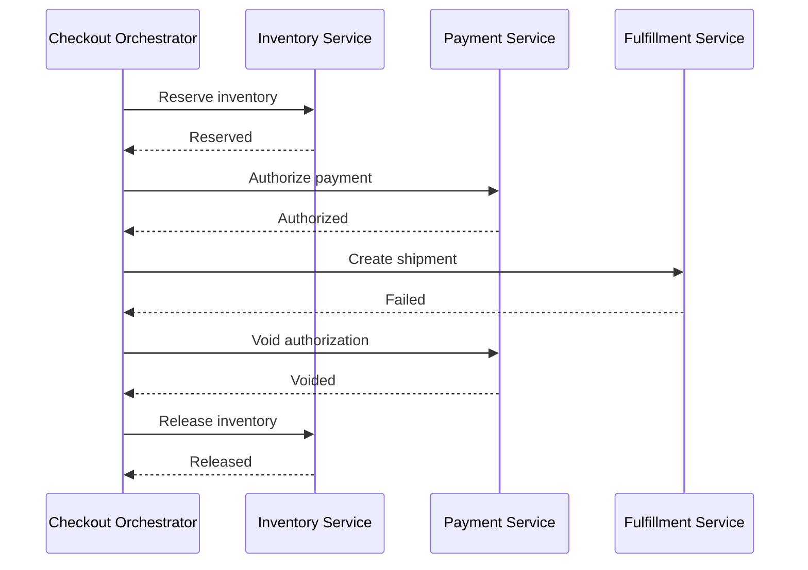

## 1. Hook

Booking a vacation is not one action. You reserve a flight, book a
hotel, rent a car, and buy travel insurance. If the hotel booking
fails after the flight succeeds, nobody can roll back the airline's
database from your living room. The travel agent must compensate:
cancel the flight, release the car, refund the insurance, and explain
the final state.

A database transaction is like one cashier handling one purchase in
one shop. A saga is like coordinating several shops where each shop
keeps its own cash register. You cannot undo time. You can run a
careful sequence of forward actions and compensating actions.

That is the saga pattern. It is the practical answer when one business
workflow spans multiple services and no single ACID transaction can own
the whole thing.

## 2. What Is It

(a) Plain-English one-liner: a saga breaks a distributed business
transaction into local transactions, with compensating steps when later
steps fail.

(b) Formal definition: the saga pattern is a distributed transaction
management pattern where a long-running business process is represented
as a sequence of local transactions across services. Each local
transaction commits within one service's database and publishes an
event or response that triggers the next step. If a step fails, the
saga executes compensating transactions to semantically undo prior
steps. Sagas trade immediate ACID atomicity for eventual consistency
and explicit recovery (see: MOD-05/04-message-queues and
MOD-03/03-acid-properties).

## 3. The Problem It Solves

Before sagas, teams try to make distributed workflows behave like one
database transaction. Checkout writes order, payment, inventory,
shipment, and loyalty updates across several services. A payment
capture succeeds, then inventory reservation fails. Without a saga,
the system has a paid order with no inventory or a reserved item with
no payment.

After sagas, the workflow is explicit. Reserve inventory. Authorize
payment. Create shipment. Confirm order. If shipment fails, release
inventory and void authorization. Every step has a known forward action
and a known compensation.

Sagas solve cross-service workflow correctness. They do not make
distributed state magically atomic; they make failure and repair part
of the design.

## 4. Core Concept Breakdown

- **Local transaction:** one service updates its own database
  atomically.
- **Saga step:** one local transaction in the overall workflow.
- **Compensation:** a business action that reverses or neutralizes a
  prior successful step.
- **Orchestration:** one coordinator tells services what to do next.
- **Choreography:** services react to each other's events without a
  central coordinator.
- **Saga state:** durable record of which steps succeeded, failed, or
  compensated.
- **Idempotency:** each step and compensation must tolerate retries.
- **Timeout:** a step that never responds must trigger retry,
  compensation, or manual intervention.

## 5. How It Works

Step by step, orchestrating checkout:

1. **Start the saga.** Create a durable saga record with status
   `STARTED`.
2. **Reserve inventory.** Inventory service commits reservation in its
   own database.
3. **Authorize payment.** Payment service authorizes or captures funds.
4. **Create shipment.** Fulfillment service creates a shipment request.
5. **Confirm order.** Ordering service marks order confirmed.
6. **Handle step failure.** If shipment fails, run compensation in
   reverse order.
7. **Compensate payment.** Void authorization or issue refund.
8. **Compensate inventory.** Release reserved units.
9. **Mark final status.** Saga ends as `COMPLETED`, `COMPENSATED`, or
   `FAILED_REQUIRES_REVIEW`.
10. **Retry safely.** Every command uses idempotency keys so duplicate
    messages do not double-charge or double-release.

Saga design checklist:

- **Name every terminal state.** Completed, compensated, failed manual
  review, expired, and cancelled should be explicit.
- **Define compensation before launch.** If the business cannot say how
  to reverse a step, the system needs a hold point before that step.
- **Store step history.** Support and recovery need to know which
  participant succeeded, failed, timed out, or compensated.
- **Make manual repair boring.** A senior system has an operator path
  for stuck sagas, not only logs and hope.

## 6. Diagram



<!-- IMAGE: checkout saga timeline with successful steps moving
forward and compensation arrows moving backward after shipment failure -->

## 7. When to Use It

Use sagas when:

- **A business workflow spans multiple service databases.** Checkout,
  booking, onboarding, and fulfillment are common examples.
- **2PC is unavailable or too costly.** Most microservice databases do
  not support safe distributed ACID across boundaries.
- **Compensation has real business meaning.** Refund, release,
  cancel, reverse, or notify manual review.
- **The workflow can tolerate intermediate states.** Users may see
  pending, processing, or refunding states.

## 8. When NOT to Use It

- **Do not use a saga inside one database.** A local ACID transaction
  is simpler and stronger.
- **Do not use a saga when compensation is impossible.** Some actions,
  like sending a physical package, may need hold points before commit.
- **Do not hide intermediate states.** Users and support teams need to
  see pending and compensating states.
- **Do not run sagas without idempotency.** Retries are normal and
  double effects are dangerous.

## 9. Real-World Example

**Travel booking platforms** are classic saga domains: flight, hotel,
payment, car, and insurance are independent systems with compensations.

**E-commerce checkout** uses saga-like workflows for payment
authorization, inventory reservation, shipment creation, and order
confirmation.

Realistic number: a checkout saga with 4 services and 2 retries per
step may execute 8 to 12 messages on the success path and 12 to 20
messages on a failure path with compensation.

Concrete production rule: prefer authorization over capture until
inventory and fulfillment have passed their irreversible points. A
voided authorization is cheaper and cleaner than refunding captured
money after the business discovers it cannot ship.

## 10. Production-Grade Code

```typescript
type SagaStatus = "STARTED" | "INVENTORY_RESERVED" | "PAYMENT_AUTHORIZED" | "COMPLETED" | "COMPENSATED";

interface InventoryClient {
  reserve(orderId: string): Promise<void>;
  release(orderId: string): Promise<void>;
}

interface PaymentClient {
  authorize(orderId: string): Promise<void>;
  voidAuthorization(orderId: string): Promise<void>;
}

interface SagaStore {
  setStatus(orderId: string, status: SagaStatus): Promise<void>;
}

export class CheckoutSaga {
  constructor(
    private readonly inventory: InventoryClient,
    private readonly payment: PaymentClient,
    private readonly store: SagaStore
  ) {}

  async run(orderId: string): Promise<void> {
    await this.store.setStatus(orderId, "STARTED");
    try {
      await this.inventory.reserve(orderId);
      await this.store.setStatus(orderId, "INVENTORY_RESERVED");

      await this.payment.authorize(orderId);
      await this.store.setStatus(orderId, "PAYMENT_AUTHORIZED");

      await this.store.setStatus(orderId, "COMPLETED");
    } catch (error) {
      // Compensation is part of the business workflow, not exception
      // cleanup. These calls must be idempotent because retries may
      // repeat them after partial failure.
      await this.payment.voidAuthorization(orderId).catch(() => undefined);
      await this.inventory.release(orderId).catch(() => undefined);
      await this.store.setStatus(orderId, "COMPENSATED");
      throw error;
    }
  }
}
```

Why-not-what notes:

- Saga status is durable because a process crash must resume from the
  last known step.
- Compensation failures are not ignored in real systems; they usually
  go to retry or manual review. The snippet keeps the core shape small.
- Idempotency belongs in every downstream command because orchestration
  retries are unavoidable.

## 11. Trade-offs Table

| Pros | Cons | What it costs you |
|---|---|---|
| Enables workflows across service-owned databases | Not ACID across the full workflow | Intermediate states and support tooling |
| Makes failure paths explicit | Compensation can be business-hard | Product decisions for reversal rules |
| Avoids distributed locks and 2PC | More messages and state transitions | Orchestrator or choreography discipline |
| Supports long-running processes | Debugging is harder than one transaction | Saga IDs, tracing, and audit records |
| Fits microservice ownership | Users may see pending states | UX and customer communication |

## 12. Comparison Table

| Approach | Consistency | Coordination | Best fit | Failure handling | Risk |
|---|---|---|---|---|---|
| Local ACID transaction | strong | one database | single service | rollback | cannot cross service DBs |
| 2PC | atomic distributed commit | coordinator lock | few trusted participants | abort commit protocol | blocking and operational fragility |
| Saga orchestration | eventual | central workflow | complex business process | compensating actions | coordinator coupling |
| Saga choreography | eventual | events among services | simple fan-out workflow | compensating events | hard to trace |

## 13. Numbers & Benchmarks

- **Workflow length:** practical sagas often have 3 to 8 steps; beyond
  that, visibility and retry tooling become essential.
- **Timeouts:** payment and inventory steps often use timeouts in the
  1 to 30 second range depending on provider and user flow.
- **Retry count:** 3 retries with exponential backoff is common before
  moving a step to manual review or DLQ.
- **Intermediate state duration:** payment authorizations may remain
  valid for days, while inventory reservations may expire in minutes.
- **Message count:** each step usually needs command, reply or event,
  and possible compensation message.
- **Manual review threshold:** workflows touching money often move to
  manual review after 3 to 5 failed retries rather than looping forever.
- **Idempotency window:** keep idempotency keys at least as long as the
  maximum retry and replay window for the saga.

## 14. Common Pitfalls

- **Incident: compensation was not idempotent.** A retry released
  inventory twice and oversold a SKU.
- **Incident: no durable saga state.** The orchestrator crashed after
  payment authorization and forgot to confirm or void payment.
- **Incident: hidden pending state.** Customers saw "order failed" even
  though payment was still reversing, causing duplicate purchases.

## 15. Interview Q&A

**Q1. Why use a saga instead of a distributed transaction?** Model
answer: many microservice systems cannot safely use 2PC across
independent databases. Sagas use local transactions and compensations
to reach eventual consistency.

**Q2. Orchestration vs choreography?** Model answer: orchestration has
a coordinator and is easier to reason about for complex workflows.
Choreography is looser but can become hard to trace.

**Q3. What makes a good compensation?** Model answer: it is a business
action that safely reverses or neutralizes a prior step, such as void
authorization or release inventory, and it is idempotent.

**Q4. Can a saga guarantee no user-visible inconsistency?** Model
answer: no. It manages inconsistency through states and compensation.
The UI must show pending, processing, or reversal states.

**Q5. How do you recover from a stuck saga?** Model answer: durable
saga state, timeouts, retries, DLQ, manual review, and idempotent
resume from the last completed step.

## 16. Follow-up / Curveball Questions

**Curveball 1. Payment captured but inventory release fails during
compensation.** Answer direction: keep saga in failed-compensation
state, retry release, alert support, and prevent shipment until state
is repaired.

**Curveball 2. The business says refunds cost money, so compensation
is not free.** Answer direction: add hold points. Authorize payment
instead of capture until inventory and fulfillment are ready.

**Curveball 3. A saga step is slow for hours.** Answer direction:
model it as long-running with explicit timeout, heartbeat, and manual
states rather than keeping a request open.

## 17. Cheat-Sheet Summary

- A saga is a sequence of local transactions across services.
- Each successful step needs a compensating action if later steps fail.
- Sagas provide eventual consistency, not distributed ACID.
- Orchestration centralizes workflow; choreography uses events.
- Durable saga state, idempotency, timeouts, and visibility are mandatory.

## 18. Further Reading

- Hector Garcia-Molina and Kenneth Salem, "Sagas" - original paper on
  long-lived transactions:
  https://www.cs.cornell.edu/andru/cs711/2002fa/reading/sagas.pdf
- Chris Richardson, "Microservices Patterns" - practical saga
  orchestration and choreography examples:
  https://microservices.io/patterns/data/saga.html
- Temporal documentation on workflows - production-grade durable
  orchestration concepts:
  https://docs.temporal.io/

---

## COMPLETENESS CHECK

Section checklist (18):

1. Hook - Covered (vacation booking analogy)
2. What Is It - Covered (plain-English and formal definitions)
3. The Problem It Solves - Covered (distributed checkout failure before, explicit workflow after)
4. Core Concept Breakdown - Covered (8 concepts)
5. How It Works - Covered (10 steps)
6. Diagram - Covered (sequence diagram with compensation)
7. When to Use It - Covered (4 triggers)
8. When NOT to Use It - Covered (4 warnings)
9. Real-World Example - Covered (travel, e-commerce, message counts)
10. Production-Grade Code - Covered (TypeScript orchestrated saga)
11. Trade-offs Table - Covered (5 rows)
12. Comparison Table - Covered (4 approaches)
13. Numbers & Benchmarks - Covered (5 figures)
14. Common Pitfalls - Covered (3 incident notes)
15. Interview Q&A - Covered (5 Q&As)
16. Follow-up / Curveball Questions - Covered (3 curveballs)
17. Cheat-Sheet Summary - Covered (5 lines)
18. Further Reading - Covered (3 sources)

No em-dashes. No emojis. Cross-links included.
