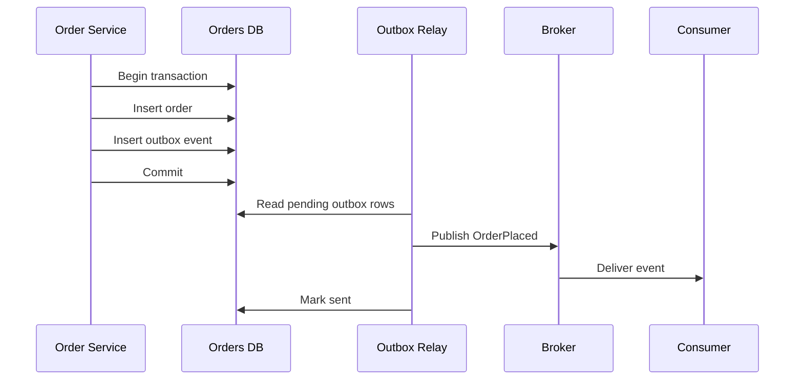

## 1. Hook

A shopkeeper writes sales in a ledger and also mails receipts. If she
updates the ledger, then the power fails before she mails the receipt,
the sale happened but the customer never hears about it. If she mails
the receipt first, then the ledger write fails, the customer has a
receipt for a sale the shop does not recognize.

The safe habit is to write the receipt request into the same ledger
transaction as the sale. Later, a clerk reads pending receipt requests
from the ledger and mails them. The sale and the intent to notify are
recorded together.

That is the transactional outbox pattern. It solves the crack between
"write database" and "publish message."

## 2. What Is It

(a) Plain-English one-liner: the transactional outbox stores messages
inside the same database transaction as business data, then publishes
them asynchronously so state changes and events do not split.

(b) Formal definition: the transactional outbox pattern is a reliability
pattern where an application writes domain state and an outbox row in
one local ACID transaction. A separate relay process reads unpublished
outbox rows and delivers them to a broker or external system, marking
them sent after successful publish. It avoids dual-write inconsistency
between a database and message broker while still accepting at-least-once
delivery semantics (see:
MOD-17/07-delivery-semantics-at-most-least-exactly-once).

## 3. The Problem It Solves

Before outbox, a service writes to its database and publishes to Kafka
as two separate actions. If the database commit succeeds and Kafka
publish fails, consumers never learn about the change. If Kafka publish
succeeds and the database commit fails, consumers react to a fact that
is not true. Distributed transactions between the database and broker
are often unavailable or operationally risky.

After outbox, the service inserts the business row and event row in the
same database transaction. A relay publishes the event later. If the
relay crashes, the outbox row remains. If the broker duplicates the
message, consumers use idempotency.

The pattern solves dual writes by turning "publish" into durable data
first, then delivery second.

## 4. Core Concept Breakdown

- **Dual write:** two systems updated separately, such as database then
  broker.
- **Outbox table:** database table containing pending messages to
  publish.
- **Local transaction:** business update and outbox insert commit
  atomically in one database.
- **Relay or poller:** worker that reads outbox rows and publishes to
  the broker.
- **At-least-once publish:** a message may be sent more than once after
  crashes or retries.
- **Idempotent consumer:** downstream service tolerates duplicate
  messages.
- **Ordering key:** entity ID used to preserve order where possible.
- **Cleanup:** old published rows are archived or deleted after safe
  retention.

## 5. How It Works

Step by step, publishing `OrderPlaced` safely:

1. **Begin database transaction.** The ordering service starts a local
   transaction.
2. **Write business state.** Insert or update the order row.
3. **Write outbox message.** Insert an outbox row with event ID, topic,
   key, payload, and status `PENDING`.
4. **Commit once.** Order and outbox message become durable together.
5. **Relay polls pending rows.** A background worker locks a batch of
   outbox rows.
6. **Publish to broker.** The relay sends payloads to Kafka, SQS, or
   another transport.
7. **Mark sent.** After publish succeeds, the relay records sent time.
8. **Retry failures.** Failed rows remain pending or move to retry
   status with attempt count.
9. **Consumers deduplicate.** Event IDs protect downstream side
   effects.
10. **Clean old rows.** Archive sent rows after retention so the outbox
    table stays small.

Relay hardening checklist:

- **Claim rows safely.** Use row locks, leases, or status transitions
  so two relay workers do not publish the same batch unnecessarily.
- **Mark sent after broker acknowledgement.** Marking early recreates
  the lost-event bug.
- **Publish with a stable event key.** Aggregate ID gives the broker a
  chance to preserve per-entity ordering.
- **Expose lag and oldest pending age.** Row count alone hides old
  stuck messages.

## 6. Diagram



<!-- IMAGE: transactional boundary around orders table and outbox table,
with a separate relay publishing from outbox to a broker -->

## 7. When to Use It

Use transactional outbox when:

- **A service must publish after database changes.** Domain events,
  integration events, emails, and search indexing are common.
- **Database and broker cannot share one transaction.** This is the
  normal case in microservices.
- **Missing an event is worse than duplicate delivery.** The outbox
  favors at-least-once delivery.
- **Consumers can be idempotent.** Duplicate events are acceptable if
  they do not duplicate effects.

## 8. When NOT to Use It

- **Do not use outbox when no durable state changed.** A pure transient
  task can go straight to a queue.
- **Do not use outbox to avoid consumer idempotency.** Duplicate
  delivery is still possible.
- **Do not leave the table unbounded.** A hot outbox without cleanup
  becomes a database problem.
- **Do not mark sent before publish is durable.** That recreates the
  lost-message failure.

## 9. Real-World Example

**Debezium outbox pattern** is widely used with change data capture:
services write outbox rows, Debezium streams those rows to Kafka from
the database log.

**E-commerce orders** use outbox to publish OrderPlaced, PaymentCaptured,
and ShipmentCreated without losing events during broker outages.

Realistic number: a service creating 1,000 orders per minute writes
1,000 outbox rows per minute. With 7 days retention, that is about
10 million rows, so partitioning and cleanup are not optional.

Concrete production split: request path owns the local transaction;
relay owns delivery. Do not let request handlers wait for broker
success unless the product truly needs synchronous notification.

## 10. Production-Grade Code

```typescript
import { randomUUID } from "node:crypto";

type Db = {
  transaction<T>(fn: (tx: Tx) => Promise<T>): Promise<T>;
};

type Tx = {
  query(sql: string, params: unknown[]): Promise<void>;
};

export async function placeOrder(db: Db, input: {
  orderId: string;
  userId: string;
  totalCents: number;
}): Promise<void> {
  const eventId = randomUUID();
  await db.transaction(async (tx) => {
    await tx.query(
      "insert into orders(id, user_id, total_cents) values($1, $2, $3)",
      [input.orderId, input.userId, input.totalCents]
    );

    // The event is stored in the same commit as the order so a process
    // crash cannot leave durable order state without a durable publish
    // intent.
    await tx.query(
      `insert into outbox(id, topic, event_key, payload, status)
       values($1, $2, $3, $4, 'PENDING')`,
      [
        eventId,
        "orders.v1",
        input.orderId,
        JSON.stringify({ eventId, type: "OrderPlaced", ...input }),
      ]
    );
  });
}
```

Why-not-what notes:

- The outbox row is a durable publish intent, not a best-effort log.
- `event_key` preserves per-order ordering when the broker supports
  keyed partitions.
- Consumers still need idempotency because the relay may publish and
  crash before marking the row sent.

## 11. Trade-offs Table

| Pros | Cons | What it costs you |
|---|---|---|
| Prevents lost events after database commit | Adds relay infrastructure | Poller or CDC pipeline and monitoring |
| Uses one local ACID transaction | Delivery is still at least once | Idempotent consumers |
| Works with existing databases | Outbox table can grow quickly | Partitioning, cleanup, and indexes |
| Decouples broker availability from request path | Events may be delayed | Lag alerts and retry policy |
| Pairs well with EDA and sagas | Ordering needs careful keys | Topic design and partitioning strategy |

## 12. Comparison Table

| Approach | Atomic with DB write | Delivery style | Best fit | Main risk |
|---|---|---|---|---|
| Direct publish after commit | no | at most once if publish fails | low-value notifications | lost events |
| Publish before commit | no | can publish false facts | rarely safe | ghost events |
| Transactional outbox | yes locally | at least once | domain events | duplicates |
| CDC outbox | yes locally | at least once via log | high throughput streams | CDC ops complexity |
| 2PC DB and broker | yes distributed | exactly once in theory | rare controlled systems | blocking and coordination cost |

## 13. Numbers & Benchmarks

- **Outbox volume:** 1,000 events per minute is 1.44 million rows per
  day before cleanup.
- **Relay batch size:** 100 to 1,000 rows per batch is common,
  depending on payload size and broker latency.
- **Lag target:** user-facing integration events often target under 5
  seconds from commit to publish.
- **Indexing:** an index on `(status, created_at)` or partitioned
  pending rows prevents full-table scans.
- **Duplicate window:** if the relay publishes then crashes before mark
  sent, the row can republish on restart.
- **Oldest pending age:** alert on age, such as "oldest unsent row
  older than 60 seconds," because it maps directly to business delay.
- **Cleanup safety:** archive by sent time and partition, not by blind
  deletes that fight the OLTP workload.

## 14. Common Pitfalls

- **Incident: outbox row written outside transaction.** An order
  committed but the outbox insert failed, losing `OrderPlaced`.
- **Incident: relay marked sent too early.** Broker publish failed
  after status changed, permanently dropping the event.
- **Incident: no cleanup.** A 400-million-row outbox slowed ordinary
  order writes because indexes and vacuum fell behind.

## 15. Interview Q&A

**Q1. What problem does transactional outbox solve?** Model answer:
the dual-write problem between database state and message publishing.
It makes the state change and publish intent atomic in one database.

**Q2. Does outbox give exactly-once delivery?** Model answer: no. It
prevents lost publish intent, but relay crashes can duplicate events.
Consumers must be idempotent.

**Q3. Poller or CDC?** Model answer: polling is simpler and portable.
CDC reduces query load and latency at higher scale but adds log
streaming operations.

**Q4. What fields belong in an outbox row?** Model answer: ID, topic,
key, payload, status, attempt count, created time, sent time, and
error metadata.

**Q5. How do you preserve ordering?** Model answer: use a stable event
key such as aggregate ID and publish to a broker partitioned by that
key.

## 16. Follow-up / Curveball Questions

**Curveball 1. Broker is down for 30 minutes. What happens?** Answer
direction: request path still commits database and outbox. Relay lag
grows, alerts fire, and relay drains when broker returns.

**Curveball 2. Relay publishes duplicate events. Is that a bug?**
Answer direction: duplicate delivery is expected. It is a consumer
idempotency requirement, though excessive duplicates need investigation.

**Curveball 3. Outbox table is hurting OLTP performance.** Answer
direction: partition by time or status, keep payloads small, archive
sent rows, or move to CDC reading from the database log.

## 17. Cheat-Sheet Summary

- Transactional outbox fixes the database plus broker dual-write crack.
- Write business row and outbox row in one local transaction.
- A relay publishes pending outbox rows asynchronously.
- Delivery is at least once, so consumers must deduplicate.
- Monitor relay lag and keep the outbox table clean.

## 18. Further Reading

- Chris Richardson, "Transactional Outbox" - microservices pattern
  explanation and examples:
  https://microservices.io/patterns/data/transactional-outbox.html
- Debezium documentation on the outbox event router - CDC-based outbox
  implementation:
  https://debezium.io/documentation/reference/stable/transformations/outbox-event-router.html
- Kafka documentation on idempotent producers and transactions - useful
  broker-side context, even when using DB outbox:
  https://kafka.apache.org/documentation/#semantics

---

## COMPLETENESS CHECK

Section checklist (18):

1. Hook - Covered (shop ledger and receipt analogy)
2. What Is It - Covered (plain-English and formal definitions)
3. The Problem It Solves - Covered (dual-write before, outbox after)
4. Core Concept Breakdown - Covered (8 concepts)
5. How It Works - Covered (10 steps)
6. Diagram - Covered (sequence diagram from DB transaction to relay)
7. When to Use It - Covered (4 triggers)
8. When NOT to Use It - Covered (4 warnings)
9. Real-World Example - Covered (Debezium, e-commerce, row volume)
10. Production-Grade Code - Covered (TypeScript transactional insert)
11. Trade-offs Table - Covered (5 rows)
12. Comparison Table - Covered (5 approaches)
13. Numbers & Benchmarks - Covered (5 figures)
14. Common Pitfalls - Covered (3 incident notes)
15. Interview Q&A - Covered (5 Q&As)
16. Follow-up / Curveball Questions - Covered (3 curveballs)
17. Cheat-Sheet Summary - Covered (5 lines)
18. Further Reading - Covered (3 sources)

No em-dashes. No emojis. Cross-links included.
