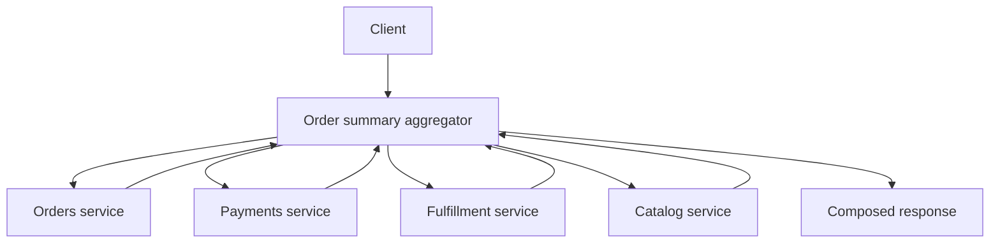

## 1. Hook

A dinner guest asks, "What is tonight's meal?" One host runs to the
kitchen for the main dish, the pantry for ingredients, the cellar for
wine, and the calendar for dietary notes, then gives one answer. That
host is composing information.

If every guest had to visit all four rooms personally, dinner would be
chaotic. But if the host becomes responsible for cooking, storing wine,
tracking allergies, and writing the menu, the host becomes the whole
restaurant.

API composition and aggregator patterns solve the same kind of
problem. A client wants one answer, but the data lives behind several
services. The trick is collecting data without turning the collector
into a new monolith.

## 2. What Is It

(a) Plain-English one-liner: API composition builds one response by
calling multiple services, while an aggregator is the component that
centralizes that fan-out and response assembly.

(b) Formal definition: API composition is a query pattern where a
client-facing layer retrieves data from multiple backend services and
combines it into a response for a specific use case. The aggregator
pattern is an implementation of that composition through a dedicated
service or gateway component. It is often used in microservices when
data ownership is split and the UI needs a combined read view (see:
MOD-06/01-monolithic-vs-microservices-architecture).

## 3. The Problem It Solves

Before composition, clients know too much. A mobile app loads order
detail by calling orders, payments, catalog, shipping, promotions, and
reviews. Every client repeats the fan-out logic. One slow service
breaks the page. Mobile releases are needed when backend service
contracts change.

After composition, a backend endpoint like `/order-summary/:id` calls
the needed services, applies timeouts and fallbacks, and returns a
screen-shaped response. The client gets one contract. Backend teams can
change internal calls behind that contract.

The pattern solves read fan-out at the client boundary. The danger is
that the aggregator can become a business-logic dumping ground.

## 4. Core Concept Breakdown

- **Composition:** joining data from several services for one read use
  case.
- **Aggregator:** component that performs fan-out, joins responses, and
  returns one API response.
- **Backend for Frontend:** client-specific aggregator for one UI
  family (see: MOD-06/11-backend-for-frontend-bff-pattern).
- **Timeout budget:** maximum time each downstream call may spend
  before fallback.
- **Partial response:** response that includes available data and marks
  missing optional parts.
- **Data ownership:** aggregator reads from services but should not own
  their source data.
- **N+1 call risk:** per-item downstream calls that multiply latency.
- **Read model alternative:** precompute the joined view instead of
  composing at request time.

## 5. How It Works

Step by step, composing an order summary:

1. **Define the client question.** "Show order detail with items,
   payment status, shipment ETA, and support actions."
2. **Identify source owners.** Orders owns order lines, payments owns
   payment state, fulfillment owns shipment, catalog owns names and
   images.
3. **Create one response contract.** The client should not know every
   backend service.
4. **Fan out in parallel.** Independent calls run concurrently to stay
   inside latency budget.
5. **Set per-call timeouts.** Optional sections fail closed with
   fallbacks instead of blocking the whole response.
6. **Avoid N+1 calls.** Batch item IDs into one catalog request.
7. **Apply lightweight mapping.** The aggregator shapes data for the
   client but does not own domain decisions.
8. **Cache stable fragments.** Catalog names and images can be cached
   longer than payment state.
9. **Trace every downstream call.** Fan-out without tracing is painful
   to debug.
10. **Promote hot compositions to read models.** If the endpoint is
    high traffic or expensive, precompute with CQRS.

Aggregator design checklist:

- **Classify dependencies as required or optional.** Required failures
  fail the response; optional failures degrade clearly.
- **Set a total deadline.** Per-call timeouts must fit inside the
  user's end-to-end latency budget.
- **Batch before caching.** Batching removes structural N+1 load;
  caching only hides it until the cache misses.
- **Track dependency contribution.** The dashboard should show which
  downstream service made the composed response slow or degraded.

## 6. Diagram



<!-- IMAGE: mobile order detail screen on the left with lines pointing
to aggregator fan-out calls to orders, payments, fulfillment, and
catalog services -->

## 7. When to Use It

Use API composition or an aggregator when:

- **The client needs one view assembled from several services.**
  Product pages, order detail, dashboards, and profile pages fit.
- **The data changes too frequently for a precomputed read model.**
  Real-time status may need live composition.
- **Client simplicity matters.** Mobile apps especially benefit from
  one stable API contract.
- **Composition logic is lightweight.** Mapping and fallback are fine;
  core business rules should remain in owning services.

## 8. When NOT to Use It

- **Do not use request-time composition for heavy joins at high QPS.**
  Precompute a read model instead.
- **Do not put ownership logic in the aggregator.** It should not
  decide payment rules or inventory truth.
- **Do not fan out sequentially without reason.** Sequential calls turn
  small latencies into slow pages.
- **Do not expose partial data silently.** Mark missing sections so
  clients and users understand degraded state.

## 9. Real-World Example

**Netflix device APIs** popularized client-oriented aggregation because
TVs, phones, and web clients needed different shapes from many backend
systems.

**GraphQL gateways** often act as API composition layers, resolving
fields from different services behind one graph.

Realistic number: an order detail endpoint that calls 5 services in
parallel with 100 ms per-call timeout can return in about 120 to 200 ms
including mapping. Sequential calls would often exceed 500 ms before
rendering.

Concrete production rule: if the same composed response is requested
by many users and can be a few seconds stale, move it to a read model.
Request-time aggregation is best for personalized or freshness-sensitive
views.

## 10. Production-Grade Code

```typescript
type Order = { id: string; itemIds: string[]; userId: string };
type Payment = { status: "AUTHORIZED" | "CAPTURED" | "FAILED" };
type Shipment = { etaDays: number | null };
type CatalogItem = { id: string; name: string };

const DOWNSTREAM_TIMEOUT_MS = 100;

function withTimeout<T>(promise: Promise<T>, ms: number): Promise<T> {
  return Promise.race([
    promise,
    new Promise<T>((_, reject) =>
      setTimeout(() => reject(new Error("downstream timeout")), ms)
    ),
  ]);
}

export async function getOrderSummary(
  orderId: string,
  clients: {
    orders: { get(orderId: string): Promise<Order> };
    payments: { get(orderId: string): Promise<Payment> };
    shipments: { get(orderId: string): Promise<Shipment> };
    catalog: { batchGet(ids: string[]): Promise<CatalogItem[]> };
  }
) {
  const order = await withTimeout(clients.orders.get(orderId), DOWNSTREAM_TIMEOUT_MS);

  const [payment, shipment, items] = await Promise.allSettled([
    withTimeout(clients.payments.get(order.id), DOWNSTREAM_TIMEOUT_MS),
    withTimeout(clients.shipments.get(order.id), DOWNSTREAM_TIMEOUT_MS),
    withTimeout(clients.catalog.batchGet(order.itemIds), DOWNSTREAM_TIMEOUT_MS),
  ]);

  // Optional fragments are marked degraded so the client never mistakes
  // missing downstream data for a real business state.
  return {
    orderId: order.id,
    payment: payment.status === "fulfilled" ? payment.value : { status: "UNKNOWN" },
    shipment: shipment.status === "fulfilled" ? shipment.value : { etaDays: null },
    items: items.status === "fulfilled" ? items.value : [],
    degraded: [payment, shipment, items].some((r) => r.status === "rejected"),
  };
}
```

Why-not-what notes:

- The order call is required; optional fragments can degrade.
- Catalog is batched to avoid one request per item.
- Timeouts are part of the API contract because fan-out endpoints fail
  by waiting too long, not only by returning errors.

## 11. Trade-offs Table

| Pros | Cons | What it costs you |
|---|---|---|
| Simplifies clients with one response | Aggregator can become a bottleneck | Scaling and caching at composition layer |
| Hides backend service topology | Fan-out amplifies downstream failures | Timeouts, fallbacks, and circuit breakers |
| Allows screen-specific responses | Can duplicate mapping logic across aggregators | BFF ownership and shared schema discipline |
| Parallel calls reduce client latency | Request-time joins can be expensive | Batching and read-model promotion |
| Supports partial degradation | Partial responses add UX complexity | Explicit degraded-state contracts |

## 12. Comparison Table

| Approach | Data freshness | Latency | Best fit | Ownership risk | Complexity |
|---|---|---|---|---|---|
| Client fan-out | fresh | high on mobile | internal tools | client knows services | medium |
| API aggregator | fresh to near-real-time | medium | composed screens | aggregator grows too much | medium |
| GraphQL gateway | field-level flexible | variable | many clients | resolver N+1 | high |
| Precomputed read model | eventually consistent | low | hot read paths | projection ownership | high |

## 13. Numbers & Benchmarks

- **Fan-out math:** 5 parallel calls with p95 100 ms usually finish
  near the slowest call plus overhead; sequential calls sum to about
  500 ms.
- **Timeout budget:** composition endpoints often reserve 50 to 200 ms
  per optional dependency.
- **N+1 impact:** 20 items with one catalog call each can turn one page
  into 20 downstream requests; batching reduces it to one.
- **Cacheability:** catalog fragments may cache for minutes, while
  payment state may cache for seconds or not at all.
- **Failure amplification:** if each of 5 dependencies has 99.9 percent
  availability, all-required composition is roughly 99.5 percent
  before retries and fallbacks.
- **Payload budget:** mobile composition endpoints should usually track
  compressed response size, because a 1 MB "single call" still feels
  slow on weak networks.
- **Fallback budget:** define which fields may be stale, missing, or
  cached before an incident forces the decision.

## 14. Common Pitfalls

- **Incident: sequential fan-out.** A dashboard called 9 services one
  after another and p99 exceeded 3 seconds during normal traffic.
- **Incident: aggregator owned business rules.** Payment eligibility
  logic duplicated in aggregator and payments service, creating
  conflicting results.
- **Incident: silent partial response.** Shipment service timed out and
  UI showed "no shipment" instead of "shipment unavailable."

## 15. Interview Q&A

**Q1. What problem does API composition solve?** Model answer: it
assembles data from service-owned sources into one client-facing
response without making clients call every service directly.

**Q2. When should you use a read model instead?** Model answer: when
the composed read is high traffic, expensive, or can tolerate eventual
consistency.

**Q3. How do you keep aggregators from becoming monoliths?** Model
answer: keep domain ownership in source services, make aggregation
screen-specific, and avoid write decisions in the aggregator.

**Q4. How do you handle downstream failure?** Model answer: use
timeouts, fallbacks, partial response markers, retries where safe, and
circuit breakers for recurring failure.

**Q5. Why is batching important?** Model answer: it avoids N+1
downstream calls and keeps latency and load predictable.

## 16. Follow-up / Curveball Questions

**Curveball 1. One optional dependency is slow but executives demand
complete data.** Answer direction: either increase latency budget,
precompute that data, or make the dependency required and accept lower
availability.

**Curveball 2. GraphQL causes hundreds of resolver calls.** Answer
direction: add dataloaders, batching, query cost limits, and cached
read models for hot fields.

**Curveball 3. Aggregator needs to combine data from services with
different auth rules.** Answer direction: enforce user authorization at
source services and propagate identity context, not only trust the
aggregator.

## 17. Cheat-Sheet Summary

- API composition builds one read response from multiple services.
- Aggregators centralize fan-out, mapping, timeouts, and fallbacks.
- Keep business ownership in source services, not the aggregator.
- Batch calls and run independent calls in parallel.
- Promote expensive hot compositions to CQRS read models.

## 18. Further Reading

- Chris Richardson, "API Composition Pattern" - microservices read
  model alternatives and trade-offs:
  https://microservices.io/patterns/data/api-composition.html
- Netflix technology blog on API gateway and device APIs - practical
  motivation for client-specific aggregation:
  https://netflixtechblog.com/optimizing-the-netflix-api-5c9ac715cf19
- GraphQL DataLoader documentation - batching and N+1 mitigation for
  resolver-based composition:
  https://github.com/graphql/dataloader

---

## COMPLETENESS CHECK

Section checklist (18):

1. Hook - Covered (dinner host analogy)
2. What Is It - Covered (plain-English and formal definitions)
3. The Problem It Solves - Covered (client fan-out before, aggregator after)
4. Core Concept Breakdown - Covered (8 concepts)
5. How It Works - Covered (10 steps)
6. Diagram - Covered (flowchart aggregator fan-out)
7. When to Use It - Covered (4 triggers)
8. When NOT to Use It - Covered (4 warnings)
9. Real-World Example - Covered (Netflix, GraphQL, latency numbers)
10. Production-Grade Code - Covered (TypeScript parallel aggregator)
11. Trade-offs Table - Covered (5 rows)
12. Comparison Table - Covered (4 approaches)
13. Numbers & Benchmarks - Covered (5 figures)
14. Common Pitfalls - Covered (3 incident notes)
15. Interview Q&A - Covered (5 Q&As)
16. Follow-up / Curveball Questions - Covered (3 curveballs)
17. Cheat-Sheet Summary - Covered (5 lines)
18. Further Reading - Covered (3 sources)

No em-dashes. No emojis. Cross-links included.
