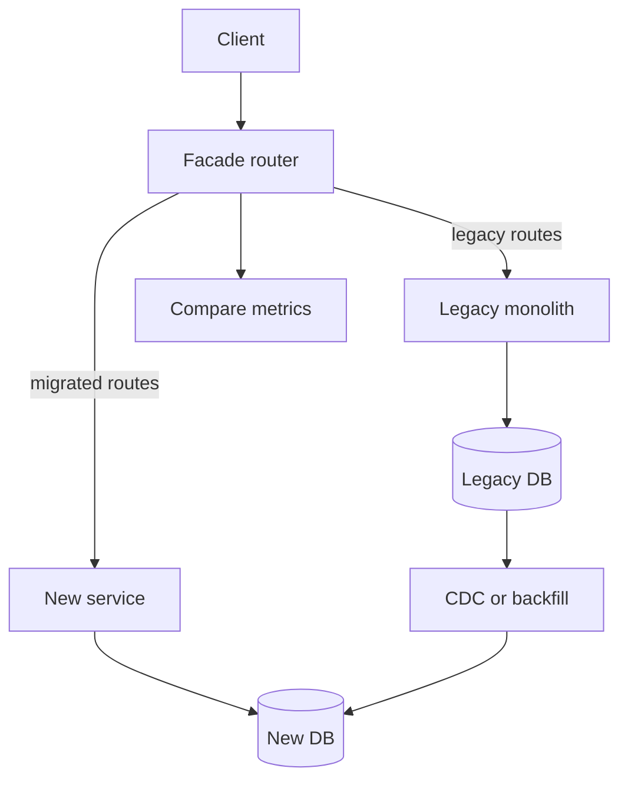

## 1. Hook

A city cannot shut down its old bridge for two years while building a
new one if thousands of people cross it every day. Instead, engineers
build a new lane beside the old bridge, redirect a little traffic,
watch it, then redirect more. Eventually the old bridge carries no
traffic and can be removed safely.

The strangler fig pattern is that bridge plan for software. You do not
rewrite the whole legacy system in one heroic launch. You wrap it,
route one capability at a time to the new implementation, and let the
new system grow around the old one until the old one can be retired.

It is less dramatic than a rewrite. That is the point. It turns a
dangerous big-bang replacement into a sequence of reversible traffic
moves.

## 2. What Is It

(a) Plain-English one-liner: the strangler fig pattern replaces a
legacy system gradually by routing one feature or flow at a time to a
new system while the old system keeps running.

(b) Formal definition: the strangler fig pattern is an incremental
migration pattern where a facade, router, proxy, or gateway intercepts
requests to a legacy system and selectively redirects specific
capabilities to new services or modules. Over time, migrated
capabilities expand until the legacy implementation is no longer used.
It is commonly used to move from a monolith to services or to modernize
legacy platforms (see:
MOD-06/01-monolithic-vs-microservices-architecture).

## 3. The Problem It Solves

Before strangler migration, teams attempt a full rewrite. The old
system keeps changing while the new system chases parity. After 18
months, the replacement is almost done, except for billing edge cases,
admin reports, refunds, tax rules, and five undocumented workflows.
Launch risk grows until nobody wants to cut over.

After strangler migration, the team chooses one slice: product search,
invoice PDF generation, notification sending, or one checkout step.
Traffic is routed to the new implementation for that slice. Metrics
compare old and new behavior. Rollback is routing, not a company-wide
restore. Each slice retires part of the old system.

The pattern solves rewrite risk. It keeps production learning close to
each migration step.

## 4. Core Concept Breakdown

- **Legacy system:** existing application that still serves production
  traffic.
- **Facade or router:** layer that decides whether a request goes to
  old or new implementation.
- **Migration slice:** one capability, endpoint, tenant, region, or
  workflow moved at a time.
- **Parallel run:** old and new systems both execute for comparison,
  often with only one producing user-visible output.
- **Traffic shifting:** gradually increasing percentage or scope of
  requests sent to the new system.
- **Data synchronization:** keeping old and new data models aligned
  during transition.
- **Rollback path:** ability to route traffic back to legacy quickly.
- **Retirement:** deleting old code, tables, jobs, and routes after a
  slice is fully migrated.

## 5. How It Works

Step by step, strangling a legacy order module:

1. **Put a facade in front of the legacy path.** API gateway, reverse
   proxy, or application router becomes the traffic control point.
2. **Map capabilities.** List endpoints, batch jobs, reports, and data
   tables owned by the legacy module.
3. **Choose a low-risk slice.** Pick a flow with clear ownership and
   measurable output.
4. **Build the new implementation.** Keep its contract compatible with
   the facade.
5. **Sync data carefully.** Use dual writes, CDC, backfills, or API
   reads depending on source of truth.
6. **Run shadow traffic.** Send copied requests to the new service and
   compare results without affecting users.
7. **Shift real traffic gradually.** Start with internal users, one
   tenant, one region, or 1 percent.
8. **Monitor business metrics.** Compare error rate, latency, revenue,
   count totals, and support tickets.
9. **Retire the old slice.** Remove routes and code only after
   rollback window closes.
10. **Repeat.** Each retired slice reduces legacy surface and increases
    confidence.

Migration readiness checklist:

- **Inventory hidden entry points.** Batch jobs, reports, admin tools,
  webhooks, and manual scripts often bypass the main API.
- **Define parity tests.** Shadow traffic needs field-level comparison,
  not only "HTTP 200 vs HTTP 200."
- **Own the data path.** Decide source of truth, sync mechanism,
  backfill, cutover, and rollback before routing real writes.
- **Write the deletion plan early.** Every migrated slice should have a
  date or condition for removing legacy code.

## 6. Diagram



<!-- IMAGE: migration timeline showing old system initially handling
all traffic, then three slices routed to new services, then legacy
traffic shrinking to zero -->

## 7. When to Use It

Use strangler fig when:

- **The old system is too important for a big-bang rewrite.** Revenue,
  compliance, or operations depend on it daily.
- **Capabilities can be sliced.** Endpoints, tenants, regions, or
  workflows can move independently.
- **You need production feedback early.** Shadow traffic and partial
  routing reveal unknown edge cases.
- **Migration will take months or years.** Incremental value matters.

## 8. When NOT to Use It

- **Do not use it when the system is small enough to replace safely.**
  A simple internal tool may not need migration machinery.
- **Do not start without a routing control point.** If you cannot
  choose old vs new per slice, rollback becomes painful.
- **Do not ignore data ownership.** Most migration pain hides in data,
  not endpoint routing.
- **Do not leave duplicated systems forever.** Strangler migration must
  include retirement milestones.

## 9. Real-World Example

**Amazon and many large retailers** use incremental service extraction
patterns because commerce systems cannot pause while being rewritten.

**Insurance and banking platforms** often migrate mainframe functions
behind API facades one product line at a time.

Realistic number: a 2-year rewrite can often be converted into 10 to
20 migration slices, each shipping in 2 to 8 weeks, with value and risk
reduction after every slice instead of one final launch.

Concrete slice example: migrate "invoice PDF generation" before
"billing." It has a clear input, a visible output, comparison is easy,
and rollback can route PDF requests back to the legacy renderer without
touching payment state.

## 10. Production-Grade Code

```typescript
type Request = { path: string; tenantId: string };
type Response = { status: number; body: unknown };

interface Backend {
  handle(req: Request): Promise<Response>;
}

type RouteRule = {
  pathPrefix: string;
  tenantsOnNewSystem: Set<string>;
};

export class StranglerRouter {
  constructor(
    private readonly legacy: Backend,
    private readonly modern: Backend,
    private readonly rules: RouteRule[]
  ) {}

  async handle(req: Request): Promise<Response> {
    const rule = this.rules.find((r) => req.path.startsWith(r.pathPrefix));
    const useModern = rule?.tenantsOnNewSystem.has(req.tenantId) ?? false;

    // Tenant-scoped routing keeps rollback precise: move one tenant
    // back to legacy without changing unrelated traffic.
    if (useModern) return await this.modern.handle(req);
    return await this.legacy.handle(req);
  }
}
```

Why-not-what notes:

- Routing by path and tenant allows gradual migration by capability and
  customer cohort.
- The router does not contain business logic; it only controls traffic.
- In production, rule changes should be audited and paired with
  dashboards so migration is observable.

## 11. Trade-offs Table

| Pros | Cons | What it costs you |
|---|---|---|
| Avoids big-bang rewrite risk | Old and new systems coexist for a while | Facade, routing, and migration governance |
| Enables incremental delivery | Data synchronization can be hard | Backfills, dual writes, or CDC |
| Rollback can be traffic routing | Feature parity must be tracked per slice | Migration inventory and acceptance tests |
| Learns from production early | Temporary duplication increases cost | Sunset dates and cleanup discipline |
| Fits monolith-to-service extraction | Cross-slice workflows can be tricky | Careful slice selection |

## 12. Comparison Table

| Approach | Launch style | Risk | Feedback speed | Best fit | Main danger |
|---|---|---|---|---|---|
| Big-bang rewrite | one cutover | high | late | small replaceable systems | parity chase |
| Strangler fig | incremental routing | medium | early | critical legacy systems | permanent dual systems |
| Database-first migration | data cutover first | high | medium | storage modernization | application mismatch |
| UI-only refresh | frontend change | low to medium | early | experience updates | backend debt remains |

## 13. Numbers & Benchmarks

- **Slice size:** practical migration slices often take 2 to 8 weeks,
  not 12 months.
- **Traffic ramp:** common ramps are internal, 1 percent, 5 percent,
  25 percent, 50 percent, then 100 percent.
- **Shadow comparison:** compare status, totals, and key fields for
  thousands to millions of requests before cutover.
- **Rollback time:** a good facade can roll back a slice in seconds or
  minutes through configuration.
- **Hidden surface:** batch jobs and reports can be 30 to 50 percent of
  legacy behavior and must be inventoried.
- **Diff threshold:** for shadow traffic, define which differences are
  acceptable, such as timestamp formatting, and which block cutover,
  such as totals, tax, or authorization result.
- **Retirement metric:** a slice is not done at 100 percent traffic; it
  is done when legacy routes, jobs, dashboards, and runbooks are gone.

## 14. Common Pitfalls

- **Incident: migrated endpoint but not nightly job.** New checkout
  wrote orders differently, but the legacy settlement job still read
  old fields.
- **Incident: no rollback route.** A new service failed for one large
  tenant, but routing was all-or-nothing for every tenant.
- **Incident: old system never retired.** Two implementations stayed
  alive for three years, doubling maintenance and confusing support.

## 15. Interview Q&A

**Q1. What is the strangler fig pattern?** Model answer: an incremental
migration strategy that routes slices of functionality from a legacy
system to a new system until the legacy system can be retired.

**Q2. What is the first thing you need?** Model answer: a facade or
routing point that can decide old vs new per slice and support
rollback.

**Q3. Why is data harder than routing?** Model answer: data has
history, ownership, consistency, reports, and backfills. Endpoint
routing is often the visible part only.

**Q4. How do you choose the first slice?** Model answer: pick a
valuable but bounded capability with clear metrics, limited coupling,
and a safe rollback path.

**Q5. How do you know a slice is done?** Model answer: 100 percent
traffic on new path, rollback window closed, old code and data path
retired, dashboards stable, support trained.

## 16. Follow-up / Curveball Questions

**Curveball 1. Legacy and new systems disagree during shadow traffic.**
Answer direction: define authoritative fields, log diffs, categorize
expected vs unexpected, and delay cutover until critical diffs are
resolved.

**Curveball 2. The old database must remain source of truth for a year.**
Answer direction: route writes carefully, use CDC to feed the new
system, and avoid claiming ownership before data ownership moves.

**Curveball 3. Product wants new features only in the new system.**
Answer direction: acceptable if traffic is routed to new slices, but
avoid feature divergence that blocks rollback for unmigrated users.

## 17. Cheat-Sheet Summary

- Strangler fig migrates a legacy system one slice at a time.
- A facade routes traffic to old or new implementations.
- Shadow traffic and gradual ramps reduce rewrite risk.
- Data synchronization and retirement plans are the hard parts.
- The migration is not done until old code, routes, jobs, and tables
  are removed.

## 18. Further Reading

- Martin Fowler, "Strangler Fig Application" - original modernization
  framing:
  https://martinfowler.com/bliki/StranglerFigApplication.html
- Thoughtworks Technology Radar entries on legacy displacement -
  practical migration cautions.
- Martin Fowler and Ian Cartwright, "Patterns of Legacy Displacement" -
  practical migration cautions and modernization patterns:
  https://martinfowler.com/articles/patterns-legacy-displacement/
- Sam Newman, "Monolith to Microservices" - detailed patterns for
  service extraction and data migration.
  https://samnewman.io/books/monolith-to-microservices/

---

## COMPLETENESS CHECK

Section checklist (18):

1. Hook - Covered (bridge replacement analogy)
2. What Is It - Covered (plain-English and formal definitions)
3. The Problem It Solves - Covered (rewrite risk before, incremental migration after)
4. Core Concept Breakdown - Covered (8 concepts)
5. How It Works - Covered (10 steps)
6. Diagram - Covered (flowchart facade routing old and new)
7. When to Use It - Covered (4 triggers)
8. When NOT to Use It - Covered (4 warnings)
9. Real-World Example - Covered (retail, banking, migration slice numbers)
10. Production-Grade Code - Covered (TypeScript migration router)
11. Trade-offs Table - Covered (5 rows)
12. Comparison Table - Covered (4 approaches)
13. Numbers & Benchmarks - Covered (5 figures)
14. Common Pitfalls - Covered (3 incident notes)
15. Interview Q&A - Covered (5 Q&As)
16. Follow-up / Curveball Questions - Covered (3 curveballs)
17. Cheat-Sheet Summary - Covered (5 lines)
18. Further Reading - Covered (3 sources)

No em-dashes. No emojis. Cross-links included.
