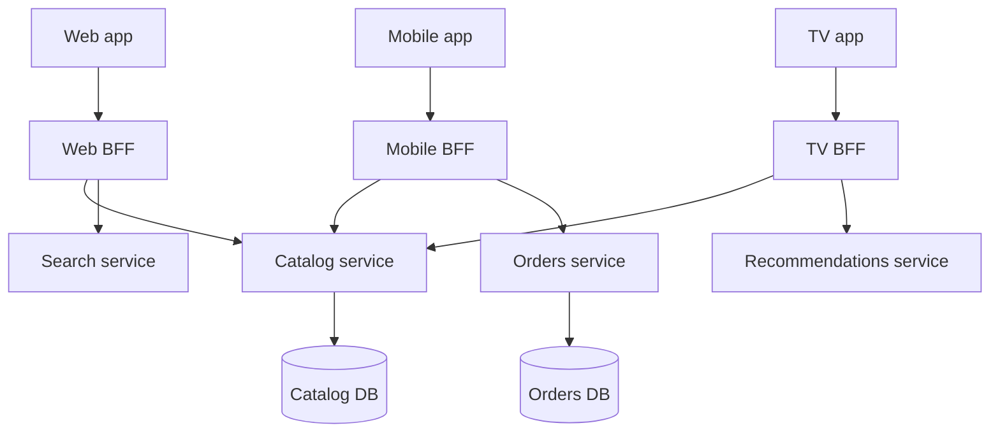

## 1. Hook

A museum gives different maps to different visitors. A child gets a
map with dinosaurs, bathrooms, and snack stops. An art historian gets
gallery numbers and collection notes. A wheelchair user gets elevator
routes. The museum is the same, but the useful map depends on the
visitor.

One universal map would either be too crowded for everyone or too thin
for specialists. Better maps are shaped for the person using them.

Backend for Frontend applies that idea to APIs. Web, mobile, TV, and
admin clients often need different response shapes, auth flows, caching
rules, and latency budgets. A BFF gives each client family a backend
tailored to its experience without forcing every backend service to
know every screen.

## 2. What Is It

(a) Plain-English one-liner: a Backend for Frontend is a client-specific
backend layer that shapes APIs, composition, auth, and caching for one
frontend experience.

(b) Formal definition: the Backend for Frontend (BFF) pattern creates
separate backend services or modules for distinct client applications
or device families. Each BFF composes downstream services, adapts
payloads, applies client-specific policies, and exposes an API optimized
for that frontend. It is a specialized form of API composition and
gateway design for frontend system design concerns (see:
MOD-09/01-frontend-vs-backend-system-design and
MOD-06/09-api-composition-vs-aggregator-pattern).

## 3. The Problem It Solves

Before BFF, one public API tries to serve web, iOS, Android, smart TV,
admin portal, and partner integrations. Web wants rich data and can
handle larger payloads. Mobile wants compact responses and offline
support. TV wants fewer round trips and remote-control-friendly flows.
Admin wants internal fields. The universal API becomes bloated and
still wrong for everyone.

After BFF, each client family has a tailored backend. The mobile BFF
returns compact payloads, hides chatty backend calls, and supports
versioned app releases. The web BFF supports SSR or edge caching. The
admin BFF exposes internal workflows with stricter permissions.

BFF solves client mismatch. It keeps downstream services business-owned
while giving frontends APIs that match their real constraints.

## 4. Core Concept Breakdown

- **Client family:** a class of frontend with distinct needs, such as
  web, mobile, TV, or admin.
- **BFF service:** backend layer owned with or near the frontend team.
- **API shaping:** transforming backend domain data into screen-ready
  payloads.
- **Composition:** calling several services to build one client
  response.
- **Client-specific auth:** token handling, session shape, and
  permission checks tailored to a frontend.
- **Version tolerance:** mobile BFFs often support older app versions
  longer than web BFFs.
- **Caching policy:** cache choices shaped by client behavior and
  freshness needs.
- **Boundary risk:** BFF should shape experience, not own core domain
  rules.

## 5. How It Works

Step by step, designing mobile and web BFFs:

1. **Group clients by real differences.** Do not create a BFF per page;
   create one for meaningful platform differences.
2. **Define screen contracts.** The BFF response should match the
   frontend's workflow and rendering needs.
3. **Compose downstream services.** The BFF calls catalog, identity,
   orders, recommendations, or search as needed.
4. **Apply client-aware caching.** Web SSR may cache at edge; mobile
   may use ETags and compact deltas.
5. **Handle auth and session shape.** Browser cookies and mobile bearer
   tokens may need different flows.
6. **Hide backend topology.** The frontend should not know every
   internal service.
7. **Keep business rules downstream.** Pricing, payment eligibility,
   and inventory truth remain in owning services.
8. **Version contracts deliberately.** Mobile app releases linger, so
   the mobile BFF must support older response shapes.
9. **Observe by client.** Track latency, payload size, error rate, and
   dependency failures per BFF.
10. **Consolidate when needs converge.** If two BFFs become identical,
    merge shared code or endpoints.

BFF design checklist:

- **One BFF per client family, not per team.** Web, mobile, TV, and
  admin are sensible boundaries; "checkout squad BFF" usually sprawl.
- **Track payload and round trips.** BFF value should show up in
  startup time, endpoint count, response size, or release independence.
- **Keep domain decisions downstream.** The BFF can choose fields; it
  should not choose price, eligibility, or inventory truth.
- **Version native clients deliberately.** Use app-version telemetry
  before removing fields or changing response meanings.

## 6. Diagram



<!-- IMAGE: three client experiences (web, mobile, TV) each connected
to its own BFF, with BFFs composing shared downstream domain services -->

## 7. When to Use It

Use BFF when:

- **Different clients have different payload needs.** Mobile, web, TV,
  and admin screens should not share one awkward response.
- **Frontend teams need fast iteration.** A BFF can evolve with the UI
  without changing core services for every screen tweak.
- **Client auth and caching differ.** Browser sessions, native app
  tokens, and TV device codes often need separate handling.
- **You need to reduce client fan-out.** BFFs keep frontend apps from
  calling many backend services directly.

## 8. When NOT to Use It

- **Do not create a BFF for every tiny client variation.** Too many
  BFFs duplicate code and operations.
- **Do not put domain ownership into the BFF.** It should not decide
  product price or payment state.
- **Do not use BFF to hide broken backend contracts forever.** It can
  adapt, but source services still need clean APIs.
- **Do not forget old mobile versions.** Removing fields too early can
  break installed apps.

## 9. Real-World Example

**Netflix** has used client-specific API layers because TV, mobile, web,
and game console experiences have different capabilities and payload
needs.

**Large commerce apps** often use mobile BFFs to return compact home
feed, cart, order, and recommendation payloads while web uses SSR or
edge-oriented APIs.

Realistic number: a mobile BFF can reduce app startup calls from 8 to
2 and cut payload size from 500 KB to 120 KB by returning screen-shaped
data and omitting desktop-only fields.

Concrete production shape: a web BFF may optimize for server-side
rendering and edge cache headers, while a mobile BFF may optimize for
small JSON, app-version compatibility, and fewer round trips over
high-latency networks.

## 10. Production-Grade Code

```typescript
type Product = {
  id: string;
  title: string;
  description: string;
  imageUrls: string[];
  desktopMarketingHtml: string;
};

type MobileProductCard = {
  id: string;
  title: string;
  imageUrl: string | null;
};

interface CatalogClient {
  getProduct(id: string): Promise<Product>;
}

export class MobileCatalogBff {
  constructor(private readonly catalog: CatalogClient) {}

  async getProductCard(productId: string): Promise<MobileProductCard> {
    const product = await this.catalog.getProduct(productId);

    // Mobile receives only the fields needed for the card. The source
    // service still owns product truth; the BFF owns client shaping.
    return {
      id: product.id,
      title: product.title,
      imageUrl: product.imageUrls[0] ?? null,
    };
  }
}
```

Why-not-what notes:

- The BFF strips desktop-only fields to reduce payload and parsing cost
  on mobile.
- The BFF does not calculate price or inventory because those are
  domain rules owned by catalog or commerce services.
- The response is screen-shaped, so mobile can render without knowing
  backend service topology.

## 11. Trade-offs Table

| Pros | Cons | What it costs you |
|---|---|---|
| Gives each client an API that fits | More deployable backend surfaces | Ownership, CI, and on-call per BFF |
| Reduces client fan-out and payload size | Can duplicate mapping logic | Shared libraries or schema discipline |
| Lets frontend teams iterate faster | BFF can grow into a mini-monolith | Clear rule: shaping, not domain ownership |
| Handles client-specific auth and caching | Version support can linger | Mobile compatibility policy |
| Improves frontend performance | More observability dimensions | Metrics per client, endpoint, and dependency |

## 12. Comparison Table

| Approach | API shape | Best fit | Client complexity | Backend complexity | Main risk |
|---|---|---|---|---|---|
| One public API | universal | small product | medium | low | bloated contracts |
| API gateway only | route-focused | simple service routing | low | low to medium | little client shaping |
| BFF | client-specific | distinct client families | low | medium | duplicated logic |
| GraphQL gateway | flexible per query | many varied reads | medium | high | resolver fan-out |

## 13. Numbers & Benchmarks

- **Payload reduction:** mobile BFFs often reduce response size by 50
  to 80 percent compared with broad desktop APIs.
- **Round trips:** a BFF can reduce 5 to 10 mobile startup calls to 1
  to 3 composed calls.
- **Latency budget:** mobile networks can add 50 to 200 ms RTT, so
  fewer round trips matter more than on server-side web.
- **Version support:** native apps may require API compatibility for
  6 to 18 months depending on upgrade rates.
- **BFF count:** most products need BFFs by client family, often 2 to
  4, not dozens.
- **Upgrade tail:** if 10 percent of mobile users remain on an old
  version for 90 days, the BFF contract must keep compatibility that
  long or explicitly block the old app.
- **Payload budget:** track p95 compressed payload size alongside p95
  latency, because mobile performance is bandwidth-sensitive.

## 14. Common Pitfalls

- **Incident: BFF changed pricing logic.** Mobile and web showed
  different prices because a mobile BFF copied a discount rule from
  commerce.
- **Incident: old app broke.** A field was removed from the mobile BFF
  while 12 percent of users still ran an old app version.
- **Incident: too many BFFs.** Every squad created a BFF and the
  company ended with duplicated auth, logging, and rate limiting.

## 15. Interview Q&A

**Q1. What is a BFF?** Model answer: a backend layer tailored to a
specific frontend or client family, responsible for shaping,
composition, and client-specific policies.

**Q2. How is BFF different from an API gateway?** Model answer: a
gateway usually routes, secures, and rate-limits. A BFF shapes
responses and workflows for a frontend.

**Q3. What logic belongs in a BFF?** Model answer: presentation shaping,
composition, client-specific caching, auth adaptation, and fallback
handling. Core domain rules stay in domain services.

**Q4. When would you avoid BFF?** Model answer: when clients have
nearly identical needs or when the team cannot operate extra backend
surfaces.

**Q5. How do BFFs affect mobile releases?** Model answer: mobile BFFs
must support old app versions because users upgrade gradually. Contract
removal requires telemetry and deprecation windows.

## 16. Follow-up / Curveball Questions

**Curveball 1. Web and mobile BFFs duplicate 80 percent of code.**
Answer direction: extract shared composition helpers or merge
endpoints, but keep client-specific contracts where needs differ.

**Curveball 2. Product wants the BFF to calculate discounts.** Answer
direction: reject or delegate to commerce service. The BFF can display
discounts, not own pricing truth.

**Curveball 3. A BFF dependency is down. Should the client fail?**
Answer direction: depends on fragment criticality. Required account
data may fail the request; optional recommendations should degrade.

## 17. Cheat-Sheet Summary

- BFF means one backend tailored to one frontend family.
- It shapes payloads, composes services, adapts auth, and reduces
  client fan-out.
- It should not own core domain rules like pricing, inventory, or payment.
- Use BFF when clients have meaningfully different needs.
- Watch duplication, mobile version support, and BFF sprawl.

## 18. Further Reading

- Sam Newman, "Pattern: Backends For Frontends" - original BFF framing
  and motivation:
  https://samnewman.io/patterns/architectural/bff/
- Netflix technology blog on API architecture - examples of
  client-specific API shaping.
  https://netflixtechblog.com/optimizing-the-netflix-api-5c9ac715cf19
- Microsoft Architecture Center, "Backends for Frontends pattern" -
  concise cloud architecture trade-offs:
  https://learn.microsoft.com/en-us/azure/architecture/patterns/backends-for-frontends

---

## COMPLETENESS CHECK

Section checklist (18):

1. Hook - Covered (museum maps analogy)
2. What Is It - Covered (plain-English and formal definitions)
3. The Problem It Solves - Covered (universal API before, tailored BFF after)
4. Core Concept Breakdown - Covered (8 concepts)
5. How It Works - Covered (10 steps)
6. Diagram - Covered (flowchart of web, mobile, TV BFFs)
7. When to Use It - Covered (4 triggers)
8. When NOT to Use It - Covered (4 warnings)
9. Real-World Example - Covered (Netflix, commerce, payload numbers)
10. Production-Grade Code - Covered (TypeScript mobile BFF shaping)
11. Trade-offs Table - Covered (5 rows)
12. Comparison Table - Covered (4 approaches)
13. Numbers & Benchmarks - Covered (5 figures)
14. Common Pitfalls - Covered (3 incident notes)
15. Interview Q&A - Covered (5 Q&As)
16. Follow-up / Curveball Questions - Covered (3 curveballs)
17. Cheat-Sheet Summary - Covered (5 lines)
18. Further Reading - Covered (3 sources)

No em-dashes. No emojis. Cross-links included.
