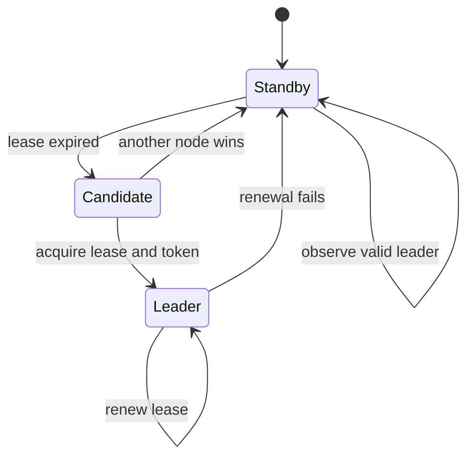

## 1. Hook

A hiking group loses its guide in thick fog. They need one temporary
leader to decide when to move, when to stop, and which trail marker to
trust. If nobody leads, the group freezes. If two people lead different
halves of the group, the hikers split and the situation becomes worse.

The group needs a fair way to choose a new guide, detect when the
current guide is gone, and replace them without creating two guides.
That is leader election.

Distributed systems elect leaders for the same reason. A leader is not
a trophy. It is a coordination role that makes one node responsible for
ordering decisions, assigning work, or owning a primary lease.

## 2. What Is It

(a) Plain-English one-liner: leader election is the process by which a
cluster chooses exactly one node to coordinate work for a period of
time.

(b) Formal definition: leader election is a distributed coordination
protocol that selects a unique leader among a set of nodes despite
crashes, message delays, and membership changes. Correct leader
election requires safety (at most one valid leader for an epoch or
lease interval), liveness (eventually elect a leader when enough nodes
are healthy), fencing (old leaders cannot act after replacement), and
failure detection. Many systems implement leader election using
consensus systems such as Raft, ZooKeeper, etcd, or database leases
(see: MOD-07/01-distributed-consensus-paxos-raft).

## 3. The Problem It Solves

Before leader election, a system either has a static primary or no
primary. If the static primary fails, humans must intervene. If every
node tries to coordinate, duplicate jobs run, two primaries accept
writes, or shards are assigned twice.

After leader election, nodes compete through a safe mechanism. One
leader owns a term, lease, or ephemeral znode. Other nodes follow or
stand by. If the leader fails, the group elects another. A stale leader
is fenced off by term numbers, leases, or compare-and-swap tokens.

Leader election solves coordination ownership. It does not solve the
work itself; it decides who is allowed to coordinate it now.

## 4. Core Concept Breakdown

- **Leader:** node temporarily responsible for coordination.
- **Follower:** node that accepts the leader's authority or waits.
- **Term or epoch:** version of leadership; higher epoch defeats lower
  epoch.
- **Lease:** time-bounded leadership claim, valid only while renewed.
- **Fencing token:** monotonically increasing value attached to leader
  actions so stale leaders are rejected.
- **Failure detector:** mechanism that suspects leader failure through
  missed heartbeats or timeouts.
- **Split vote:** election where no candidate gets majority.
- **Backoff:** randomized wait to reduce repeated split votes.
- **External coordinator:** ZooKeeper, etcd, Consul, or database row
  used to store leadership state.

## 5. How It Works

Step by step, electing a leader with a consensus-backed lease:

1. **Every node starts as standby.** No node assumes leadership by
   startup order alone.
2. **Candidates try to acquire a lease.** The lease record is updated
   only if its version or expiry condition matches.
3. **The coordinator commits one winner.** Consensus or CAS makes the
   update atomic.
4. **Winner receives a fencing token.** The token increments each time
   leadership changes.
5. **Leader sends heartbeats or renews lease.** It must prove it is
   still alive before expiry.
6. **Followers watch the lease.** If renewal stops, they wait for
   expiry before competing.
7. **New election begins.** Candidates use random backoff to avoid
   collisions.
8. **Downstream systems check fencing token.** A stale leader with an
   old token cannot write.
9. **Leader steps down on lost renewal.** If it cannot renew in time,
   it stops coordinating.
10. **Operators can force transfer.** Safe handoff uses a higher epoch
    and drains old leadership before accepting new work.

Senior design review questions:

- **What fences stale leaders?** A heartbeat alone is not a fence.
- **What clock assumption exists?** Lease protocols depend on bounded
  clock drift or coordinator time.
- **What is the blast radius of leader loss?** One global leader is
  simpler but can bottleneck the whole system.
- **Can leadership be sharded?** Per-partition leaders often scale
  better than one cluster-wide leader.

## 6. Diagram



<!-- IMAGE: three nodes competing for a leadership lease, one winner
with fencing token 42, and a stale old leader rejected by storage -->

## 7. When to Use It

Use leader election when:

- **Exactly one node should coordinate a task.** Schedulers, shard
  assigners, primaries, and compaction coordinators fit.
- **Automatic failover is required.** Human primary promotion is too
  slow or error-prone.
- **A consensus system already exists.** Use etcd or ZooKeeper instead
  of inventing election storage.
- **Work can be fenced.** Downstream systems can reject stale leaders.

## 8. When NOT to Use It

- **Do not elect a leader when independent workers are enough.** A work
  queue may distribute jobs without a coordinator.
- **Do not use time-only leases without fencing.** Paused leaders can
  wake up and corrupt state.
- **Do not make one global leader for unrelated work.** It becomes a
  bottleneck and failure domain.
- **Do not assume TCP connection loss equals node death.** Network
  partitions and pauses create false suspicions.

## 9. Real-World Example

**Kubernetes controllers** use leader election so only one controller
manager instance actively reconciles a controller loop while standby
instances wait.

**ZooKeeper recipes** use ephemeral sequential znodes for leader
election. The smallest sequence number becomes leader; watchers observe
predecessor deletion.

**PostgreSQL high-availability managers** such as Patroni use DCS
systems like etcd, Consul, or ZooKeeper to coordinate primary election.

Realistic number: controller leader leases often use renew deadlines
around 10 seconds and lease durations around 15 seconds. Those values
balance failover speed against false failover from brief pauses.

## 10. Production-Grade Code

```go
package main

import (
	"errors"
	"time"
)

type Lease struct {
	Holder       string
	FencingToken int64
	ExpiresAt    time.Time
	Version       int64
}

type LeaseStore interface {
	Get() (Lease, error)
	CompareAndSwap(expectedVersion int64, next Lease) error
}

func TryAcquire(store LeaseStore, nodeID string, now time.Time, ttl time.Duration) (Lease, error) {
	current, err := store.Get()
	if err != nil {
		return Lease{}, err
	}
	if current.ExpiresAt.After(now) && current.Holder != nodeID {
		return Lease{}, errors.New("lease still held")
	}
	next := Lease{
		Holder:       nodeID,
		FencingToken: current.FencingToken + 1,
		ExpiresAt:    now.Add(ttl),
		Version:       current.Version + 1,
	}
	// CAS makes leadership a single committed decision. The fencing
	// token is what downstream systems use to reject stale leaders.
	if err := store.CompareAndSwap(current.Version, next); err != nil {
		return Lease{}, err
	}
	return next, nil
}
```

Why-not-what notes:

- The lease grants time-bounded authority, but the fencing token grants
  stale-leader protection.
- Compare-and-swap must be backed by a strongly consistent store.
- Real systems renew before expiry and step down when renewal fails.

## 11. Trade-offs Table

| Pros | Cons | What it costs you |
|---|---|---|
| Enables automatic failover | False suspicions can cause churn | Careful timeout and heartbeat tuning |
| Gives one coordinator for ordered work | Leader can bottleneck throughput | Sharded leadership or partition ownership |
| Lease model is easy to operate | Clock assumptions can bite | Conservative TTLs and monotonic clocks |
| Fencing tokens protect downstream state | Every sink must validate tokens | Schema and API support for fencing |
| Reuses proven coordination systems | Coordinator becomes dependency | DCS monitoring and backups |

## 12. Comparison Table

| Method | Safety strength | Failover speed | Best fit | Main risk |
|---|---|---|---|---|
| Static primary | low | manual | tiny systems | slow recovery |
| Database row lock | medium | seconds | simple jobs | DB coupling |
| ZooKeeper ephemeral node | high | seconds | coordination services | session tuning |
| etcd lease election | high | seconds | Kubernetes-style control loops | lease misconfiguration |
| Raft internal election | high | sub-second to seconds | replicated logs | implementation complexity |

## 13. Numbers & Benchmarks

- **Lease duration:** common production ranges are 10 to 60 seconds,
  depending on pause tolerance and failover target.
- **Renew interval:** often one-third to one-half of lease duration.
- **Fencing token:** must be monotonic and stored durably; timestamps
  are not enough.
- **Failover target:** many control-plane systems accept 5 to 30
  seconds of leader failover.
- **Election backoff:** randomized backoff in the 150 to 300 ms range
  is common in Raft-style elections to avoid split votes.

## 14. Common Pitfalls

- **Incident: old leader wrote after GC pause.** Lease expired during a
  long pause, a new leader took over, then the old process resumed and
  wrote without fencing.
- **Incident: timeout too aggressive.** Network jitter caused repeated
  leadership flaps and job duplication.
- **Incident: global leader overloaded.** One leader assigned every
  shard, ran every cron, and handled every repair task; failover was
  safe but throughput was poor.

## 15. Interview Q&A

**Q1. What is leader election for?** Model answer: selecting exactly
one coordinator for a period of time so work is ordered or assigned
without duplicate ownership.

**Q2. Why do you need fencing tokens?** Model answer: a stale leader
can wake up after a pause. Downstream systems need a monotonic token to
reject operations from older leaders.

**Q3. Why not just use heartbeats?** Model answer: heartbeats detect
suspected failure but do not prove old leaders cannot act. Detection
and fencing are separate concerns.

**Q4. How is leader election related to consensus?** Model answer:
safe leader election often relies on consensus or a strongly
consistent coordinator to make one election result durable.

**Q5. What causes split-brain?** Model answer: two nodes believe they
are leader and both can affect state. Missing quorum, missing fencing,
or unsafe leases cause it.

## 16. Follow-up / Curveball Questions

**Curveball 1. The leader is alive but cannot reach the coordinator.**
Answer direction: it should step down when it cannot renew. Being alive
is not enough; leadership requires a valid lease or term.

**Curveball 2. Two candidates keep splitting votes.** Answer direction:
use randomized election timeouts, backoff, and stable membership.

**Curveball 3. A downstream database cannot store fencing tokens.**
Answer direction: then the lease is unsafe for writes to that database.
Use a different sink, add token checks, or avoid leader-based writes.

## 17. Cheat-Sheet Summary

- Leader election chooses one coordinator for a term or lease.
- Safe election needs uniqueness, liveness, failure detection, and
  fencing.
- Heartbeats detect suspicion; fencing blocks stale leaders.
- Prefer etcd, ZooKeeper, Consul, or Raft over custom election code.
- Shard leadership when one global leader becomes a bottleneck.

## 18. Further Reading

- Kubernetes leader election package - production lease-based leader
  election concepts:
  https://pkg.go.dev/k8s.io/client-go/tools/leaderelection
- ZooKeeper recipes and solutions - leader election with ephemeral
  sequential znodes:
  https://zookeeper.apache.org/doc/current/recipes.html
- Martin Kleppmann, "How to do distributed locking" - fencing tokens
  and lease safety:
  https://martin.kleppmann.com/2016/02/08/how-to-do-distributed-locking.html

---

## COMPLETENESS CHECK

Section checklist (18):

1. Hook - Covered (hiking group analogy)
2. What Is It - Covered (plain-English and formal definitions)
3. The Problem It Solves - Covered (static primary before, safe election after)
4. Core Concept Breakdown - Covered (9 concepts)
5. How It Works - Covered (10 lease-election steps plus review questions)
6. Diagram - Covered (stateDiagram-v2)
7. When to Use It - Covered (4 triggers)
8. When NOT to Use It - Covered (4 warnings)
9. Real-World Example - Covered (Kubernetes, ZooKeeper, Patroni)
10. Production-Grade Code - Covered (Go lease CAS)
11. Trade-offs Table - Covered (5 rows)
12. Comparison Table - Covered (5 methods)
13. Numbers & Benchmarks - Covered (5 figures)
14. Common Pitfalls - Covered (3 incident notes)
15. Interview Q&A - Covered (5 Q&As)
16. Follow-up / Curveball Questions - Covered (3 curveballs)
17. Cheat-Sheet Summary - Covered (5 lines)
18. Further Reading - Covered (3 URL-backed sources)

No em-dashes. No emojis. Cross-links included.
