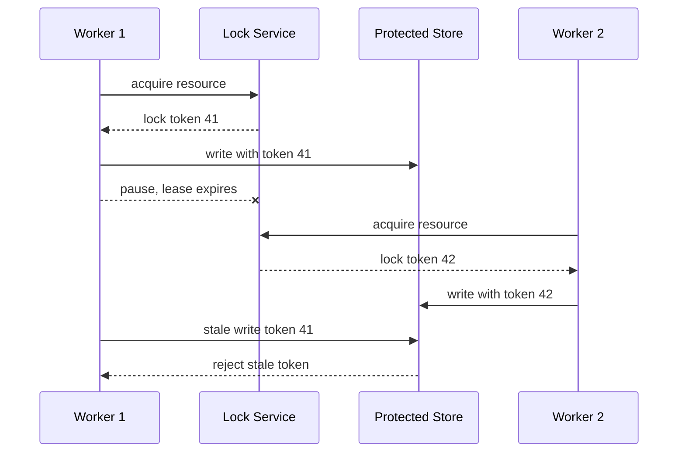

## 1. Hook

A storage room has one key. If Alice has the key, Bob cannot enter
until Alice returns it. That works in one building. Now imagine five
buildings, copied keys, unreliable couriers, and a person who might
fall asleep while holding a key. Bob may think the key expired, Alice
may wake up and still open the door, and two people may move the same
box.

Distributed locking is trying to coordinate that room across unreliable
machines. It is much harder than a local mutex because time, failure,
and stale owners matter.

A safe distributed lock is not just "set a key in Redis." It needs
ownership, expiry, renewal, fencing, and a plan for what happens when
the lock holder pauses or the network lies.

## 2. What Is It

(a) Plain-English one-liner: a distributed lock tries to let only one
client at a time perform an operation across multiple machines.

(b) Formal definition: a distributed lock is a coordination mechanism
that grants temporary exclusive ownership of a named resource to one
client in a distributed system. Correctness depends on mutual
exclusion, deadlock avoidance through expiry or sessions, ownership
checks on release, fencing tokens for stale owners, and a strongly
consistent lock service when the protected operation requires safety.
Distributed locks often rely on consensus or quorum systems (see:
MOD-07/03-quorum-based-systems).

## 3. The Problem It Solves

Before distributed locking, two workers may run the same critical job:
both charge a card, both send a settlement file, both compact the same
shard, or both update a shared object store path. Local mutexes do not
help because each worker has its own process memory.

After distributed locking, a worker acquires a lease for a resource
name, performs the critical section, and releases or lets it expire. If
the worker crashes, expiry prevents permanent deadlock. If the worker
pauses and resumes after losing the lock, fencing tokens let the
protected system reject stale work.

Distributed locking solves temporary exclusive coordination. It does
not make unsafe side effects safe unless the side effect checks the
lock ownership or fencing token.

## 4. Core Concept Breakdown

- **Lock name:** resource identifier, such as `settlement:2026-07-09`.
- **Owner ID:** unique client token stored with the lock.
- **TTL or lease:** expiry time to prevent abandoned locks forever.
- **Renewal:** holder extends the lock while still healthy.
- **Compare-and-delete:** release only if owner ID matches.
- **Fencing token:** monotonically increasing token issued with each
  lock acquisition.
- **Stale owner:** client that still runs after lock expiry or loss.
- **Lock service:** Redis, ZooKeeper, etcd, database row, or custom
  coordinator.
- **Critical section:** operation intended to be exclusive.

## 5. How It Works

Step by step, using a lock safely for a settlement job:

1. **Worker generates owner ID.** It must be unique per attempt.
2. **Worker asks lock service to acquire.** The lock is created only if
   absent or expired.
3. **Lock service returns fencing token.** The token increases on every
   successful acquisition.
4. **Worker enters critical section.** It passes fencing token to the
   protected database, object store, or job output.
5. **Protected resource validates token.** It rejects writes with a
   token lower than the last accepted token.
6. **Worker renews before TTL.** Renewal must fail if owner ID no
   longer matches.
7. **Worker releases by owner check.** It deletes the lock only if it
   still owns it.
8. **If worker crashes, TTL expires.** Another worker can acquire.
9. **If worker pauses, token fences it.** Resumed stale writes are
   rejected.
10. **Operator monitors lock age and contention.** Hot locks may signal
    bad sharding or too-large critical sections.

Design review checks:

- **What happens if the holder pauses longer than TTL?**
- **Does the protected resource enforce fencing tokens?**
- **Is the lock for correctness or efficiency?** Correctness locks need
  stronger mechanisms.
- **Can the job be made idempotent instead?** Idempotency is often
  simpler than locking.

## 6. Diagram



<!-- IMAGE: timeline showing worker 1 acquiring a lock, pausing past
TTL, worker 2 acquiring token 42, and worker 1 being fenced off -->

## 7. When to Use It

Use distributed locking when:

- **A critical section must run once at a time.** Settlement files,
  migrations, shard repair, and singleton jobs fit.
- **The protected resource supports fencing.** Without fencing,
  correctness is weaker.
- **The critical section is short.** Long locks create expiry and
  renewal risk.
- **A proven lock service exists.** ZooKeeper, etcd, or a database with
  transaction semantics is better than custom lock code.

## 8. When NOT to Use It

- **Do not use locks to hide non-idempotent design.** Make operations
  idempotent when possible.
- **Do not use weak locks for money movement.** Use transactions,
  unique constraints, idempotency keys, or consensus-backed workflows.
- **Do not assume Redis TTL alone gives safety.** Pauses and partitions
  can create stale owners.
- **Do not protect long-running human workflows with one lock.** Model
  state transitions instead.

## 9. Real-World Example

**ZooKeeper** provides ephemeral nodes and sessions often used for
locks and leader election. If a session expires, ephemeral ownership is
removed.

**etcd** provides leases and compare-and-swap operations backed by
Raft, making it a strong choice for coordination locks.

**Redis** supports simple `SET key value NX PX ttl` locks, useful for
efficiency locks. For correctness-critical locks, fencing and stronger
coordination are needed.

Realistic number: a lock TTL of 30 seconds with renewal every 10
seconds is common for short jobs. If the process can pause for 60
seconds under GC or host freeze, that TTL is unsafe without fencing.

## 10. Production-Grade Code

```typescript
import { randomUUID } from "node:crypto";

type Lock = {
  resource: string;
  ownerId: string;
  fencingToken: number;
  expiresAtMs: number;
};

interface LockStore {
  acquire(resource: string, ownerId: string, ttlMs: number): Promise<Lock | null>;
  release(resource: string, ownerId: string): Promise<void>;
}

interface ProtectedStore {
  writeWithFence(resource: string, fencingToken: number, value: string): Promise<void>;
}

export async function runWithLock(
  locks: LockStore,
  store: ProtectedStore,
  resource: string,
  value: string,
  ttlMs: number
): Promise<boolean> {
  const ownerId = randomUUID();
  const lock = await locks.acquire(resource, ownerId, ttlMs);
  if (!lock) return false;
  try {
    // The fencing token is sent to the protected store so a stale lock
    // holder cannot write after another holder has acquired a newer
    // lease.
    await store.writeWithFence(resource, lock.fencingToken, value);
    return true;
  } finally {
    await locks.release(resource, ownerId);
  }
}
```

Why-not-what notes:

- Owner ID prevents one client from releasing another client's lock.
- Fencing token is the safety feature that TTL alone cannot provide.
- `finally` releases best-effort; correctness still depends on TTL and
  fencing if release never happens.

## 11. Trade-offs Table

| Pros | Cons | What it costs you |
|---|---|---|
| Prevents duplicate critical sections when healthy | Stale owners remain possible | Fencing tokens and downstream checks |
| TTL avoids permanent deadlock | TTL tuning is hard | Pause and network-delay analysis |
| Strong coordinators give clear semantics | Adds dependency on lock service | Monitoring and failover |
| Simple API for singleton jobs | Can serialize too much work | Lock sharding and short critical sections |
| Compare-and-delete prevents accidental release | Does not solve side-effect idempotency | Idempotent operation design |

## 12. Comparison Table

| Method | Safety | Best fit | Failure risk | Notes |
|---|---|---|---|---|
| Local mutex | process-only | threads in one process | useless across hosts | fastest |
| Redis single-node lock | low to medium | efficiency locks | failover and stale owner | simple |
| Redlock-style Redis quorum | debated | efficiency or bounded-risk locks | timing assumptions | use carefully |
| ZooKeeper or etcd lock | high | correctness coordination | coordinator dependency | consensus-backed |
| Database unique row | medium to high | app-level singleton | transaction contention | easy when DB is source |

## 13. Numbers & Benchmarks

- **TTL rule:** renew at one-third to one-half of TTL to leave recovery
  time before expiry.
- **Pause risk:** JVM or runtime pauses of seconds are normal; host
  suspension can last much longer.
- **Lock hold time:** keep critical sections in milliseconds to
  seconds; minute-long locks need stronger workflow modeling.
- **Contention metric:** p95 wait time for a lock is often a better
  signal than acquisition count.
- **Fencing token:** must increase monotonically per resource and be
  checked by the protected resource.

## 14. Common Pitfalls

- **Incident: release deleted another owner's lock.** Worker A expired,
  worker B acquired, then A released by key name only and deleted B's
  lock.
- **Incident: stale write after pause.** A worker paused beyond TTL,
  resumed, and overwrote newer work because the database did not check
  fencing tokens.
- **Incident: one global lock.** A nightly job used one lock for all
  tenants and turned a 5-minute task into a 2-hour serial bottleneck.

## 15. Interview Q&A

**Q1. What makes distributed locks hard?** Model answer: failures,
pauses, partitions, and stale owners. A process may continue running
after its lock expired.

**Q2. What is a fencing token?** Model answer: a monotonically
increasing token issued with each lock acquisition. Protected resources
reject operations with older tokens.

**Q3. Is Redis `SET NX PX` enough?** Model answer: it can be enough for
efficiency locks, but correctness-critical operations need fencing and
careful failure analysis.

**Q4. How do you release safely?** Model answer: delete only if the
stored owner ID matches your owner ID.

**Q5. What is better than a lock?** Model answer: idempotency keys,
unique constraints, local transactions, queues, or state machines often
solve the real problem with fewer timing assumptions.

## 16. Follow-up / Curveball Questions

**Curveball 1. The lock service is partitioned from the worker.** Answer
direction: worker must stop if it cannot renew. Liveness is not
authority; valid lease is authority.

**Curveball 2. The protected object store cannot check fencing tokens.**
Answer direction: the lock cannot provide strong correctness there.
Write through a service or database that can enforce fencing.

**Curveball 3. A job holds lock for 20 minutes.** Answer direction:
split the job, checkpoint progress, use idempotent chunks, or model it
as a workflow rather than one lock.

## 17. Cheat-Sheet Summary

- Distributed locks coordinate exclusive work across machines.
- TTL prevents deadlock but creates stale-owner risk.
- Owner IDs protect release; fencing tokens protect writes.
- Use consensus-backed stores for correctness-critical locks.
- Prefer idempotency and state machines when they solve the problem.

## 18. Further Reading

- Martin Kleppmann, "How to do distributed locking" - fencing and
  correctness risks:
  https://martin.kleppmann.com/2016/02/08/how-to-do-distributed-locking.html
- Redis distributed locks documentation - Redis locking algorithm and
  caveats:
  https://redis.io/docs/latest/develop/clients/patterns/distributed-locks/
- etcd concurrency package - sessions, elections, and mutex primitives:
  https://pkg.go.dev/go.etcd.io/etcd/client/v3/concurrency

---

## COMPLETENESS CHECK

Section checklist (18):

1. Hook - Covered (storage room key analogy)
2. What Is It - Covered (plain-English and formal definitions)
3. The Problem It Solves - Covered (duplicate critical work before, fenced lock after)
4. Core Concept Breakdown - Covered (9 concepts)
5. How It Works - Covered (10 steps plus design checks)
6. Diagram - Covered (sequenceDiagram)
7. When to Use It - Covered (4 triggers)
8. When NOT to Use It - Covered (4 warnings)
9. Real-World Example - Covered (ZooKeeper, etcd, Redis)
10. Production-Grade Code - Covered (TypeScript fenced lock wrapper)
11. Trade-offs Table - Covered (5 rows)
12. Comparison Table - Covered (5 methods)
13. Numbers & Benchmarks - Covered (5 figures)
14. Common Pitfalls - Covered (3 incident notes)
15. Interview Q&A - Covered (5 Q&As)
16. Follow-up / Curveball Questions - Covered (3 curveballs)
17. Cheat-Sheet Summary - Covered (5 lines)
18. Further Reading - Covered (3 URL-backed sources)

No em-dashes. No emojis. Cross-links included.
