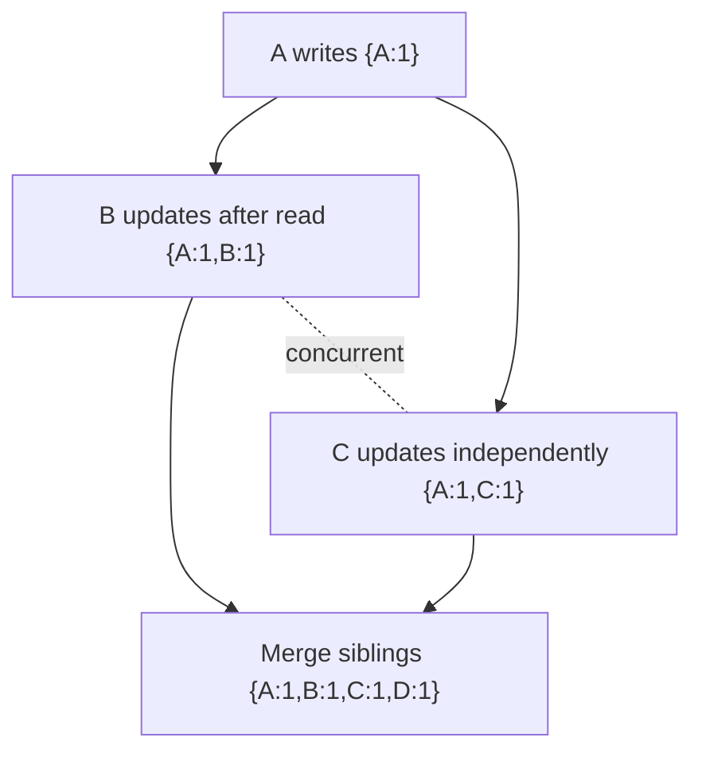

## 1. Hook

Two friends edit a shared grocery list while their phones are offline.
One adds "milk." The other removes "eggs." Later the phones sync. The
question is not only "which edit happened later by wall clock?" The
question is "did one edit know about the other?"

If the milk edit was made after seeing the egg removal, the milk edit
can safely include both decisions. If both edits happened without
knowing about each other, they are concurrent and need a merge.

Logical clocks are the labels that answer this kind of question.
Vector clocks go further: they can tell whether one event happened
after another or whether two events are concurrent.

## 2. What Is It

(a) Plain-English one-liner: logical clocks order events without
trusting wall clocks, and vector clocks detect whether distributed
updates are causally related or concurrent.

(b) Formal definition: a logical clock assigns monotonically increasing
logical timestamps to events so a distributed system can reason about
causal order. Lamport clocks preserve the happens-before relation by
ensuring if event A causally precedes event B, then timestamp(A) <
timestamp(B), but they cannot detect concurrency. Vector clocks store
one counter per participant, allowing systems to determine whether one
version descends from another or whether versions are concurrent
(see: MOD-15/06-strong-vs-eventual-consistency).

## 3. The Problem It Solves

Before logical time, systems use wall-clock timestamps to resolve
conflicts. Two replicas write the same shopping cart, one machine's
clock is 90 seconds fast, and last-write-wins deletes the real newer
business update. The database did not know causality; it only compared
clocks.

After logical clocks, messages carry causal metadata. A replica can see
whether version B includes version A or whether A and B were created
independently. If independent, the system can keep siblings and ask the
application to merge.

Logical clocks solve "what did this update know?" They are not about
actual time; they are about causality.

## 4. Core Concept Breakdown

- **Happens-before:** event A causally precedes B if A occurred in the
  same process before B or a message from A influenced B.
- **Lamport clock:** one counter per process, incremented on local
  events and updated on receive.
- **Vector clock:** map from node ID to counter, tracking known progress
  from each participant.
- **Causal descendant:** version B includes all counters from version A
  and at least one higher counter.
- **Concurrent versions:** neither vector dominates the other.
- **Conflict sibling:** concurrent value stored until application merge.
- **Clock truncation:** limiting vector size, which can lose causal
  precision.
- **Hybrid logical clock:** combines physical time with logical counter
  for practical ordering with causality hints.

## 5. How It Works

Step by step, using vector clocks in a key-value store:

1. **Each replica has an ID.** Example: A, B, C.
2. **Write increments local counter.** Replica A writes with vector
   `{A:1}`.
3. **Read returns value and vector.** Client must send the vector back
   on update.
4. **Update merges known vector.** If client updates at B after reading
   `{A:1}`, B writes `{A:1,B:1}`.
5. **Replica compares vectors.** `{A:1,B:1}` dominates `{A:1}`, so the
   new value supersedes the old.
6. **Concurrent write appears.** Another client writes at C from old
   state `{A:1,C:1}`.
7. **Neither vector dominates.** `{A:1,B:1}` and `{A:1,C:1}` are
   concurrent.
8. **Store keeps siblings.** Both values are returned to the next read.
9. **Application merges.** Cart merge may union items; profile merge
   may ask user or choose field-level rules.
10. **Merged write dominates both.** New vector might be `{A:1,B:1,C:1,D:1}`.

Design review checks:

- **What is the merge rule?** Detecting concurrency is not resolving
  it.
- **How large can vectors grow?** Per-client vectors can explode.
- **Can last-write-wins lose data?** If yes, vector clocks or CRDTs may
  be safer.
- **Does causality matter per key or across keys?** Cross-key causality
  is much harder.

## 6. Diagram



<!-- IMAGE: two offline clients branching from the same version, then
syncing with vector clocks that show concurrent updates and merge -->

## 7. When to Use It

Use logical or vector clocks when:

- **Wall-clock order is unsafe.** Clocks drift and partitions delay
  messages.
- **Concurrent writes must be detected.** Shopping carts, collaborative
  edits, and multi-master writes need this.
- **You can define merge semantics.** Causality metadata is useful only
  if the application can act on it.
- **Eventual consistency is intentional.** Vector clocks help expose
  conflicts instead of hiding them.

## 8. When NOT to Use It

- **Do not use vector clocks for a single-leader log.** Consensus order
  already gives a total order.
- **Do not use them when merge is impossible.** Banking ledger entries
  should not be reconciled by siblings.
- **Do not store unbounded vectors per user or device blindly.** They
  can grow large in high-cardinality systems.
- **Do not confuse Lamport order with concurrency detection.** Lamport
  clocks can order timestamps but cannot prove two events are concurrent.

## 9. Real-World Example

**Amazon Dynamo** used vector clocks to detect divergent object
versions and return siblings to clients for reconciliation.

**Riak** exposed vector-clock-style metadata and sibling values for
conflict resolution in an eventually consistent key-value store.

**DynamoDB global tables** often use last-writer-wins conflict
resolution, which is operationally simpler but can overwrite
concurrent business updates.

Realistic number: a vector clock with 10 replica IDs and 64-bit
counters is roughly 160 bytes before encoding overhead. If vectors
track thousands of client IDs instead of replicas, metadata can become
larger than small values.

## 10. Production-Grade Code

```typescript
type VectorClock = Record<string, number>;

export function increment(clock: VectorClock, nodeId: string): VectorClock {
  return { ...clock, [nodeId]: (clock[nodeId] ?? 0) + 1 };
}

export function merge(a: VectorClock, b: VectorClock): VectorClock {
  const out: VectorClock = { ...a };
  for (const [node, counter] of Object.entries(b)) {
    out[node] = Math.max(out[node] ?? 0, counter);
  }
  return out;
}

export function compare(a: VectorClock, b: VectorClock): "before" | "after" | "equal" | "concurrent" {
  let aGreater = false;
  let bGreater = false;
  const nodes = new Set([...Object.keys(a), ...Object.keys(b)]);
  for (const node of nodes) {
    const av = a[node] ?? 0;
    const bv = b[node] ?? 0;
    if (av > bv) aGreater = true;
    if (bv > av) bGreater = true;
  }
  if (!aGreater && !bGreater) return "equal";
  if (!aGreater) return "before";
  if (!bGreater) return "after";
  // Both clocks have knowledge the other lacks, so neither update
  // causally includes the other. The application must merge.
  return "concurrent";
}
```

Why-not-what notes:

- Missing counters are treated as zero because absence means "no known
  events from that participant."
- The comparison returns concurrency explicitly instead of pretending
  timestamps can pick a safe winner.
- Production systems often cap or compress vectors, which trades
  precision for metadata size.

## 11. Trade-offs Table

| Pros | Cons | What it costs you |
|---|---|---|
| Detects concurrent updates | Metadata grows with participants | Truncation or bounded participant design |
| Avoids unsafe wall-clock conflict resolution | Does not resolve conflicts by itself | Application merge rules |
| Preserves causal reasoning under partitions | Harder for developers to understand | Clear API contracts |
| Useful for multi-master systems | Cross-key causality is complex | Scope decisions |
| Enables sibling repair instead of data loss | User-visible conflicts may appear | UX or automatic merge design |

## 12. Comparison Table

| Clock | Detects causality | Detects concurrency | Metadata size | Best fit | Risk |
|---|---|---|---|---|---|
| Wall clock | no | no | small | human timestamps | skew loses data |
| Lamport clock | one-way order | no | small | event ordering | false total order |
| Vector clock | yes | yes | grows with nodes | conflict detection | metadata growth |
| Hybrid logical clock | partial | limited | small | databases with physical time needs | clock assumptions |

## 13. Numbers & Benchmarks

- **Lamport metadata:** one integer per event.
- **Vector metadata:** one counter per participant in the vector.
- **Counter size:** 64-bit counters are common to avoid overflow.
- **Dynamo siblings:** highly concurrent hot keys can accumulate
  siblings until a client reconciles.
- **Clock skew:** NTP drift can be milliseconds normally, but VM pauses,
  leap events, and misconfiguration can create much larger errors.

## 14. Common Pitfalls

- **Incident: last-write-wins deleted cart items.** Two devices edited
  offline and the faster clock won, dropping the other cart.
- **Incident: vectors tracked users, not replicas.** Metadata grew with
  every client and overwhelmed small-value storage.
- **Incident: conflict detected but never merged.** Sibling versions
  piled up because the application treated conflict resolution as a
  storage problem.

## 15. Interview Q&A

**Q1. What does a Lamport clock guarantee?** Model answer: if A
happened before B, then A's Lamport timestamp is less than B's. The
reverse is not guaranteed.

**Q2. What does a vector clock add?** Model answer: it can tell whether
one version causally descends from another or whether two versions are
concurrent.

**Q3. Why not use wall-clock timestamps?** Model answer: clock skew and
delayed messages make wall-clock order unsafe for causality.

**Q4. What happens when vectors are concurrent?** Model answer: the
store should keep siblings or surface a conflict. The application must
merge or reject.

**Q5. Where do vector clocks hurt?** Model answer: metadata growth,
developer complexity, and difficult merge semantics.

## 16. Follow-up / Curveball Questions

**Curveball 1. Two concurrent profile edits change different fields.**
Answer direction: merge field-wise if rules are safe; keep siblings or
ask user if fields conflict.

**Curveball 2. A vector clock is truncated. Can causality be wrong?**
Answer direction: yes. Truncation can lose causal history and create
false conflicts or unsafe overwrites depending on algorithm.

**Curveball 3. You need total order for payments.** Answer direction:
use a ledger or consensus log. Vector clocks detect concurrency but do
not create one authoritative order.

## 17. Cheat-Sheet Summary

- Logical clocks order events without trusting wall clocks.
- Lamport clocks preserve happens-before but cannot detect concurrency.
- Vector clocks detect causal dominance and concurrent versions.
- Concurrent versions need application merge rules.
- Use vector clocks for eventual consistency, not strict ledgers.

## 18. Further Reading

- Leslie Lamport, "Time, Clocks, and the Ordering of Events" - original
  logical clocks paper:
  https://lamport.azurewebsites.net/pubs/time-clocks.pdf
- Amazon Dynamo paper - production vector clock usage:
  https://www.allthingsdistributed.com/files/amazon-dynamo-sosp2007.pdf
- Riak documentation on vector clocks and siblings:
  https://docs.riak.com/riak/kv/latest/developing/usage/conflict-resolution/index.html

---

## COMPLETENESS CHECK

Section checklist (18):

1. Hook - Covered (offline grocery list analogy)
2. What Is It - Covered (plain-English and formal definitions)
3. The Problem It Solves - Covered (wall-clock conflict before, causal metadata after)
4. Core Concept Breakdown - Covered (8 concepts)
5. How It Works - Covered (10 steps plus review checks)
6. Diagram - Covered (graph)
7. When to Use It - Covered (4 triggers)
8. When NOT to Use It - Covered (4 warnings)
9. Real-World Example - Covered (Dynamo, Riak, DynamoDB)
10. Production-Grade Code - Covered (TypeScript vector clock compare)
11. Trade-offs Table - Covered (5 rows)
12. Comparison Table - Covered (4 clocks)
13. Numbers & Benchmarks - Covered (5 figures)
14. Common Pitfalls - Covered (3 incident notes)
15. Interview Q&A - Covered (5 Q&As)
16. Follow-up / Curveball Questions - Covered (3 curveballs)
17. Cheat-Sheet Summary - Covered (5 lines)
18. Further Reading - Covered (3 URL-backed sources)

No em-dashes. No emojis. Cross-links included.
