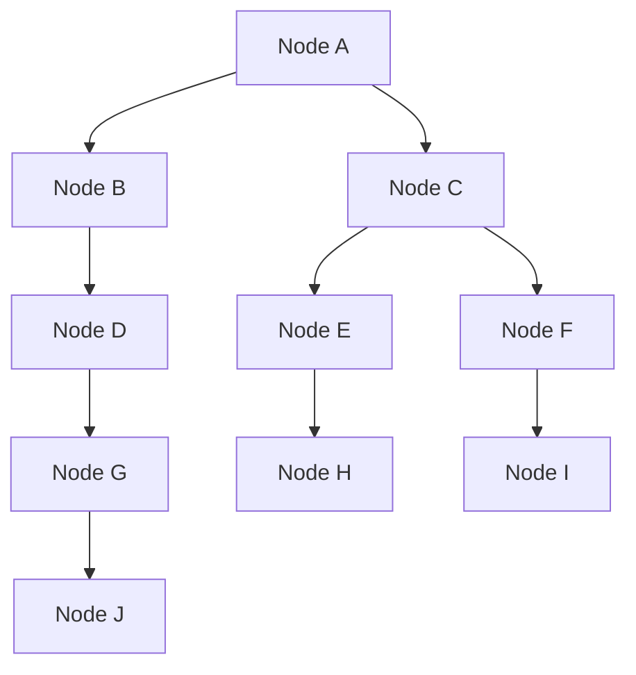

## 1. Hook

A rumor spreads through a school. One student tells three friends.
Each of them tells three more. Nobody stands on a stage. Nobody needs a
complete phone book. After a few rounds, almost everyone has heard it.

Gossip protocols use that same shape. Each node periodically talks to a
few other nodes and shares what it knows: who is alive, what version it
has, what configuration changed, or what data needs repair.

The magic is scale. A central coordinator can become a bottleneck.
Gossip spreads information with small local conversations. The cost is
that information is probabilistic and eventually consistent, not
instant or perfectly ordered.

## 2. What Is It

(a) Plain-English one-liner: gossip protocols spread cluster
information by having each node periodically exchange state with a few
random peers.

(b) Formal definition: a gossip protocol is a decentralized
communication protocol where nodes repeatedly select peers and exchange
state, membership, or updates. Epidemic dissemination gives high
probability spread in logarithmic rounds and avoids single coordinators.
Gossip is used for membership, failure detection, anti-entropy repair,
configuration propagation, and eventually consistent replication (see:
MOD-07/05-vector-clocks-and-logical-clocks).

## 3. The Problem It Solves

Before gossip, every node asks one central registry for membership and
state. At 50 nodes, it works. At 5,000 nodes, the registry becomes a
hot dependency. A registry outage freezes the cluster's view of itself.

After gossip, each node keeps a partial view and periodically exchanges
updates with peers. If node A learns node X is down, that suspicion
spreads. If node B has a new schema version, peers learn over several
rounds. No single node must broadcast to everyone.

Gossip solves scalable dissemination. It trades exact immediate truth
for high-probability convergence with low per-node load.

## 4. Core Concept Breakdown

- **Peer sampling:** choosing random peers to contact each round.
- **Gossip round:** one periodic exchange of state between nodes.
- **Push gossip:** sender sends updates to peer.
- **Pull gossip:** node asks peer for updates it lacks.
- **Push-pull gossip:** both sides exchange digests and missing state.
- **Membership list:** known nodes and their status.
- **Incarnation number:** version for a node's own membership state,
  used to refute stale suspicion.
- **Anti-entropy:** comparing digests and repairing differences.
- **Convergence:** eventual spread of information to most or all nodes.

## 5. How It Works

Step by step, spreading membership:

1. **Each node stores membership.** It tracks node ID, address, status,
   heartbeat counter, and incarnation.
2. **Every interval, pick peers.** Randomness avoids fixed hot paths.
3. **Send a digest.** The node sends compact metadata, not necessarily
   full state.
4. **Peer compares versions.** It asks for missing or newer updates.
5. **Both nodes merge state.** Newer incarnation and heartbeat values
   win.
6. **Suspicion spreads carefully.** A node suspected failed is marked
   suspect before dead to reduce false positives.
7. **Alive node refutes suspicion.** It increments its incarnation and
   gossips alive state.
8. **Dead state spreads after timeout.** If no refutation appears,
   nodes mark the member dead.
9. **Anti-entropy repairs drift.** Periodic full sync or digest compare
   catches missed updates.
10. **Operators tune fanout and interval.** Higher fanout converges
    faster but costs more network traffic.

Design review checks:

- **What is the acceptable convergence delay?**
- **How are false suspicions refuted?**
- **Does gossip carry full state or digests?**
- **What happens during network partitions and healing?**

## 6. Diagram



<!-- IMAGE: gossip fanout over four rounds, showing one update spreading
from node A to most of a cluster without central broadcast -->

## 7. When to Use It

Use gossip when:

- **Cluster membership must scale.** Thousands of nodes should not poll
  one coordinator constantly.
- **Eventual propagation is acceptable.** Updates can take several
  rounds to converge.
- **Partial views are enough.** Not every node needs a perfect global
  snapshot instantly.
- **Anti-entropy repair is needed.** Replicas can compare digests and
  repair missing data.

## 8. When NOT to Use It

- **Do not use gossip for linearizable decisions.** Use consensus for
  one committed truth.
- **Do not rely on gossip for instant revocation.** Security-critical
  revocation may need stronger push or central checks.
- **Do not ignore message size.** Full-state gossip can become huge.
- **Do not treat suspicion as proof.** Network delay can look like
  failure.

## 9. Real-World Example

**Cassandra** uses gossip to spread node membership and state around
the cluster.

**Consul** uses Serf, based on SWIM, for membership and failure
detection across agents.

**Dynamo-style systems** use gossip-like membership and anti-entropy
ideas to keep distributed replicas informed without central broadcast.

Realistic number: with fanout 3, one update can reach roughly 3, 9, 27,
and 81 nodes over four ideal rounds before duplicates. Real clusters
see duplicates and packet loss, but convergence is still logarithmic in
practice.

## 10. Production-Grade Code

```typescript
type MemberStatus = "alive" | "suspect" | "dead";

type Member = {
  id: string;
  status: MemberStatus;
  heartbeat: number;
  incarnation: number;
};

export function mergeMember(local: Member | undefined, incoming: Member): Member {
  if (!local) return incoming;
  if (incoming.incarnation > local.incarnation) return incoming;
  if (incoming.incarnation < local.incarnation) return local;
  if (incoming.heartbeat > local.heartbeat) return incoming;

  // For equal version data, prefer the more severe status only after
  // suspicion rules have had a chance to refute false failure signals.
  const rank: Record<MemberStatus, number> = { alive: 0, suspect: 1, dead: 2 };
  return rank[incoming.status] > rank[local.status] ? incoming : local;
}

export function pickPeers(allNodeIds: string[], selfId: string, fanout: number): string[] {
  return allNodeIds
    .filter((id) => id !== selfId)
    .sort(() => Math.random() - 0.5)
    .slice(0, fanout);
}
```

Why-not-what notes:

- Incarnation numbers let a live node override stale suspicion about
  itself.
- Heartbeat counters give versioned liveness without trusting wall
  clocks alone.
- Random peer selection is simple here; production systems often use a
  better peer sampler to avoid bias.

## 11. Trade-offs Table

| Pros | Cons | What it costs you |
|---|---|---|
| Scales without central broadcast | Information is eventually consistent | Staleness-tolerant design |
| Low per-node bandwidth with digests | Convergence is probabilistic | Fanout and interval tuning |
| Handles large membership lists | False suspicions happen | Suspicion and refutation logic |
| Useful for anti-entropy repair | Full-state gossip can be expensive | Compact digests |
| Resilient to individual node failures | Harder to reason about than central registry | Simulation and chaos testing |

## 12. Comparison Table

| Approach | Control model | Convergence | Best fit | Main risk |
|---|---|---|---|---|
| Central registry | centralized | immediate if reachable | small clusters | registry bottleneck |
| Heartbeat to coordinator | centralized | fast | simple failover | coordinator dependency |
| Gossip | decentralized | eventual | large clusters | stale views |
| Consensus membership | quorum-based | strong | small CP groups | latency and quorum cost |

## 13. Numbers & Benchmarks

- **Fanout:** 2 to 5 peers per round is common for membership gossip.
- **Interval:** 100 ms to several seconds, depending on cluster size
  and failure sensitivity.
- **Spread:** epidemic dissemination usually converges in `O(log N)`
  rounds under healthy conditions.
- **Message size:** digest-first exchange can keep messages in KB
  instead of sending full membership every round.
- **False positive trade:** shorter intervals detect faster but mark
  slow nodes suspect more often.

## 14. Common Pitfalls

- **Incident: full-state gossip exploded.** A cluster gossiped megabyte
  membership payloads every second and created network pressure.
- **Incident: suspicion became deletion too fast.** A brief network
  hiccup marked healthy nodes dead and triggered unnecessary repair.
- **Incident: partitions healed with stale incarnation.** Old status
  overwrote newer liveness because versioning was incomplete.

## 15. Interview Q&A

**Q1. Why use gossip?** Model answer: to spread information across many
nodes without central broadcast or every node contacting every other
node.

**Q2. Is gossip strongly consistent?** Model answer: no. It converges
eventually with high probability.

**Q3. What is SWIM?** Model answer: a scalable membership and failure
detection protocol using randomized probing, indirect checks, and
infection-style dissemination.

**Q4. What is anti-entropy?** Model answer: replicas compare summaries
or digests and repair missing or stale data.

**Q5. How do you reduce false failure detection?** Model answer: use
suspect states, indirect probes, longer timeouts, and refutation through
incarnation numbers.

## 16. Follow-up / Curveball Questions

**Curveball 1. Gossip says a node is dead but clients still reach it.**
Answer direction: treat gossip failure as suspicion and use incarnation
refutation; network views can differ.

**Curveball 2. A security key must be revoked immediately.** Answer
direction: gossip alone is weak. Use central validation, short-lived
tokens, or strongly pushed revocation.

**Curveball 3. Cluster has 20,000 nodes.** Answer direction: use
hierarchical gossip, zones, compact digests, and bounded membership
views rather than naive full-cluster state.

## 17. Cheat-Sheet Summary

- Gossip spreads information through repeated peer exchanges.
- It scales well because each node talks to a few peers.
- It is eventually consistent and probabilistic.
- SWIM-style protocols combine gossip with failure detection.
- Use gossip for membership and anti-entropy, not linearizable decisions.

## 18. Further Reading

- SWIM paper - scalable weakly-consistent infection-style membership:
  https://www.cs.cornell.edu/projects/Quicksilver/public_pdfs/SWIM.pdf
- HashiCorp memberlist documentation - production SWIM-style library:
  https://github.com/hashicorp/memberlist
- Cassandra architecture docs - gossip and failure detection context:
  https://cassandra.apache.org/doc/latest/cassandra/architecture/dynamo.html

---

## COMPLETENESS CHECK

Section checklist (18):

1. Hook - Covered (school rumor analogy)
2. What Is It - Covered (plain-English and formal definitions)
3. The Problem It Solves - Covered (central registry before, gossip after)
4. Core Concept Breakdown - Covered (9 concepts)
5. How It Works - Covered (10 steps plus review checks)
6. Diagram - Covered (graph)
7. When to Use It - Covered (4 triggers)
8. When NOT to Use It - Covered (4 warnings)
9. Real-World Example - Covered (Cassandra, Consul/Serf, Dynamo)
10. Production-Grade Code - Covered (TypeScript membership merge)
11. Trade-offs Table - Covered (5 rows)
12. Comparison Table - Covered (4 approaches)
13. Numbers & Benchmarks - Covered (5 figures)
14. Common Pitfalls - Covered (3 incident notes)
15. Interview Q&A - Covered (5 Q&As)
16. Follow-up / Curveball Questions - Covered (3 curveballs)
17. Cheat-Sheet Summary - Covered (5 lines)
18. Further Reading - Covered (3 URL-backed sources)

No em-dashes. No emojis. Cross-links included.
