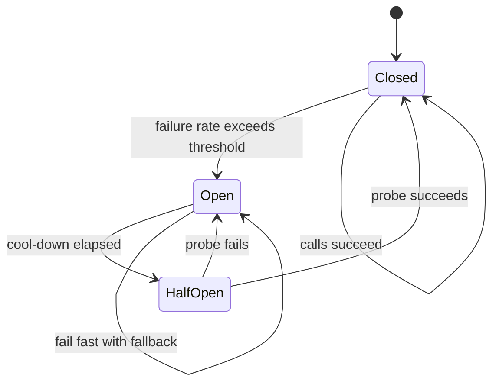

## 1. Hook

A house has electrical breakers. If one room overloads, the breaker
cuts power to that room instead of letting the whole house burn. A ship
has bulkheads. If one compartment floods, doors close so the whole ship
does not sink.

Services need the same protections. A failing dependency should not
consume every thread, connection, and request slot in the caller. A
slow recommendation service should not take checkout down.

Circuit breakers stop calling a failing dependency for a while.
Bulkheads limit how much capacity one dependency or tenant can consume.
Together, they turn one failure into a contained failure instead of a
system-wide collapse.

## 2. What Is It

(a) Plain-English one-liner: circuit breakers stop repeated calls to a
failing dependency, while bulkheads isolate capacity so one failure
does not exhaust the whole service.

(b) Formal definition: the circuit breaker pattern tracks dependency
failures and transitions between closed, open, and half-open states to
fail fast and allow recovery probes. The bulkhead pattern partitions
resources such as thread pools, connection pools, queues, or concurrency
limits so one dependency, tenant, or workload cannot consume all shared
capacity. They are resilience patterns for partial failure in
distributed systems (see: MOD-07/07-failure-detection-and-timeouts and
MOD-11/06-microservice-resilience-circuit-breaker-service-mesh).

## 3. The Problem It Solves

Before circuit breakers and bulkheads, a service calls a slow
dependency until every worker is waiting. Retries increase traffic.
Connection pools fill. The caller becomes unhealthy, then its callers
retry, and a small dependency outage becomes a cascading failure.

After circuit breakers and bulkheads, the caller notices high failure
or timeout rates, opens the circuit, and fails fast with fallback. A
separate pool or concurrency limit prevents the bad dependency from
using all resources. After a cool-down, half-open probes test recovery.

The patterns solve failure containment. They do not make dependencies
healthy; they stop dependency failure from becoming total service
failure.

## 4. Core Concept Breakdown

- **Closed circuit:** calls flow normally while failure rate is healthy.
- **Open circuit:** calls fail fast without hitting the dependency.
- **Half-open circuit:** limited probe calls test whether dependency
  recovered.
- **Failure threshold:** error or timeout rate that opens the circuit.
- **Cool-down:** time the circuit stays open before probing.
- **Fallback:** degraded response used when dependency is unavailable.
- **Bulkhead:** isolated capacity pool or concurrency limit.
- **Load shedding:** rejecting work early when capacity is exhausted.
- **Retry budget:** cap on retries so resilience does not amplify load.

## 5. How It Works

Step by step, protecting checkout from recommendations:

1. **Classify dependency criticality.** Recommendations are optional;
   payment authorization is required.
2. **Give dependency a timeout.** Breakers need failure signals from
   timeouts and errors.
3. **Track rolling failure rate.** Count failures over a window such as
   20 to 100 requests.
4. **Open circuit when threshold is crossed.** Stop calling the failing
   dependency.
5. **Return fallback.** Checkout shows no recommendations or cached
   recommendations.
6. **Isolate capacity.** Recommendation calls get their own concurrency
   limit or pool.
7. **Wait cool-down.** Avoid hammering a dependency that is already
   struggling.
8. **Try half-open probes.** Let a small number of calls through.
9. **Close on success, reopen on failure.** Recovery must be proven,
   not assumed.
10. **Alert on open circuits.** A breaker is a symptom and a shield;
    operators still need to fix the dependency.

Design review checks:

- **What is the fallback?** No fallback means open circuit becomes user
  failure.
- **What resource is bulkheaded?** Threads, connections, CPU, queue,
  tenant budget, or request concurrency.
- **Can retries bypass the breaker?** They must not.
- **Are critical and optional dependencies isolated differently?**

## 6. Diagram



<!-- IMAGE: service with separate bulkhead pools for payments,
recommendations, and search, with recommendation circuit open and
checkout still serving core flow -->

## 7. When to Use It

Use circuit breakers and bulkheads when:

- **Dependencies can fail or slow down.** That is every network
  dependency.
- **Fallback or degradation exists.** Cached data, partial response, or
  clear user error can be returned.
- **One dependency should not exhaust all capacity.** Bulkheads contain
  blast radius.
- **Retries are present.** Breakers prevent retries from hammering a
  failing dependency.

## 8. When NOT to Use It

- **Do not use a breaker without timeouts.** Calls must have bounded
  waiting.
- **Do not hide critical failures with fake success.** Payment failure
  should not look like payment success.
- **Do not set one global bulkhead for all work.** That defeats
  isolation.
- **Do not open circuits on tiny sample sizes.** One failure out of one
  request is not enough signal.

## 9. Real-World Example

**Netflix Hystrix** popularized circuit breakers, thread-pool isolation,
fallbacks, and dashboards for microservice resilience.

**Envoy** and modern service meshes support outlier detection,
connection limits, retries, and circuit-breaking-style controls at the
proxy layer.

**E-commerce checkout** commonly treats recommendations as optional,
inventory as required but retry-limited, and payments as required with
strict idempotency and clear failure states.

Realistic number: a breaker might open after 50 percent failures over a
rolling window of 20 requests, then wait 10 seconds before allowing 1
to 5 half-open probes.

## 10. Production-Grade Code

```typescript
type CircuitState = "closed" | "open" | "half-open";

export class CircuitBreaker {
  private state: CircuitState = "closed";
  private failures = 0;
  private openedAt = 0;

  constructor(
    private readonly failureThreshold: number,
    private readonly cooldownMs: number
  ) {}

  async execute<T>(call: () => Promise<T>, fallback: () => T): Promise<T> {
    const now = Date.now();
    if (this.state === "open") {
      if (now - this.openedAt < this.cooldownMs) return fallback();
      this.state = "half-open";
    }
    try {
      const result = await call();
      this.failures = 0;
      this.state = "closed";
      return result;
    } catch (err) {
      this.failures++;
      if (this.state === "half-open" || this.failures >= this.failureThreshold) {
        // Opening the circuit protects the caller's capacity while the
        // dependency recovers. The fallback must be an honest degraded
        // response, not fake success.
        this.state = "open";
        this.openedAt = now;
      }
      return fallback();
    }
  }
}
```

Why-not-what notes:

- This minimal breaker uses consecutive failures for clarity;
  production breakers usually use rolling windows and request volume
  thresholds.
- Fallback is required by the API so callers design degradation before
  incidents.
- Timeouts should wrap the `call`; breaker state alone cannot stop a
  hung network request.

## 11. Trade-offs Table

| Pros | Cons | What it costs you |
|---|---|---|
| Prevents cascading failure | Can fail fast during partial recovery | Half-open tuning |
| Protects caller capacity | Needs meaningful fallback | Product degradation design |
| Bulkheads isolate blast radius | Can underutilize shared capacity | Pool and limit sizing |
| Makes dependency health visible | Misconfigured thresholds flap | Metrics and tuning |
| Reduces retry storms | Can mask dependency pain if ignored | Alerting and incident response |

## 12. Comparison Table

| Pattern | Protects against | Mechanism | Best fit | Risk |
|---|---|---|---|---|
| Timeout | waiting forever | deadline | every network call | false failure |
| Retry | transient failure | repeat with backoff | idempotent operations | retry storm |
| Circuit breaker | repeated dependency failure | open and fail fast | unstable dependencies | bad fallback |
| Bulkhead | resource exhaustion | isolated capacity | mixed workloads | wasted capacity |
| Rate limiter | overload from callers | request budget | public APIs | rejecting good traffic |

## 13. Numbers & Benchmarks

- **Failure window:** common breakers require 20 to 100 requests before
  evaluating failure rate.
- **Open threshold:** 50 percent failure or timeout rate is a common
  starting point, tuned per dependency.
- **Cool-down:** 5 to 60 seconds is common, depending on recovery
  behavior.
- **Bulkhead size:** optional dependencies should have small dedicated
  pools so they cannot starve required paths.
- **Retry budget:** retries should usually be a small percentage of
  total traffic, such as 5 to 20 percent.

## 14. Common Pitfalls

- **Incident: breaker had no timeout.** Calls hung forever, so failure
  counters never updated and the circuit never opened.
- **Incident: fallback lied.** Checkout showed "payment pending" for
  failed payments, creating support and accounting issues.
- **Incident: shared thread pool.** Recommendations timed out and used
  every web worker, taking checkout down despite being optional.

## 15. Interview Q&A

**Q1. What are the circuit breaker states?** Model answer: closed
allows calls, open fails fast, half-open allows limited probes.

**Q2. What is a bulkhead?** Model answer: isolated capacity so one
dependency, tenant, or workload cannot exhaust resources for others.

**Q3. How do breakers and retries interact?** Model answer: retries
must respect breaker state and budgets; otherwise they amplify failure.

**Q4. What makes a good fallback?** Model answer: honest degraded
behavior that preserves correctness, such as cached optional data or a
clear unavailable response.

**Q5. Where should breakers live?** Model answer: in client libraries,
service mesh, gateway, or app code depending on whether fallback and
business semantics are needed.

## 16. Follow-up / Curveball Questions

**Curveball 1. Payment service fails. Should checkout fallback to
"success"?** Answer direction: no. Critical correctness paths need
clear failure or pending states, not fake success.

**Curveball 2. Circuit opens during a dependency deploy.** Answer
direction: expected if failures spike. Half-open probes should close it
after recovery; alerts should show dependency and breaker state.

**Curveball 3. Bulkhead pool is always full.** Answer direction:
either dependency is slow, limit is too low, demand is too high, or the
work should be async. Measure queue wait and service time.

## 17. Cheat-Sheet Summary

- Circuit breakers fail fast when a dependency is unhealthy.
- Bulkheads isolate capacity to contain blast radius.
- Breakers need timeouts, thresholds, cool-downs, probes, and fallbacks.
- Bulkheads can be pools, queues, connection limits, or concurrency caps.
- Use these patterns to preserve the caller, not to hide broken dependencies.

## 18. Further Reading

- Martin Fowler, "Circuit Breaker" - foundational pattern explanation:
  https://martinfowler.com/bliki/CircuitBreaker.html
- Netflix Hystrix wiki - historical production circuit breaker and
  bulkhead design:
  https://github.com/Netflix/Hystrix/wiki
- Microsoft Architecture Center, "Bulkhead pattern":
  https://learn.microsoft.com/en-us/azure/architecture/patterns/bulkhead

---

## COMPLETENESS CHECK

Section checklist (18):

1. Hook - Covered (electrical breaker and ship bulkhead analogy)
2. What Is It - Covered (plain-English and formal definitions)
3. The Problem It Solves - Covered (cascading failure before, containment after)
4. Core Concept Breakdown - Covered (9 concepts)
5. How It Works - Covered (10 steps plus review checks)
6. Diagram - Covered (stateDiagram-v2)
7. When to Use It - Covered (4 triggers)
8. When NOT to Use It - Covered (4 warnings)
9. Real-World Example - Covered (Hystrix, Envoy, e-commerce)
10. Production-Grade Code - Covered (TypeScript circuit breaker)
11. Trade-offs Table - Covered (5 rows)
12. Comparison Table - Covered (5 patterns)
13. Numbers & Benchmarks - Covered (5 figures)
14. Common Pitfalls - Covered (3 incident notes)
15. Interview Q&A - Covered (5 Q&As)
16. Follow-up / Curveball Questions - Covered (3 curveballs)
17. Cheat-Sheet Summary - Covered (5 lines)
18. Further Reading - Covered (3 URL-backed sources)

No em-dashes. No emojis. Cross-links included.
